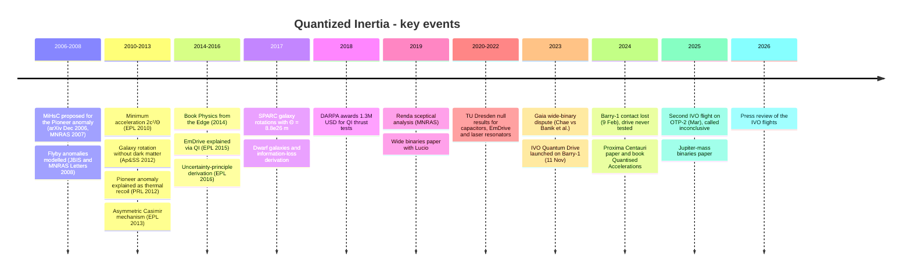

# Quantized Inertia timeline (2006–2026)

Dates come from the source folders in this repository. Most entries give only the year of journal publication, because online-first dates are often a year earlier. Where a source gives an exact day, it is shown. Entries are tagged as **theory** (QI papers), **critique** (critiques and null tests), **test** (experiments), **media** (press) or **book**.

## At a glance

## Detailed timeline

### 2006–2009: Origins in solar-system anomalies
| Date | Event | Tag | Source |
|---|---|---|---|
| Dec 2006 / 2007 | McCulloch posts *Modelling the Pioneer anomaly as modified inertia* (arXiv:astro-ph/0612599), published in MNRAS 376, 338 (2007). It introduces MiHsC: Unruh radiation plus a Hubble-scale Casimir effect. Predicts 6.9 ± 3.5 × 10⁻¹⁰ m s⁻² for Pioneer. The paper notes its predicted anomaly inside 10 AU is not observed. | theory | [2007-mcculloch-pioneer-anomaly](../01-papers/2007-mcculloch-pioneer-anomaly/README.md) |
| 2008 | QI applied to Earth-flyby velocity anomalies (JBIS 61; MNRAS Lett. 389). | theory | [JBIS](../01-papers/2008-mcculloch-flyby-anomalies-jbis/README.md), [MNRAS](../01-papers/2008-mcculloch-flyby-anomalies-mnras/README.md) |

### 2010–2013: Minimum acceleration, galaxies and a mechanism
| Date | Event | Tag | Source |
|---|---|---|---|
| 2010 | *Can the Tajmar effect be explained…?* (EPL 89) and *Minimum accelerations from quantised inertia* (EPL 90), which gives a_min = 2c²/Θ and the name "quantised inertia". | theory | [Tajmar](../01-papers/2010-mcculloch-tajmar-effect-explained/README.md), [min. accel.](../01-papers/2010-mcculloch-minimum-accelerations/README.md) |
| 2010 | Turyshev & Toth's *Living Reviews* article on the Pioneer anomaly lists MiHsC among candidate explanations. | review | [2010-turyshev-pioneer-review](../01-papers/2010-turyshev-pioneer-review/README.md) |
| 2011 | Tajmar-effect refinement (EPL 95) and Podkletnov-effect paper. Giné links holographic gravity and modified inertia. | theory | [2011 Tajmar](../01-papers/2011-mcculloch-tajmar-effect/README.md), [Podkletnov](../01-papers/2011-mcculloch-podkletnov-effect/README.md), [Giné](../01-papers/2011-gine-pioneer-holographic/README.md) |
| 2012 | *Testing quantised inertia on galactic scales* (Ap&SS 342) derives v⁴ = 2GMc²/Θ with "no adjustable parameters". It overpredicts spiral velocities by 30–54%, within the stated errors. | theory | [2012-mcculloch-galactic-scales](../01-papers/2012-mcculloch-galactic-scales/README.md) |
| 2012 | Turyshev et al. (PRL 108, 241101) attribute the Pioneer anomaly to anisotropic thermal recoil. This removes QI's original target. | critique | [2012-turyshev-pioneer-thermal](../03-criticism/2012-turyshev-pioneer-thermal/README.md) |
| 2012 | Hernandez et al. report flattening of wide-binary velocities at low acceleration (later used by QI). | data | [2012-hernandez-wide-binaries](../01-papers/2012-hernandez-wide-binaries/README.md) |
| 2013 | *Inertia from an asymmetric Casimir effect* (EPL 101) proposes the Rindler/Hubble horizon radiation-pressure mechanism. | theory | [2013-mcculloch-asymmetric-casimir](../01-papers/2013-mcculloch-asymmetric-casimir/README.md) |

### 2014–2016: Book, EmDrive and new derivations
| Date | Event | Tag | Source |
|---|---|---|---|
| 21 Feb 2014 (online) | Book *Physics from the Edge: A New Cosmological Model for Inertia* (World Scientific). | book | [2014-mcculloch-physics-from-edge](../07-media/2014-mcculloch-physics-from-edge/README.md) |
| 2014 | *Gravity from the uncertainty principle* (Ap&SS 349; later called flawed by the author) and *A toy cosmology…* (Galaxies 2). | theory | [gravity](../01-papers/2014-mcculloch-gravity-uncertainty/README.md), [cosmology](../01-papers/2014-mcculloch-toy-cosmology/README.md) |
| 2015 | QI explanations of EmDrive thrust (Progress in Physics; EPL 111). Iorio reviews solar-system anomalies. | theory | [EPL](../01-papers/2015-mcculloch-emdrive-epl/README.md), [PiP](../01-papers/2015-mcculloch-emdrive-pip/README.md), [Iorio](../01-papers/2015-iorio-solar-system-anomalies/README.md) |
| 2016 | *Quantised inertia from relativity and the uncertainty principle* (EPL 115). Giné & McCulloch, *Inertial mass from Unruh temperatures* (MPLA 31). | theory | [EPL 2016](../01-papers/2016-mcculloch-relativity-uncertainty/README.md), [Giné](../01-papers/2016-gine-unruh-temperatures/README.md) |
| 2016 | Wide press coverage linking QI and the EmDrive, plus early critical blog posts. | media | [MIT Tech Review](../07-media/2016-mittechreview-flyby-emdrive/README.md), [Register](../07-media/2016-register-emdrive-inertia/README.md), [Jalopnik](../07-media/2016-jalopnik-emdrive/README.md), [Koberlein](../07-media/2016-koberlein-theoretical-dream-emdrive/README.md) |
| 2016 | NASA Eagleworks reports 1.2 ± 0.1 mN/kW from a tapered RF cavity (J. Propulsion & Power, online Nov 2016). Samsonov reports a null result for a frustum cavity. | test | [White et al.](../04-experiments/2016-white-eagleworks/README.md), [Samsonov](../03-criticism/2016-samsonov-emdrive-null/README.md) |

### 2017–2019: SPARC, DARPA and the first independent critique
| Date | Event | Tag | Source |
|---|---|---|---|
| 2017 | Dwarf galaxies (Ap&SS 362, 57), SPARC galaxy rotations (Ap&SS 362, 149), information-loss derivation (MPLA), EmDrives with dielectrics (EPL 118) and proton radius (PiP). Θ switches to 8.8 × 10²⁶ m. | theory | [dwarfs](../01-papers/2017-mcculloch-dwarf-galaxies/README.md), [SPARC](../01-papers/2017-mcculloch-galaxy-rotations-sparc/README.md), [info](../01-papers/2017-mcculloch-information-loss/README.md), [dielectrics](../01-papers/2017-mcculloch-emdrives-dielectrics/README.md), [proton](../01-papers/2017-mcculloch-proton-radius/README.md) |
| 2017 | Taylor (JBIS) predicts large QI forces in asymmetric laser resonators, later tested by Dresden. Koberlein publishes *Doing It Wrong*. | theory / media | [Taylor](../01-papers/2017-taylor-laser-resonators/README.md), [Koberlein](../07-media/2017-koberlein-doing-it-wrong/README.md) |
| 2018 | **DARPA** awards about **$1.3M over four years** (Nascent Light-Matter Interactions programme) for QI theory and thrust tests with TU Dresden and the University of Alcalá. | media | [Plymouth](../07-media/2018-plymouth-darpa/README.md), [Motherboard](../07-media/2018-motherboard-darpa-pseudoscience/README.md), [UPI](../07-media/2018-upi-darpa/README.md), [EarthSky](../07-media/2018-earthsky-darpa/README.md), [Photonics](../07-media/2018-photonics-darpa/README.md) |
| 2018 | Propellant-less propulsion (J. Space Expl.) and cold-fusion (PiP) papers. Bhatt et al. report capacitor thrust (arXiv). TU Dresden describes its SpaceDrive programme. | theory / test | [propulsion](../01-papers/2018-mcculloch-propellantless-propulsion/README.md), [cold fusion](../01-papers/2018-mcculloch-cold-fusion/README.md), [Bhatt](../04-experiments/2018-bhatt-capacitor-thrust/README.md), [SpaceDrive](../04-experiments/2018-tajmar-spacedrive/README.md) |
| 2019 | Kößling et al. trace apparent EmDrive thrust to artefacts. | test | [2019-kossling-spacedrive-balance](../04-experiments/2019-kossling-spacedrive-balance/README.md) |
| Aug 2019 | **Renda, *A sceptical analysis of Quantized Inertia*** (arXiv:1908.01589; MNRAS 489). Finds two major flaws in the derivation. | critique | [2019-renda-sceptical](../03-criticism/2019-renda-sceptical/README.md) |
| 2019 | McCulloch & Lucio, wide binaries (Ap&SS 364). *Can we hide gravitational sources behind Rindler horizons?* (PiP). | theory | [wide binaries](../01-papers/2019-mcculloch-wide-binaries/README.md), [Rindler](../01-papers/2019-mcculloch-rindler-horizons/README.md) |
| Jun 2019 | *Superluminal travel from quantised inertia* (J. Space Expl. 8(2)): QI's residual acceleration 2c²/Θ is said to persist at v = c. | theory | [2019-mcculloch-superluminal-travel](../01-papers/2019-mcculloch-superluminal-travel/README.md) |
| 2019 | Richard Mansell (later IVO Ltd.) contacts McCulloch, according to McCulloch's account as relayed in 2026. | media | [2026-nextbigfuture-ivo-review](../07-media/2026-nextbigfuture-ivo-review/README.md) |

### 2020–2022: Dresden null results
| Date | Event | Tag | Source |
|---|---|---|---|
| 2020 | Tajmar & Schreiber find no anomalous thrust from charged high-voltage capacitors (J. Electrostatics 107). | critique | [2020-tajmar-capacitor-thrust](../03-criticism/2020-tajmar-capacitor-thrust/README.md) |
| 2020 | Horizon-width rederivation (with Giné). Information-theory and nano-materials papers. Giné & Luciano link QI to extended uncertainty principles. | theory | [horizons](../01-papers/2020-mcculloch-horizon-widths/README.md), [info](../01-papers/2020-mcculloch-information-theory/README.md), [nano](../01-papers/2020-mcculloch-nano-materials/README.md), [EUP](../01-papers/2020-gine-luciano-eup-modified-inertia/README.md) |
| 2021 (online) / 2022 | **Tajmar, Neunzig & Weikert:** high-accuracy EmDrive measurements show no thrust, and earlier positives are explained as false positives (CEAS Space J. 14). **Neunzig, Weikert & Tajmar:** asymmetric laser resonators and fibre loops built to test QI show no thrust at nN level, at least four orders of magnitude below QI predictions by the authors' account (CEAS Space J. 14). Both are part of the DARPA-funded programme. | critique | [EmDrive](../03-criticism/2021-tajmar-emdrive-false-positive/README.md), [lasers](../03-criticism/2022-neunzig-laser-resonators/README.md) |
| Jul 2021 | Advocacy site quantizedinertia.com adds a Tests page: "Six labs have tested this. So far, five have shown some thrust" (citing an unpublished Pérez-Díaz et al. 2021, which McCulloch called "an artefact" in Jan 2022). | media | [2023-quantizedinertia-website](../07-media/2023-quantizedinertia-website/README.md) |
| 2021 | Symmetric-capacitor thrust preprint and EPR-paradox paper (MPLB). | theory | [capacitors](../01-papers/2021-mcculloch-symmetric-capacitors/README.md), [EPR](../01-papers/2021-mcculloch-epr-paradox/README.md) |
| 2022 | Neunzig et al. test microwave, superconducting and laser-type EmDrives (Acta Astronautica 195) and find no anomalous thrust. | critique | [2022-neunzig-emdrive-thrust](../03-criticism/2022-neunzig-emdrive-thrust/README.md) |
| 2022 | IVO Ltd. announces a QI-based "Quantum Drive" and claims ~45 mN/W in thermal-vacuum tests (company claim, unverified). Light-bending and "QI thrust as asymmetric Casimir" preprints. | media / theory | [SatNews](../07-media/2022-satnews-ivo/README.md), [light](../01-papers/2022-mcculloch-light-bending/README.md), [Casimir](../01-papers/2022-mcculloch-qi-thrust-casimir/README.md) |

### 2023–2026: Wide binaries and spaceflight
| Date | Event | Tag | Source |
|---|---|---|---|
| 2023 | Chae (ApJ 952) claims a low-acceleration boost in Gaia DR3 wide binaries. Banik et al. (MNRAS 527, online Nov 2023) find Newtonian gravity preferred at 19σ over MOND. | data / critique | [Chae](../01-papers/2023-chae-wide-binaries/README.md), [Banik](../03-criticism/2023-banik-gaia-dr3-wide-binaries/README.md) |
| 2023 | Dickmann & Dickmann claim to refute QI's explanation of inertia (Kinematics Phys. Celest. Bodies 39(6)). | critique | [2023-dickmann-casimir-contradicts](../03-criticism/2023-dickmann-casimir-contradicts/README.md) |
| Feb 2023 (PEARL 3 Feb) | Tiverton and Devon Astronomical Society lecture (Arundal, Graham-Jones, McCulloch). It reports University of Plymouth in-air capacitor tests from Jul 2022 to Jan 2023: weight changes of up to 10 mg (0.1 mN) that reverse on flipping, a claimed 0.3 N/kW, and heated runs "close to QI predictions". Slides only, not peer-reviewed. | test | [2023-arundal-tiverton-lecture](../07-media/2023-arundal-tiverton-lecture/README.md) |
| Mar 2023 | Previews of a planned in-space test, then scheduled for Transporter-8. | media | [Universe Today](../07-media/2023-universetoday-ivo/README.md), [Inverse](../07-media/2023-inverse-ivo/README.md) |
| **11 Nov 2023** | **IVO Quantum Drives launched** on Rogue Space Systems' Barry-1 (SpaceX Transporter-9). | test | [2023-debrief-ivo-launch](../07-media/2023-debrief-ivo-launch/README.md) |
| **9 Feb 2024** | **Barry-1 contact lost** after power problems during the early-orbit phase. The drives were never switched on, so there is no result. | test | [Debrief](../07-media/2024-debrief-ivo-failure/README.md), [Futurism](../07-media/2024-futurism-ivo-contact-lost/README.md) |
| 2024 | *Testing quantized inertia on Proxima Centauri* (MNRAS Lett. 532). Hernandez et al. critique the Newtonian wide-binary analyses. Provatidis reviews inertial-propulsion devices. | theory / review | [Proxima](../01-papers/2024-mcculloch-proxima-centauri/README.md), [Hernandez](../01-papers/2024-hernandez-wide-binary-review/README.md), [Provatidis](../01-papers/2024-provatidis-inertial-propulsion-review/README.md) |
| 15 Jul 2024 | Book *Quantised Accelerations: From Anomalies to New Physics* (Polaris Books; retailer release date). | book | [2024-mcculloch-quantised-accelerations](../07-media/2024-mcculloch-quantised-accelerations/README.md) |
| 2024–2025 | Hobbyist Titus Stauffer self-publishes a QI thermal-gradient drive concept (Feb 2024) and test proposals (Jan 2025) on ResearchGate, and adds them to the quantizedinertia.com papers list. | theory | [2024](../01-papers/2024-stauffer-qi-drive-versions/README.md), [2025](../01-papers/2025-stauffer-qi-experiments/README.md) |
| 2025 | *Jupiter Mass Binary Objects Show a Minimum Acceleration* (Astronomy 5). Kholupenko et al. Part III on anisotropic Unruh radiation. | theory | [JuMBOs](../01-papers/2025-mcculloch-jupiter-mass-binaries/README.md), [Kholupenko III](../01-papers/2025-kholupenko-unruh-anisotropy-3/README.md) |
| Mar 2025 | Second IVO flight on Rogue OTP-2 (Transporter-13). According to McCulloch, the drive ran for under 1 minute a day, and the satellite showed about 600 m less orbital decay than a comparison satellite over 3 months. He calls this "not conclusive" and allows for a possible conventional (Lorentz-force) explanation. | test | [2026-nextbigfuture-ivo-review](../07-media/2026-nextbigfuture-ivo-review/README.md) |
| 2026 | NextBigFuture review relays the account above. | media | [2026-nextbigfuture-ivo-review](../07-media/2026-nextbigfuture-ivo-review/README.md) |

> [!UNVERIFIED]
> The OTP-2 details (March 2025 launch, operating time, the ~600 m comparison) come only from McCulloch's account as relayed by a blog. No primary IVO or Rogue data release or peer-reviewed analysis was found.

> [!UNVERIFIED]
> The exact month of the 2018 DARPA announcement is not given in the sources collected, so only the year is listed.

## Related
- [what-is-qi.md](what-is-qi.md) · [equations.md](equations.md) · [evidence map](../assets/diagrams/evidence-map.svg)
