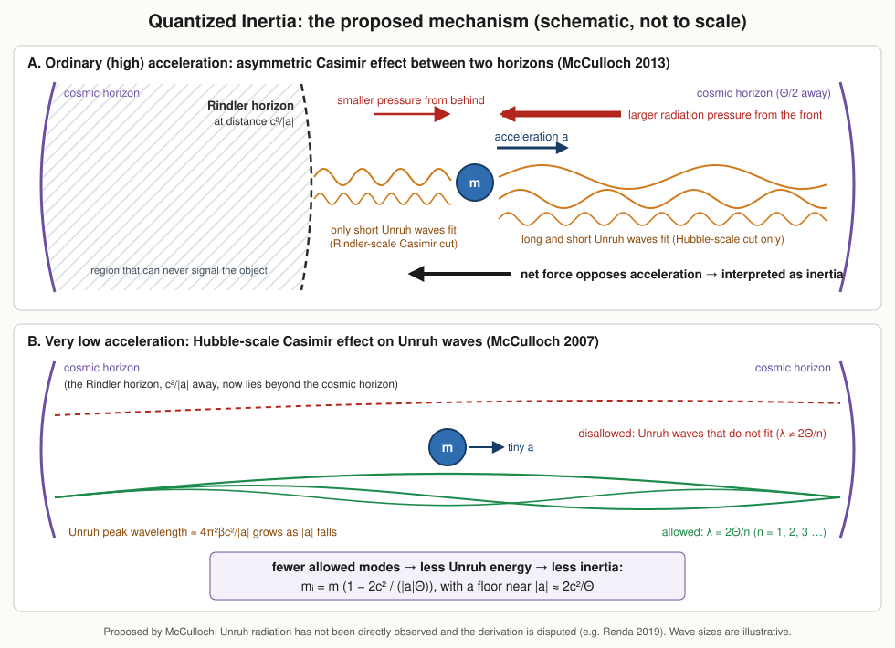
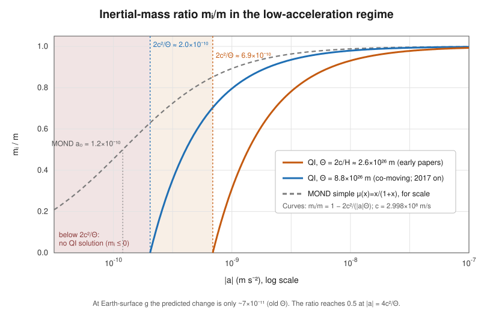
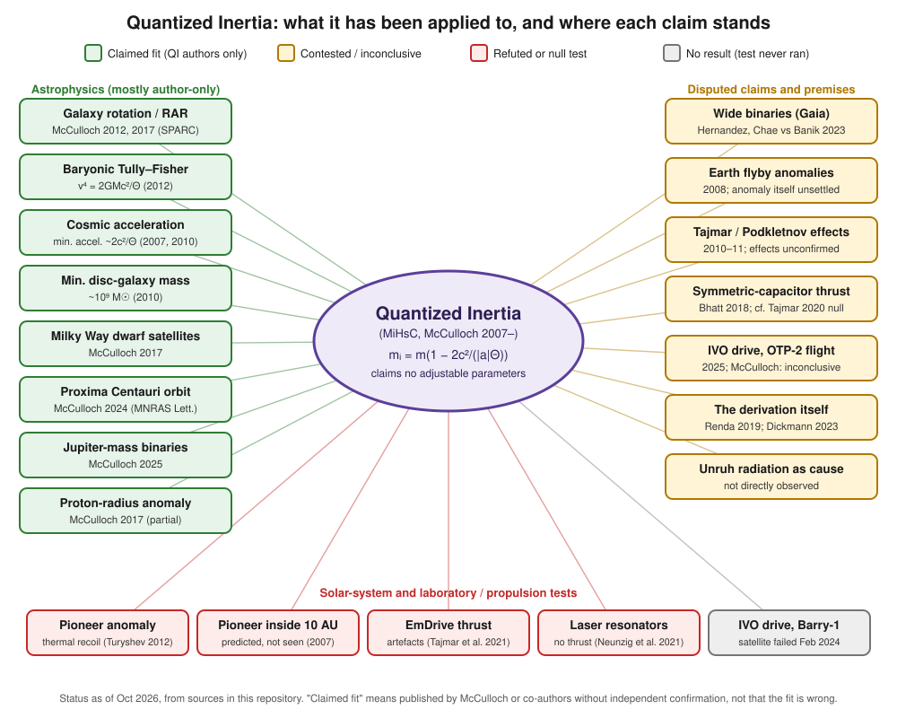

# What is Quantized Inertia (QI / MiHsC)?

**Quantized Inertia (QI)** is a hypothesis about where inertia comes from. Mike McCulloch (University of Plymouth) proposed it in 2007. He first called it **MiHsC**, short for *Modification of inertia resulting from a Hubble-scale Casimir effect*. The original spelling is "quantised inertia"; "quantized" is also common. The idea is that an object's inertial mass is not fixed. On this view it comes from the object's interaction with **Unruh radiation**, and two cosmic boundaries limit that radiation: the **Rindler horizon** behind an accelerating object and the **cosmic (Hubble) horizon**. At everyday accelerations the predicted change is far too small to measure. It becomes large only at extremely small accelerations, around 10⁻¹⁰ m s⁻². That is the regime of galaxy outskirts, wide binary stars and the cosmic expansion.

QI sits outside mainstream physics. Its predictions are almost all published by McCulloch himself, sometimes with co-authors. A few independent theorists have extended it (for example Giné and Luciano). Independent critiques ([Renda 2019](../03-criticism/2019-renda-sceptical/README.md), [Dickmann & Dickmann 2023](../03-criticism/2023-dickmann-casimir-contradicts/README.md)) and laboratory tests ([TU Dresden 2020–22](../03-criticism/2022-neunzig-laser-resonators/README.md)) have not supported it. This page explains the idea in plain terms, gives the core formula and its variants, and summarises the main objections. The mathematics is in [equations.md](equations.md), and the history is in [timeline.md](timeline.md).

---

## 1. The mechanism in plain language

**Step 1: Unruh radiation.** Quantum field theory predicts that an observer with constant acceleration *a* sees empty space as a warm bath of thermal radiation. This is the Fulling–Davies–Unruh effect. Its temperature is T = ħa / (2πck_B), which is tiny: about 4 × 10⁻²⁰ K at Earth's surface gravity. QI takes as an *assumption* that inertia is a reaction to this radiation. This idea goes back to Haisch, Rueda & Puthoff (1994), who used the zero-point field, and to Milgrom (1994, 1999), who speculated about a link between Unruh radiation and MOND. Unruh radiation has not been directly observed, and the QI papers themselves say so ([2013](../01-papers/2013-mcculloch-asymmetric-casimir/README.md)).

**Step 2: The Rindler horizon.** An object that keeps accelerating has a region of spacetime behind it from which light can never catch up with it. The boundary of that region is the Rindler horizon, at a distance of about c²/a. The faster the acceleration, the closer the horizon. At 9.8 m s⁻² it is about 10¹⁶ m (≈ 1 light-year) away.

**Step 3: The Hubble-scale Casimir effect.** In the ordinary Casimir effect, two close metal plates allow only those electromagnetic modes that fit between them. QI assumes that something similar happens on a cosmic scale. Only Unruh waves that fit the observable universe are allowed, with wavelengths λₙ = 2Θ/n, where Θ is the "Hubble diameter". This is McCulloch's 2007 assumption, and no established physics derives it.

**Step 4a: Ordinary accelerations give inertia** (the 2013 picture, panel A). In front of the object, the cosmic horizon is far away, so nearly all Unruh waves fit. Behind it, the Rindler horizon is much closer and cuts out the longer waves. So more radiation pressure comes from the front than from behind, and the net push always opposes the acceleration. McCulloch identifies this push with inertia ([McCulloch 2013, EPL](../01-papers/2013-mcculloch-asymmetric-casimir/README.md)).

**Step 4b: Very low accelerations reduce inertia** (the 2007 picture, panel B). As *a* falls, the Unruh waves get longer. Their peak wavelength is λₘ ≈ 4π²βc²/a with β ≈ 0.2. Eventually they become comparable to the Hubble scale. More and more of them are then "disallowed", so the object feels less Unruh energy and its inertial mass drops below its gravitational mass. A smaller inertial mass means the same force produces more acceleration. QI therefore predicts a **floor**: accelerations cannot settle much below about 2c²/Θ ([McCulloch 2010, EPL](../01-papers/2010-mcculloch-minimum-accelerations/README.md)).

QI therefore gives up the **equivalence of inertial and gravitational mass**, but only by amounts too small to detect in torsion-balance tests (McCulloch 2011, 2017).

---

## 2. The core formula and its variants

The headline formula is

$$
m_i \;=\; m\left(1 - \frac{2c^2}{|a|\,\Theta}\right)
$$

where *m* is the ordinary (gravitational) mass, *c* is the speed of light, |*a*| is the magnitude of the acceleration and Θ is a cosmic length (the "Hubble diameter").

This exact expression is a rounded or rederived form. Its form and justification have changed over time:

| Paper | Form given | How it is obtained | Note |
|---|---|---|---|
| [2007 MNRAS](../01-papers/2007-mcculloch-pioneer-anomaly/README.md) (astro-ph/0612599) | m_I = m_g(1 − βπ²c²/(aΘ)), β = 0.2 | Assumes a **linear** sampling factor F = 1 − λₘ/4Θ between the full and the "allowed" Unruh spectrum | The paper calls this step an assumption that has not been verified individually. βπ² ≈ 1.97–1.99 |
| [2010 EPL](../01-papers/2010-mcculloch-minimum-accelerations/README.md), [2012 Ap&SS](../01-papers/2012-mcculloch-galactic-scales/README.md) (1207.7007), [2013 EPL](../01-papers/2013-mcculloch-asymmetric-casimir/README.md) (1302.2775) | m_I = m_g(1 − βπ²c²/(\|a\|Θ)) **∼** m_g(1 − 2c²/(\|a\|Θ)) | Rounds βπ² to 2 (the 2010 paper calls this a 1.5% error) | Uses the modulus \|a\|. In 2010, \|a\| is the acceleration relative to all surrounding matter |
| [2016 EPL](../01-papers/2016-mcculloch-relativity-uncertainty/README.md) (1610.06787) | dm = 2πβ·m(1 − 2c²/(aΘ)) | Conserves mass-energy plus the Heisenberg energy ħc/Δx, with Δx set by the Rindler horizon (c²/a) and the cosmic horizon (Θ/2) | Reproduces the bracket exactly, but with a prefactor 2πβ ≈ 1.26, i.e. **26% too large** |
| [2017 MPLA, information loss](../01-papers/2017-mcculloch-information-loss/README.md) (with Giné) | m(1 − 2c²/(\|a\|Θ)) | Information lost behind the horizons | An alternative derivation |
| [2020 Adv. Stud. Theor. Phys.](../01-papers/2020-mcculloch-horizon-widths/README.md) (with Giné) | m_i = m(1 − 2c²/(aΘ)) "exactly" | Same as 2016, but Δx is taken as half the horizon *circumference* (πc²/a and πΘ/2) | Removes the 26% factor by redefining Δx |

The bracket (1 − 2c²/|a|Θ) has stayed the same throughout. What has changed is the *justification*: first a linear assumption, then an uncertainty-principle argument, then information loss. Section 5 of [equations.md](equations.md) lists the numerical inconsistencies between papers.

*The curves above come straight from the formula. Below |a| = 2c²/Θ the formula gives m_i ≤ 0. QI interprets this as a forbidden region and hence a minimum acceleration, not as negative mass.*

---

## 3. The predicted minimum acceleration and MOND's a₀

QI's characteristic acceleration is

$$
a_{\min} \;=\; \frac{2c^2}{\Theta}.
$$

Its numerical value depends on which Θ is used, and the papers have used two:

| Θ used | Source | 2c²/Θ | Compared with MOND a₀ = 1.2 × 10⁻¹⁰ m s⁻² |
|---|---|---|---|
| 2c/H with H = 2.3 × 10⁻¹⁸ s⁻¹ → 2.6 × 10²⁶ m (printed as 2.7 × 10²⁶ m in 2007–2013) | 2007, 2010, 2012, 2013 | ≈ 6.7–6.9 × 10⁻¹⁰ m s⁻² | ≈ 5.6–5.8 × a₀ |
| 8.8 × 10²⁶ m, the present co-moving diameter of the observable universe | 2017 dwarf galaxies, 2017 SPARC and later | ≈ 2.0 × 10⁻¹⁰ m s⁻² | ≈ 1.7 × a₀ |

Points to note:

- **The cosmic coincidence.** With Θ = 2c/H, 2c²/Θ equals **cH** exactly. MOND's empirical a₀ is also numerically close to cH₀/2π, a well-known coincidence that Milgrom pointed out. QI's appeal is that it claims to *derive* a scale of this size from c and the size of the cosmos instead of fitting it.
- **The factor of ~2π in the early papers.** With the older Θ, QI's scale is about 2π × a₀. In the deep low-acceleration limit both theories give v⁴ ∝ (scale) × GM, so the older QI value should give rotation speeds about (5.6)^¼ ≈ 1.5 × larger than MOND. The 2012 paper does report overpredicting spiral-galaxy speeds by 30–54% (and says this is still within error bars). Switching to Θ = 8.8 × 10²⁶ m in 2017 brought the scale to about 1.7 × a₀. *(This explanation is our own arithmetic; the papers do not frame it this way.)*
- **Shape compared with MOND.** QI's m_i = m(1 − a₀/a) equals the first two terms of the expansion of MOND's "simple" interpolation function, 1/(1 + a₀/a) ([2020](../01-papers/2020-mcculloch-horizon-widths/README.md)). In the [2017 SPARC paper](../01-papers/2017-mcculloch-galaxy-rotations-sparc/README.md), QI's radial-acceleration relation is a = a_b·√(1 + 2c²/(a_bΘ)). Its deep limit, a = √(a_b·2c²/Θ), has the same form as deep MOND, with a₀ replaced by 2c²/Θ.
- **A distinctive prediction.** Because Θ grows as the universe expands, QI predicts that the anomaly was *larger* in the past, scaling as (1 + z) in the 2017 paper. Standard MOND keeps a₀ constant. This is one of the few places where QI and MOND clearly differ.

---

## 4. What QI claims to explain

The claims below are those of the QI papers. The [evidence map](#6-evidence-map) and [timeline](timeline.md) show how each has fared.

| Phenomenon | Main QI source(s) | Status (from sources in this repository) |
|---|---|---|
| Pioneer anomaly | [2007](../01-papers/2007-mcculloch-pioneer-anomaly/README.md) | **Explained conventionally** by thermal recoil ([Turyshev et al. 2012](../03-criticism/2012-turyshev-pioneer-thermal/README.md)). The 2007 model also predicted an anomaly inside 10 AU that was not seen |
| Earth flyby anomalies | [2008 JBIS](../01-papers/2008-mcculloch-flyby-anomalies-jbis/README.md), [2008 MNRAS Lett.](../01-papers/2008-mcculloch-flyby-anomalies-mnras/README.md) | Contested; whether the anomaly is real is itself unsettled ([Iorio 2015 review](../01-papers/2015-iorio-solar-system-anomalies/README.md)) |
| Cosmic acceleration / a minimum acceleration | [2007](../01-papers/2007-mcculloch-pioneer-anomaly/README.md), [2010](../01-papers/2010-mcculloch-minimum-accelerations/README.md), [2014 toy cosmology](../01-papers/2014-mcculloch-toy-cosmology/README.md) | Order-of-magnitude coincidence claimed; no full cosmological model |
| Galaxy rotation without dark matter; Tully–Fisher; clusters | [2012](../01-papers/2012-mcculloch-galactic-scales/README.md), [2017 SPARC](../01-papers/2017-mcculloch-galaxy-rotations-sparc/README.md), [2020](../01-papers/2020-mcculloch-information-theory/README.md) | Fits claimed by the author; not independently reproduced in the sources collected |
| Dwarf galaxies; minimum disc-galaxy mass | [2017](../01-papers/2017-mcculloch-dwarf-galaxies/README.md), [2010](../01-papers/2010-mcculloch-minimum-accelerations/README.md) | Author-only |
| Wide binary stars | [2019](../01-papers/2019-mcculloch-wide-binaries/README.md) | **Contested.** The data dispute is unresolved ([Chae 2023](../01-papers/2023-chae-wide-binaries/README.md) vs [Banik et al. 2023](../03-criticism/2023-banik-gaia-dr3-wide-binaries/README.md); [Hernandez 2024](../01-papers/2024-hernandez-wide-binary-review/README.md)) |
| Proxima Centauri orbit; Jupiter-mass binary objects | [2024](../01-papers/2024-mcculloch-proxima-centauri/README.md), [2025](../01-papers/2025-mcculloch-jupiter-mass-binaries/README.md) | Author-only |
| Tajmar and Podkletnov effects | [2010](../01-papers/2010-mcculloch-tajmar-effect-explained/README.md), [2011](../01-papers/2011-mcculloch-tajmar-effect/README.md), [2011](../01-papers/2011-mcculloch-podkletnov-effect/README.md) | The underlying effects are not established |
| EmDrive thrust | [2015 EPL](../01-papers/2015-mcculloch-emdrive-epl/README.md), [2017](../01-papers/2017-mcculloch-emdrives-dielectrics/README.md) | **Null.** Dresden traced the thrust signals to artefacts ([2021](../03-criticism/2021-tajmar-emdrive-false-positive/README.md), [2022](../03-criticism/2022-neunzig-emdrive-thrust/README.md)) |
| Propellant-less thrust (laser cavities, capacitors, IVO "Quantum Drive") | [2018](../01-papers/2018-mcculloch-propellantless-propulsion/README.md), [2021](../01-papers/2021-mcculloch-symmetric-capacitors/README.md), [2022](../01-papers/2022-mcculloch-qi-thrust-casimir/README.md) | **Null** in the DARPA-funded Dresden lab tests ([2022](../03-criticism/2022-neunzig-laser-resonators/README.md)). No result from the first IVO flight; the second flight was called inconclusive by McCulloch ([2026 report](../07-media/2026-nextbigfuture-ivo-review/README.md)) |
| Proton-radius anomaly, cold fusion, EPR correlations, light bending | [2017](../01-papers/2017-mcculloch-proton-radius/README.md), [2018](../01-papers/2018-mcculloch-cold-fusion/README.md), [2021](../01-papers/2021-mcculloch-epr-paradox/README.md), [2022 preprint](../01-papers/2022-mcculloch-light-bending/README.md) | Author-only, mostly in low-impact venues or preprints |

### "No adjustable parameters"

QI papers repeatedly say the model has **no adjustable parameters**, unlike dark-matter halo fits or MOND's empirically fitted a₀ ([2007](../01-papers/2007-mcculloch-pioneer-anomaly/README.md), [2012](../01-papers/2012-mcculloch-galactic-scales/README.md), [2013](../01-papers/2013-mcculloch-asymmetric-casimir/README.md), [2017](../01-papers/2017-mcculloch-galaxy-rotations-sparc/README.md)). It is true that the formula contains only c and Θ. Three caveats apply:

1. **Θ has been chosen differently over time:** 2.6–2.7 × 10²⁶ m until 2016, then 8.8 × 10²⁶ m from 2017. That changes the key scale by a factor of about 3.4. The [2017 SPARC paper](../01-papers/2017-mcculloch-galaxy-rotations-sparc/README.md) justifies the choice physically, but critics may see it as a one-time tuning.
2. **The model's structure has been chosen**, though no number is fitted. Examples are the linear F(a) of 2007, the choice of Δx in the derivations of 2016 and 2020, and the split of accelerations into a mean part and a "local" part a′ in 2012.
3. Applying the model to a particular system requires deciding **which acceleration |a| counts**: relative to what, and averaged how. For example, the 2008 flyby model uses accelerations relative to the spinning Earth, and the 2012 model sets a′ = 2c²/Θ at a galaxy's edge.

---

## 5. Main objections

These are the main criticisms in the published and press sources in this repository. Where a reply from McCulloch is known, it is noted.

1. **The derivation has been called flawed.** [Renda (2019, MNRAS)](../03-criticism/2019-renda-sceptical/README.md) found "two major flaws". (i) The *linear* relation F = 1 − λₘ/4Θ is assumed, not derived. Computing the discrete (allowed-mode) Unruh spectrum directly gives a different F(a), with a peak of F ≈ 2.17 near 1.2 × 10⁻⁹ m s⁻². (ii) The 2013 force derivation replaces the energy density with u = hc/(λV), which keeps only the peak wavelength, and for ordinary accelerations the peak carries only a tiny part of the energy. Renda concludes that the flaws "if they do not invalidate, at least will require a major rethinking of the whole theory". No published reply by McCulloch was found.
2. **The mechanism gives the wrong dependence on acceleration.** [Dickmann & Dickmann (2023)](../03-criticism/2023-dickmann-casimir-contradicts/README.md) build on Renda's work. They sum *all* Unruh modes instead of only the peak wavelength: a continuous Planck integral on the cosmic side and discrete cavity modes with L = c²/a on the Rindler side. They find that both energy densities scale as a⁴, so the net QI radiation force would be ∝ a⁴, not ∝ a. They argue this contradicts Newton's second law, which has been tested down to ~10⁻¹³ m s⁻² (Gundlach et al. 2007), and say they "refute" QI as an explanation of inertia. They add that this does not rule out vacuum-based models of inertia in general.
3. **The Unruh-radiation premise.** Unruh radiation has not been directly observed (the 2013 paper concedes this). In a standard treatment, an observer with uniform acceleration sees *isotropic* thermal radiation, which alone exerts no net force. Milgrom (1999) argued for this reason that Unruh radiation could not cause inertia, and [Koberlein (2017)](../07-media/2017-koberlein-doing-it-wrong/README.md) makes the same point. QI depends on a horizon-induced anisotropy. Independent work by Kholupenko et al. ([2019](../01-papers/2019-kholupenko-unruh-anisotropy-1/README.md), [2022](../01-papers/2022-kholupenko-unruh-anisotropy-2/README.md), [2025](../01-papers/2025-kholupenko-unruh-anisotropy-3/README.md)) finds that Unruh radiation can be anisotropic under some conditions. Those papers do not test QI.
4. **Conservation laws and relativity in the propulsion claims.** Thrust without propellant from asymmetric cavities seems to violate momentum conservation (Newton's third law). Critics say the extra horizon or "cosmos" bookkeeping does not fix this ([Koberlein 2016](../07-media/2016-koberlein-theoretical-dream-emdrive/README.md), [2017](../07-media/2017-koberlein-doing-it-wrong/README.md)). Andrew Higgins (quoted in [Universe Today 2023](../07-media/2023-universetoday-ivo/README.md)) argues that any electric drive giving more than about 3.33 µN/kW without propellant could be made into a perpetual-motion machine. IVO's claimed ~45–52 mN/W ([SatNews 2022](../07-media/2022-satnews-ivo/README.md)) is roughly 10⁷ times that limit.
5. **Laboratory tests are null.** DARPA-funded tests at TU Dresden found no thrust attributable to QI: asymmetric laser resonators and fibre loops ([Neunzig et al. 2021/22](../03-criticism/2022-neunzig-laser-resonators/README.md)), EmDrives ([Tajmar et al. 2021](../03-criticism/2021-tajmar-emdrive-false-positive/README.md), [Neunzig et al. 2022](../03-criticism/2022-neunzig-emdrive-thrust/README.md)) and charged capacitors ([Tajmar & Schreiber 2020](../03-criticism/2020-tajmar-capacitor-thrust/README.md)). The laser-resonator paper puts limits at least four orders of magnitude below QI's predictions for those set-ups; against 2σ upper limits, our editorial [A3 ledger](../09-analysis/a3-thrust-ledger/README.md) finds margins of 6× to 3,700× depending on the device. Earlier positive EmDrive signals ([White et al. 2016](../04-experiments/2016-white-eagleworks/README.md)) were attributed to artefacts ([Kößling et al. 2019](../04-experiments/2019-kossling-spacedrive-balance/README.md)).
6. **Its first headline success went away.** The Pioneer anomaly, the original 2007 target, was explained by anisotropic thermal recoil ([Turyshev et al. 2012](../03-criticism/2012-turyshev-pioneer-thermal/README.md)). The 2007 model also predicted an anomaly inside ~10 AU and for bound planetary orbits, which is not observed. The paper acknowledges this.
7. **Θ and the "no-parameter" claim** (see above). The change from Θ ≈ 2.6 × 10²⁶ m to 8.8 × 10²⁶ m shifts QI's key scale by about 3.4×.
8. **Wide binaries are unresolved, and the dispute is mostly about MOND.** McCulloch & Lucio (2019) say QI fits the fast wide-binary orbits in the Hernandez et al. data. [Banik et al. (2023)](../03-criticism/2023-banik-gaia-dr3-wide-binaries/README.md) find Newtonian gravity preferred over MOND at 19σ in Gaia DR3. [Chae (2023)](../01-papers/2023-chae-wide-binaries/README.md) and [Hernandez et al. (2024)](../01-papers/2024-hernandez-wide-binary-review/README.md) dispute this. None of these three tests QI explicitly.
9. **Scope and independence.** QI is not a covariant field theory. It is a modification of Newton's second law with a heuristic justification. Light bending is addressed only in a [2022 preprint](../01-papers/2022-mcculloch-light-bending/README.md). Most applications are single-author papers, several in *Progress in Physics* or as non-peer-reviewed preprints. The physics community has largely regarded QI as fringe, as [press coverage of the DARPA award](../07-media/2018-motherboard-darpa-pseudoscience/README.md) makes clear.

> [!NOTE]
> McCulloch's general position, as quoted in the press, is that critics have "not understood my papers" and that "no one has ever shown any evidence against the theory" ([Motherboard 2018](../07-media/2018-motherboard-darpa-pseudoscience/README.md)). He has published several rederivations (2016, 2017, 2020) that partly address the "assumed, not derived" objection, though not Renda's specific points. Related models have been developed by Jaume Giné, sometimes as McCulloch's co-author ([2016](../01-papers/2016-gine-unruh-temperatures/README.md)) and sometimes with Giuseppe Luciano without him ([2020](../01-papers/2020-gine-luciano-eup-modified-inertia/README.md), [2021](../01-papers/2021-gine-luciano-inertia-fluctuations/README.md)).

---

## 6. Evidence map

Green means the fit was claimed by QI authors and has not been independently confirmed. It does not mean the fit is wrong. Amber means contested or inconclusive. Red means refuted, explained conventionally, or a null test. Grey means no data. See [assets/diagrams/README.md](../assets/diagrams/README.md) for the classification rules.

## See also
- [equations.md](equations.md): formulas, derivation sketches and numbers
- [timeline.md](timeline.md): 2007–2026
- [glossary.md](glossary.md)
- [INDEX.md](INDEX.md)
