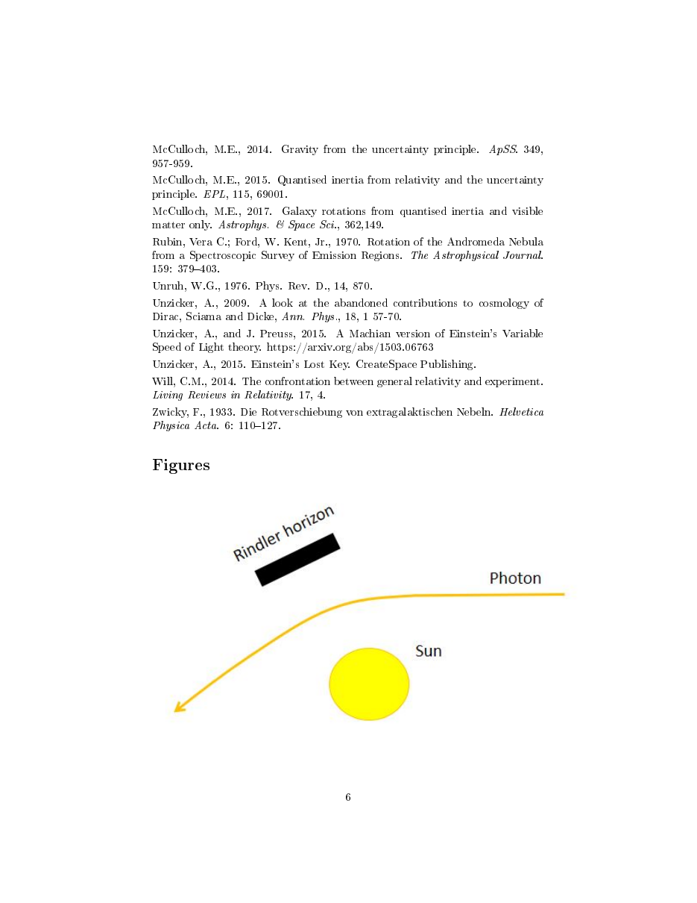

# Testing Quantised Inertia on the Bending of Light by the Sun

**Citation:** McCulloch, M. E. (2022). *Testing Quantised Inertia on the Bending of Light by the Sun*. Research Square preprint, posted 16 November 2022 (manuscript dated 8 November 2022). https://doi.org/10.21203/rs.3.rs-2251614/v1 (CC BY 4.0). No peer-reviewed version was found as of 2026-10.

**TL;DR:** The paper applies QI's modified inertial mass to a photon passing the Sun. It assumes that for photons the QI term 2c²/Θ equals the local Newtonian acceleration GM/r², because "the cosmic horizon depends upon the speed of light". The photon's effective acceleration is then twice Newtonian. Integrating gives the variable-speed-of-light relation c_r/c_∞ = 1 − 2GM/(rc²). The paper states that this relation reproduces the observed solar light deflection and the Shapiro delay, the classic GR tests. The work acknowledges DARPA grant HR001118C0125.

## Key claims
- QI "correctly predicts the observed bending of light by the Sun and the Shapiro time delay".
- QI offers "a simpler and more testable mechanism than standard general relativity", because Unruh radiation can be observed directly, while a metric cannot. The paper cites Lynch et al. (2021) as such an observation.
- Intuitive picture: the Sun acts as a horizon damping the Unruh field near it. QI "doubles the normal effect of gravity", because the cosmic horizon seen by the photon shrinks, halving its inertial mass.
- Caveat in the text: the derivation "is only valid for photons", for which Θ = 2c²/a. For orbiting matter, Θ ~ 10²⁶ m as in earlier QI papers. "It will need a detailed study to see if this still fits the data exactly."
- The paper proposes a "Casimir probe" (a Casimir cavity in a strongly accelerating environment) as another way to detect Unruh radiation.

## Key equations
QI inertial mass (Θ = 8.8 × 10²⁶ m):
$$ m_i = m\left(1 - \frac{2c^2}{|a|\Theta}\right) $$
Acceleration with gravitational mass m and QI inertial mass:
$$ a = \frac{GMm}{m_i r^2} \;\Rightarrow\; a = \frac{GM}{r^2} + \frac{2c^2}{\Theta} $$
Photon assumption, 2c²/Θ = GM/r², then integrating from r to ∞:
$$ \int_r^\infty a\,dr = \int_r^\infty\left(\frac{GM}{r^2}+\frac{GM}{r^2}\right)dr \;\Rightarrow\; c(c_r - c_\infty) = -\frac{2GM}{r} $$
Result, the empirical variable-speed-of-light relation (after Unzicker):
$$ \frac{c_r}{c_\infty} = 1 - \frac{2GM}{rc_\infty^2} $$

## Data used
- No new data. The target relation (Eq. 2) is taken as what "any successful theory must predict" from existing Solar-system tests, citing Will (2014) and Unzicker (2009, 2015).

## Results & predictions
- Recovers c_r/c_∞ = 1 − 2GM/(rc²). The paper states that this gives the standard solar deflection and the Shapiro timing, though the deflection angle (1.75″) is not computed explicitly in the text.
- No new numerical prediction differs from GR for the Sun.

## Figures

## Notable quotes
> "It is shown for the first time that QI correctly predicts the observed bending of light by the Sun and the Shapiro time delay." (abstract, PDF p. 2)

> "Note that the derivation here is only valid for photons, as for them Θ = 2c²/a." (PDF p. 5)

> "It will need a detailed study to see if this still fits the data exactly." (PDF p. 5)

## Criticisms & responses
- No published critique of this specific preprint was found in a brief search.
- **Factual observations on the derivation:**
  - The factor of 2 relative to Newtonian deflection is introduced through the assumption 2c²/Θ = GM/r² for photons, that is, a photon-specific, position-dependent Θ. This differs from the fixed cosmic Θ ≈ 8.8 × 10²⁶ m that QI uses for galaxy rotation and wide binaries. The paper flags this itself.
  - The step from ∫a dr to c(c_r − c_∞) treats the photon's speed as changing. This is a variable-speed-of-light interpretation, not a standard GR geodesic calculation.
  - The deflection angle and the Shapiro delay are asserted to follow but are not computed.
- **Lensing:** galaxy-scale and cluster-scale gravitational lensing is a separate, stronger test for modified-inertia theories. This preprint does not address it.
- General QI critique: [Renda 2019](../../03-criticism/2019-renda-sceptical/README.md).

## Related
- Evidence: [derivation](../../02-evidence/derivation.md), [other-anomalies](../../02-evidence/other-anomalies.md), [galaxy-rotation](../../02-evidence/galaxy-rotation.md)
- Sources: [2014-mcculloch-gravity-uncertainty](../2014-mcculloch-gravity-uncertainty/README.md), [2016-mcculloch-relativity-uncertainty](../2016-mcculloch-relativity-uncertainty/README.md), [2007-mcculloch-pioneer-anomaly](../2007-mcculloch-pioneer-anomaly/README.md), [2013-mcculloch-asymmetric-casimir](../2013-mcculloch-asymmetric-casimir/README.md), [2023-lynch-accelerated-electron-thermometer](../2023-lynch-accelerated-electron-thermometer/README.md), [2019-renda-sceptical](../../03-criticism/2019-renda-sceptical/README.md)
