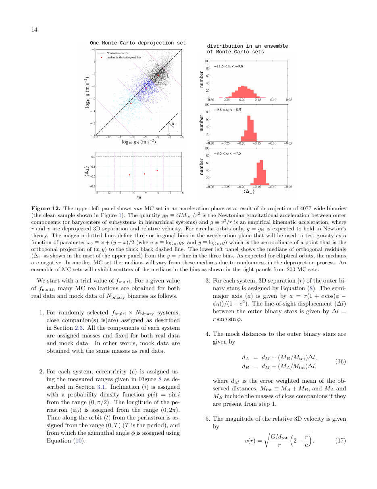
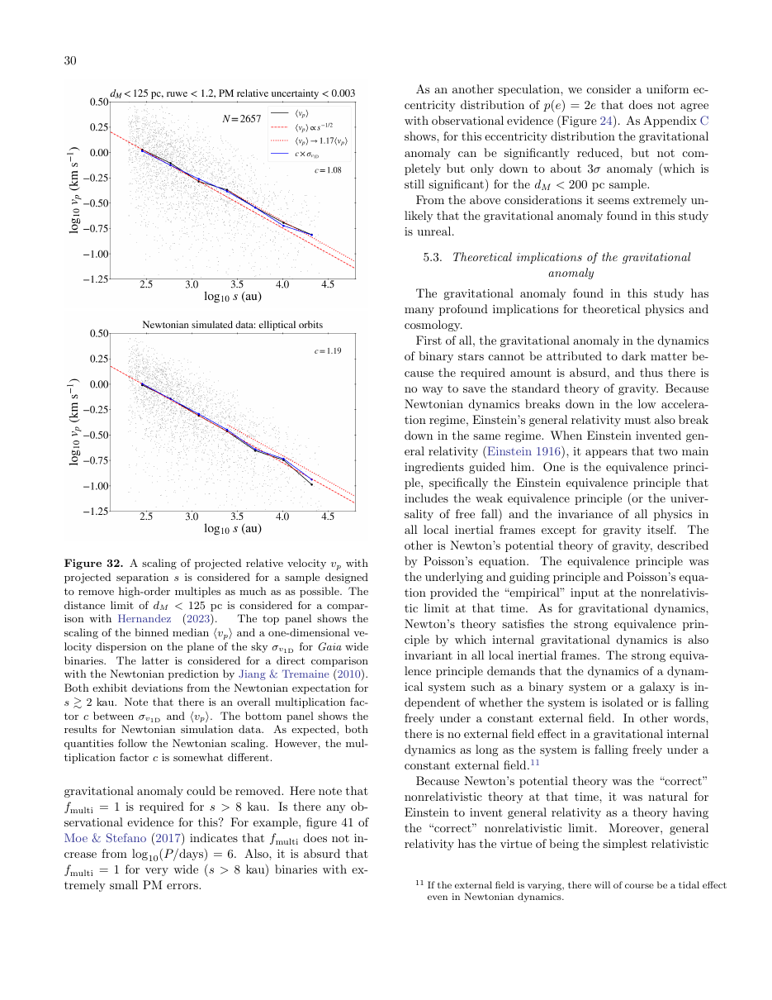

# Breakdown of the Newton-Einstein Standard Gravity at Low Acceleration in Internal Dynamics of Wide Binary Stars

**Citation:** Chae, K.-H. (2023). *Breakdown of the Newton-Einstein Standard Gravity at Low Acceleration in Internal Dynamics of Wide Binary Stars*. The Astrophysical Journal, 952(2), 128. https://doi.org/10.3847/1538-4357/ace101. arXiv:[2305.04613](https://arxiv.org/abs/2305.04613). The stored PDF is arXiv v4 (19 September 2023).

**TL;DR:** Chae uses Gaia DR3 wide binaries from the El-Badry, Rix & Heintz (2021) catalogue and deprojects sky-plane motions to 3D by Monte Carlo. He calibrates the hidden-companion (multiplicity) fraction so that the dynamics match Newton at high acceleration (≈10⁻⁸ m/s²). He then finds a systematic deviation below g_N ≲ 10⁻⁹ m/s². At g_N ≈ 10^−10.15 m/s², the observed-to-Newtonian acceleration ratio is 1.43 ± 0.06, matching the AQUAL (MOND) prediction with the Milky Way's external field effect (EFE). The combined significance is quoted as 10σ. **QI is not mentioned.** The result is relevant to QI only because QI also predicts a low-acceleration boost, although QI has *no* EFE.

## Key claims
- A "gravitational anomaly" appears at weak acceleration g_N ≲ 10⁻⁹ m/s², and is taken as "direct evidence for the breakdown of standard gravity".
- The magnitude and trend agree with AQUAL under the Galactic external field, for circular orbits.
- Dark matter cannot explain an anomaly in binary stars, because "the required amount is absurd".
- The data favour MOND as *modified gravity* rather than modified inertia, consistent with Chae (2022) on rotation curves. However, the author notes the work "has not directly distinguished" the two.
- Possible ways out are examined:
  - A multiplicity fraction that increases strongly with separation (needs f_multi = 1 for s > 8 kau, judged "absurd").
  - An eccentricity distribution p(e) = 2e, contradicted by observations, which reduces the anomaly only to about 3σ.

## Key equations
Accelerations compared in the acceleration plane:
$$ g_N \equiv \frac{GM}{r^2}, \qquad g \equiv \frac{v^2}{r} $$
Boost factor from the anomaly parameter:
$$ \frac{g_{obs}}{g_{pred}} = 10^{\sqrt{2}\,\delta_{obs-newt}} $$

## Data used
- Gaia DR3 wide binaries from El-Badry, Rix & Heintz (2021), with accurate distances, proper motions and inferred masses. Separations range from about 0.2 to 30 kau.
- Main sample: 26,615 wide binaries within 200 pc. Clean sample used in Fig. 12: 4,077 binaries within 80 pc.
- Monte Carlo deprojection with individual eccentricities from Hwang et al. (2022), and modelling of hidden inner companions (f_multi calibrated at ≈10⁻⁸ m/s²).

## Results & predictions
- Anomaly parameter δ_obs−newt:
  - 0.034 ± 0.007 at g_N ≈ 10^−8.91 m/s²
  - 0.109 ± 0.013 at g_N ≈ 10^−10.15 m/s²
  - Combined, these give 10σ.
- g_obs/g_pred = 1.43 ± 0.06 at 10^−10.15 m/s². The text quotes an acceleration boost of 1.33–1.43 (Table 2), corresponding to a velocity boost factor of about 1.17.
- Projected velocities deviate from the Newtonian scaling for s ≳ 2 kau (log₁₀ s ≳ 3.3), with a roughly constant boost, "consistent with the MONDian (modified) gravity expectation under the external field".

## Figures

## Notable quotes
> "The deviation represents a direct evidence for the breakdown of standard gravity at weak acceleration." (p. 1)

> "From the above considerations it seems extremely unlikely that the gravitational anomaly found in this study is unreal." (p. 30)

## Criticisms & responses
- **Banik et al. 2024 (MNRAS 527, 4573):** in [2023-banik-gaia-dr3-wide-binaries](../../03-criticism/2023-banik-gaia-dr3-wide-binaries/README.md), a separate Gaia DR3 analysis restricted to 2–30 kau found Newtonian gravity strongly preferred over MOND. Hernandez et al. 2024 summarise this as a claimed 16σ exclusion of MOND and a reported 19σ preference for the best-fit Newtonian model.
  - Pittordis & Sutherland (2023) reached a similar Newtonian-favouring conclusion.
  - These analyses differ from Chae's in sample selection, noise treatment, the handling of hidden triples, and fitting strategy.
- **Response:** [Hernandez, Chae & Aguayo-Ortiz 2024](../2024-hernandez-wide-binary-review/README.md) argued that the Newtonian-favouring analyses neglect observational noise, omit a deep-Newtonian calibration region, and infer excessively high hidden-tertiary fractions. They report G → (1.5 ± 0.2)G at low accelerations.
- **Status:** the wide-binary test remains disputed in the literature as of the time of writing.
- **Relevance to QI (factual):**
  - Chae's fit is to AQUAL *with* the Galactic EFE.
  - QI, as described by McCulloch, has no EFE. For example, [2025-mcculloch-jupiter-mass-binaries](../2025-mcculloch-jupiter-mass-binaries/README.md) states "QI has no external field effect".
  - Agreement with AQUAL+EFE is therefore not automatically agreement with QI. Chae does not test QI.

## Related
- Evidence: [wide-binaries](../../02-evidence/wide-binaries.md), [galaxy-rotation](../../02-evidence/galaxy-rotation.md)
- Sources: [2024-hernandez-wide-binary-review](../2024-hernandez-wide-binary-review/README.md), [2023-banik-gaia-dr3-wide-binaries](../../03-criticism/2023-banik-gaia-dr3-wide-binaries/README.md), [2019-mcculloch-wide-binaries](../2019-mcculloch-wide-binaries/README.md), [2019-hernandez-gaia-wide-binaries](../2019-hernandez-gaia-wide-binaries/README.md), [2012-hernandez-wide-binaries](../2012-hernandez-wide-binaries/README.md), [2024-mcculloch-proxima-centauri](../2024-mcculloch-proxima-centauri/README.md), [2025-mcculloch-jupiter-mass-binaries](../2025-mcculloch-jupiter-mass-binaries/README.md)
