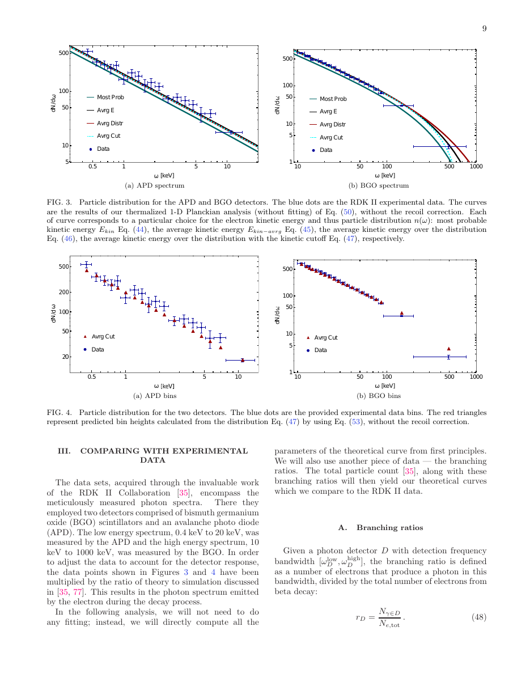
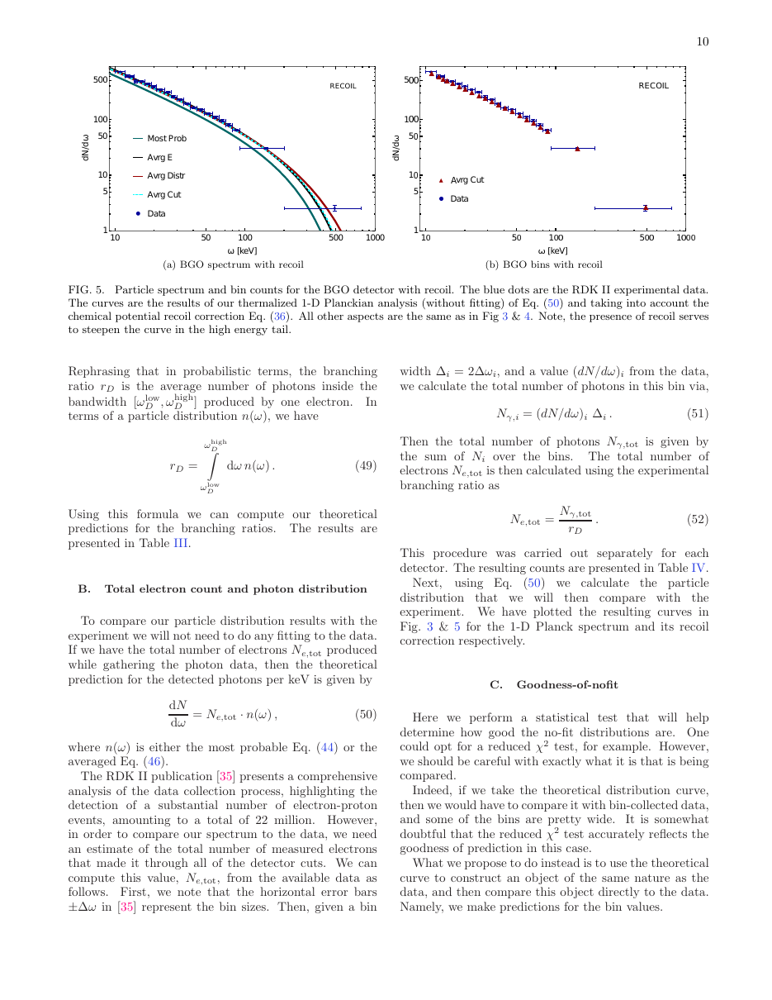

# Accelerated electron thermometer: observation of 1D Planck radiation

**Citation:** Lynch, M. H., Ievlev, E. & Good, M. R. R. (2023). *Accelerated electron thermometer: observation of 1D Planck radiation*. Progress of Theoretical and Experimental Physics, 2024(2), 023D01 (published online 21 December 2023). https://doi.org/10.1093/ptep/ptad157. arXiv:[2211.14774](https://arxiv.org/abs/2211.14774). The stored PDF is arXiv v2 (27 December 2023).

**Correction to the batch summary:** this paper analyses photons from **radiative beta decay of free neutrons**, using data from the RDK II collaboration (NIST). It does not analyse channeling data. The channeling-radiation analysis (CERN NA63 positrons in crystals) is the earlier Lynch, Cohen, Hadad & Kaminer (2021, Phys. Rev. D 104, 025015) paper, which McCulloch cites as Unruh evidence. This paper references that work as [17].

**TL;DR:** Using the electron–moving-mirror duality, the authors predict that photons emitted by the accelerated electron in neutron beta decay should follow a one-dimensional Planck spectrum. The temperature is fixed by the electron's acceleration scale κ, which is set by energy conservation. They compare this prediction with the RDK II photon spectra measured with APD (0.4–14 keV) and BGO (14.1–782 keV) detectors, without fitting. They report good agreement, using a reduced χ² of their own construction, and present this as observation of thermal radiation from an accelerated electron. They interpret it as a dynamical-Casimir / "thermal Larmor" effect associated with the Unruh effect. QI is mentioned only once, in the discussion, as a candidate idea.

## Key claims
- Photons from radiative neutron beta decay "reside in a one-dimensional Planck spectrum with a temperature predicted by the moving mirror model".
- No fitting parameters are used: the x-axis follows from the energy–κ relation and the y-axis from the distribution prefactor.
- The authors say the work "confirms a classical connection between acceleration and temperature", and note that the Planck curve here "originates in classical electrodynamics".
- Context paragraph: "entropic gravity [90], modified Newtonian dynamics [91], and quantized inertia [92]" are listed as candidate explanations for dark matter "arising from an Unruh-type effect on cosmological scales". Reference [92] is McCulloch 2007.

## Key equations
Thermal (Bose–Einstein) form for high final speeds (s ≈ 1, q ≫ p):
$$ |\beta_{pq}|^2 = \frac{1}{2\pi\kappa p}\,\frac{1}{e^{2\pi q/\kappa}-1} $$
Total photon energy emitted by the electron (natural units):
$$ E = \frac{e^2}{24\pi}\left(\frac{\tanh^{-1}s}{s}-1\right)\kappa $$
Predicted detected photons per keV, with no fitting:
$$ \frac{dN}{d\omega} = N_{e,tot}\cdot n(\omega) $$

## Data used
- RDK II collaboration radiative neutron decay photon spectra (their ref. [35]).
  - APD detector: 0.4–14 keV, 808 photons, 138,916 accounted electrons.
  - BGO detector: 14.1–782 keV, 17,872 photons, 5,334,982 accounted electrons.
- Electron kinetic-energy distribution from beta decay: E_max ≈ 782.325 keV, most probable energy 221.98 keV, average 287.48 keV.

## Results & predictions
- **Branching ratios (Table III):**
  - Experiment: APD 0.00582 ± 0.00066 (total σ); BGO 0.00335 ± 0.00016.
  - Predictions using the average-kinetic-energy distribution: APD 0.00527 (0.8σ off); BGO 0.00382 (3.0σ off) without recoil, 0.00331 (0.23σ off) with recoil correction.
  - Standard QFT prediction: 0.00515 (1.0σ) and 0.00308 (1.7σ).
- **Reduced χ² (Table V), using n_kin-avrg:** APD 1.1 (18 DOF); BGO 6.5 without recoil, 0.89 with recoil (21 DOF). Other distribution choices give χ² values from 1.3 to 37.

## Figures

## Notable quotes
> "we find the photons reside in a one-dimensional Planck spectrum with a temperature predicted by the moving mirror model." (p. 1)

> "Allow us to emphasize again that there is no fitting of the theory to the data." (p. 11, Table V caption)

## Criticisms & responses
- No published critique of this specific paper was found in a brief search.
- **Factual notes:**
  - Agreement depends on which electron-energy distribution is used. With the most-probable-energy choice, the paper's own reduced χ² values range up to 26–37 for BGO, and branching-ratio deviations reach 3.7–5.8σ.
  - The authors describe the effect as classical ("thermal Larmor") radiation. Whether it constitutes evidence for the Unruh effect *as such* is an interpretive question.
- **Relevance to QI:** McCulloch cites Lynch et al. (2021, channeling) as direct evidence of Unruh radiation, for example in [2022-mcculloch-light-bending](../2022-mcculloch-light-bending/README.md). This 2023 paper concerns a different system. It shows thermal emission tied to acceleration, but it does not test QI's specific claims: horizon damping, the Hubble-scale cut-off, and modified inertial mass.

## Related
- Evidence: [lab-tests](../../02-evidence/lab-tests.md), [derivation](../../02-evidence/derivation.md)
- Sources: [2022-mcculloch-light-bending](../2022-mcculloch-light-bending/README.md), [2025-mcculloch-jupiter-mass-binaries](../2025-mcculloch-jupiter-mass-binaries/README.md), [2022-kholupenko-unruh-anisotropy-2](../2022-kholupenko-unruh-anisotropy-2/README.md), [2025-kholupenko-unruh-anisotropy-3](../2025-kholupenko-unruh-anisotropy-3/README.md), [2007-mcculloch-pioneer-anomaly](../2007-mcculloch-pioneer-anomaly/README.md), [2016-gine-unruh-temperatures](../2016-gine-unruh-temperatures/README.md)
