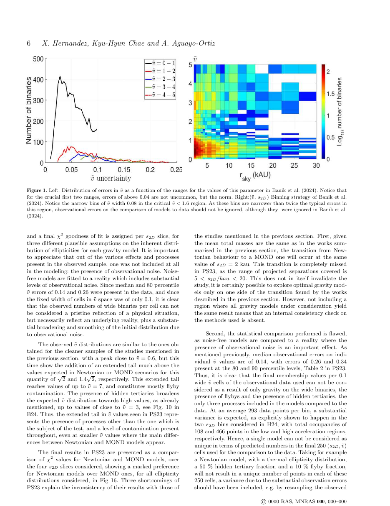
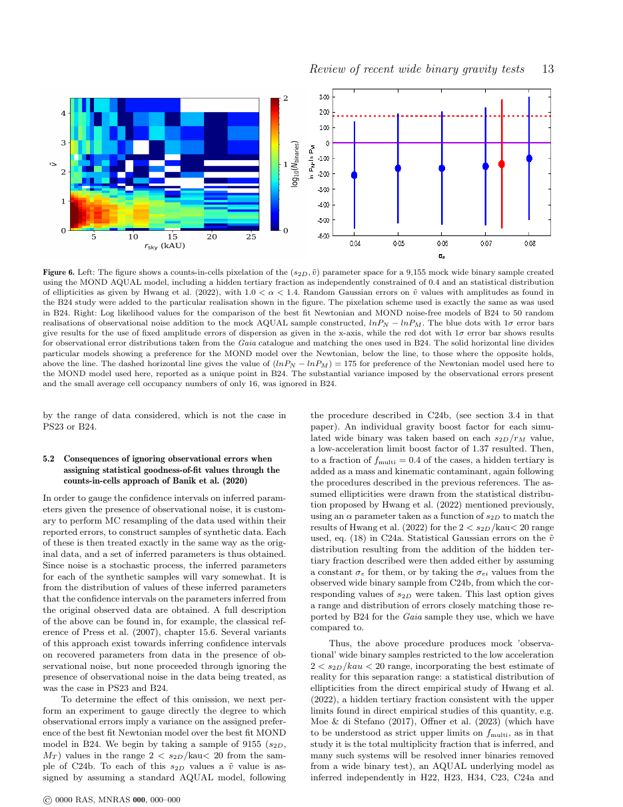

# A critical review of recent GAIA wide binary gravity tests

**Citation:** Hernandez, X., Chae, K.-H. & Aguayo-Ortiz, A. (2024). *A critical review of recent Gaia wide binary gravity tests*. Monthly Notices of the Royal Astronomical Society, 533, 729–742. https://doi.org/10.1093/mnras/stae1823 (DOI and pages from Crossref). arXiv:[2312.03162](https://arxiv.org/abs/2312.03162). The stored PDF is arXiv v3 (25 July 2024).

The batch listed this as "MNRAS (accepted)". It has since been published, as above.

**TL;DR:** Two groups report MOND-like deviations in Gaia DR3 wide binaries at low acceleration: Hernandez et al. (H22, H23, H24) and Chae (C23, C24a, C24b). Two others favour Newton: Pittordis & Sutherland 2023 (PS23) and Banik et al. 2024 (B24). This paper, written by members of the first two groups, reviews all of them. It argues that PS23/B24 share two critical problems:

- They neglect observational noise in the model-to-data comparison.
- They omit a deep-Newtonian (0.2–2 kau) calibration region, which leads them to fit excessively large hidden-tertiary fractions and eccentricity parameters.

The authors show with mocks how these choices bias the results towards Newton. Their own analyses give G → (1.5 ± 0.2)G at 2–20 kau. **QI is not discussed.**

## Key claims
- The proponent groups find full agreement with Newton at 0.2–2 kau without free parameters. At 2–20 kau they find consistency with MOND for elliptical orbits, with an effective G → (1.5 ± 0.2)G.
- PS23 and B24 fit 3 or 7 parameters simultaneously, by counts-in-cells, in a 2 (or 5)–30 (or 20) kau range, without a deep-Newtonian region. Their observational errors are "neglected from the statistical fitting procedure".
- B24's best-fit hidden-tertiary fraction and eccentricity parameter α are "excessively large", and its line-of-sight contaminants "excessively small", relative to independent determinations.
- In B24's bins, which are narrower than twice the typical ṽ errors in the critical ṽ < 1.6 region, ignoring noise matters.
- In mocks with an underlying MOND reality plus noise, the log-likelihood comparison spans from a 33.3σ preference for MOND to a 23.7σ preference for Newton. B24's reported 19σ Newtonian preference therefore "lies well within the dispersion expected".
- Using a high f_multi = 0.65 (as in B24) on Chae's data within 2–30 kau reproduces a Newtonian-consistent result. Extending to 0.2–30 kau shows f_multi = 0.65 is inconsistent with the high-acceleration data. Lowering f_multi to about 0.4 restores the AQUAL-consistent anomaly.

## Key equations
The comparison variable used throughout is the normalised sky-plane velocity ṽ (B24's definition; Eq. 5 of C23). The ellipticity distribution is parameterised as
$$ P(e) = (1+\alpha)\,e^{\alpha} $$
with gravity modelled as G → γG (Newton γ = 1.0; MOND-like γ ≈ 1.512 in Fig. 3).

## Data used
- Gaia DR3 wide-binary samples as used in H22–H24, C23, C24a,b, PS23 and B24, with projected separations 0.2–30 kau.
- Mock samples: for example, a 9,155-binary AQUAL mock with hidden-tertiary fraction 0.4, Hwang et al. (2022) eccentricities (1.0 < α < 1.4), and Gaussian ṽ errors matching B24. There were 50 noise realisations.

## Results & predictions
- G_eff = (1.5 ± 0.2)G at low acceleration (2–20 kau), from the proponent groups' combined analyses.
- The noise dispersion of the counts-in-cells likelihood test spans 33.3σ (pro-MOND) to 23.7σ (pro-Newton), for a sample like B24's with mean cell occupancy of about 16.
- The paper argues that B24's 16σ claimed exclusion of MOND, when noise is accounted for, leaves the MOND model "well within 1σ of the variance".

## Figures

## Notable quotes
> "We discover a couple of critical problems in the formal design and statistical implementation shared by the two latter groups, and show explicitly how these yield biased conclusions." (p. 1)

> "finding observations of Gaia wide binaries to be consistent with MOND predictions, for elliptical orbits within a 1.5 boost to the gravitational constant, G → (1.5 ± 0.2)G." (p. 15)

## Criticisms & responses
- **Conflict-of-perspective note:** the authors are the principal proponents of the deviation results under review, which they acknowledge implicitly by summarising "our two groups". The paper acknowledges three referees and a scientific editor as helping reach "a much more balanced" version.
- **Opposing view:** Banik et al. 2024 ([2023-banik-gaia-dr3-wide-binaries](../../03-criticism/2023-banik-gaia-dr3-wide-binaries/README.md)) and Pittordis & Sutherland 2023 maintain that Gaia DR3 wide binaries favour Newtonian gravity.
  - > [!UNVERIFIED] Whether the Banik/Sutherland groups have published a direct rebuttal to this review was not checked in this pass.
- **Relevance to QI (factual):** the review concerns MOND/AQUAL (with external field effect) versus Newton. QI predicts low-acceleration boosts but, per McCulloch, has no EFE, so it is not directly tested. McCulloch's own wide-binary paper ([2019-mcculloch-wide-binaries](../2019-mcculloch-wide-binaries/README.md)) used the earlier DR2 sample of Hernandez et al. (2019).

## Related
- Evidence: [wide-binaries](../../02-evidence/wide-binaries.md)
- Sources: [2023-chae-wide-binaries](../2023-chae-wide-binaries/README.md), [2023-banik-gaia-dr3-wide-binaries](../../03-criticism/2023-banik-gaia-dr3-wide-binaries/README.md), [2019-hernandez-gaia-wide-binaries](../2019-hernandez-gaia-wide-binaries/README.md), [2012-hernandez-wide-binaries](../2012-hernandez-wide-binaries/README.md), [2019-mcculloch-wide-binaries](../2019-mcculloch-wide-binaries/README.md), [2024-mcculloch-proxima-centauri](../2024-mcculloch-proxima-centauri/README.md)
