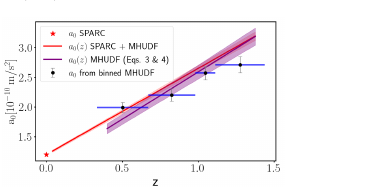

# MUSE-DARK III: The evolution of the radial acceleration relation at intermediate redshifts

**Citation:** Ciocan, B. I., Bouché, N. F., Fensch, J., Krajnović, D., Freundlich, J., Desmond, H., Famaey, B. & Techi, R. (2026). *MUSE-DARK III: The evolution of the radial acceleration relation at intermediate redshifts*. Astronomy & Astrophysics 709, L16. https://doi.org/10.1051/0004-6361/202659230. Preprint: [arXiv:2604.22613](https://arxiv.org/abs/2604.22613) (`paper.pdf` is the journal version, CC BY 4.0; the arXiv v1 copy is CC BY-NC-ND 4.0).

**TL;DR:** The radial acceleration relation (RAR) is measured for 79 star-forming galaxies at 0.33 < z < 1.44 in the MUSE Hubble Ultra Deep Field. The characteristic scale a₀ is about twice the local value and rises with redshift across four redshift bins. The paper does not mention QI; it is relevant because QI predicts a scale growing as (1+z).

## Key claims
- The RAR persists at intermediate redshift, with a₀|z∼1 = 2.38 (+0.12/−0.10) × 10⁻¹⁰ m s⁻² (95% CI) and an intrinsic scatter of about 0.17 dex (Sect. 3.1).
- Fitting the RAR in four equal-population redshift bins gives a₀ rising from about 1.99 to 2.71 × 10⁻¹⁰ m s⁻² (Sect. 3.2, Fig. 3).
- A global linear fit gives a₀(0) = 1.0 ± 0.04 and a₁ = 1.59 (+0.11/−0.10) × 10⁻¹⁰ m s⁻² per unit z (95% CI, Eq. 4). The arXiv v1 printed +0.10 in Eq. 4. The authors call the linear form "phenomenological" and say the measured evolution "is faster than that of H(z)" (Sect. 4).
- The rise appears with other dark-matter halo profiles and in a MOND-framework refit, which gives a slower slope, a₁ = 1.20 × 10⁻¹⁰ m s⁻² (Appendices D–E, Eq. E.5).
- Reconciling all bins with the local a₀ = 1.2 × 10⁻¹⁰ m s⁻² would need stellar masses larger by about +0.2 dex (low z) to +0.45 dex (high z). The authors argue that independent checks do not support such shifts (Appendix C).

## Key equations
RAR fitting function (Eq. 1, McGaugh et al. 2016):
$$a_{tot} = \frac{a_{bar}}{1 - \exp\left(-\sqrt{a_{bar}/a_0}\right)}$$

Phenomenological evolution (Eq. 3): $a_0(z) = a_0(0) + a_1 z$.

## Data used
- 79 star-forming galaxies from the MUSE Hubble Ultra Deep Field survey (Bacon et al. 2023), mass-complete above log(M★/M☉) = 8.8, 0.33 < z < 1.44 (Appendix A).
- Accelerations come from the 3D disc–halo decompositions (GalPaK3D, DC14 halo profile) of Paper I (Ciocan et al. 2026, A&A 708, A112). Points within 2 kpc are excluded. Stellar masses are inferred dynamically and cross-checked against SED masses (Appendices B–C).
- The RAR fits use the Roxy marginalised normal regression in log space. Its Gaussian prior on the true log a_bar has fitted mean −10.79 and width 0.63 dex (Fig. F.1, read from the figure).
- The paper states that the rotation curves and decomposition products are on the [DARK website](https://dark.univ-lyon1.fr/data-releases/). The linked data portal did not respond on 23 October 2026.

## Results & predictions
- Fig. 3 plots four binned a₀ values. Only the lowest and highest are printed in the text. The bar convention is not stated; the caption calls them "uncertainties".
- The authors compare their redshift trend with hydrodynamical simulations (Mayer et al. 2023: a factor of about 3 from z = 0 to 2) and say it is in tension with the Scale Invariant Vacuum prediction (Gueorguiev 2024).
- Their fit predicts a baryonic Tully–Fisher zero-point shift of about −0.2 dex between z ∼ 0 and z ∼ 1 (Sect. 4).

## Figures

*Fig. 3 (CC BY 4.0, Ciocan et al. 2026). Black points: a₀ fitted in four quantile redshift bins; blue bars show bin widths. The purple and red lines are the global linear fits without and with SPARC; the star is SPARC's z = 0 value. The confidence level of the grey error bars is not stated.*

## Notable quotes
> "the characteristic acceleration systematically increases with redshift" (Sect. 3.2)

> "a simple, phenomenological description" (Sect. 3.2)

## Criticisms & responses
- [Alcock 2026](../2026-alcock-rar-scale-hubble/README.md) refits the binned values with power laws. He finds the growth consistent with H(z) tracking and argues that "faster than H(z)" depends on the low-z anchor.
- Editorial: the MOND-framework refit's slower slope shows that the size of the evolution depends on the dynamical model used to derive the accelerations.
- Editorial test of QI against these bins: [A6](../../09-analysis/a6-rar-redshift-evolution/README.md).

## Related
- Evidence: [galaxy-rotation](../../02-evidence/galaxy-rotation.md), [cosmology](../../02-evidence/cosmology.md)
- Sources: [2017-mcculloch-galaxy-rotations-sparc](../2017-mcculloch-galaxy-rotations-sparc/README.md) (QI's (1+z) prediction), [2026-alcock-rar-scale-hubble](../2026-alcock-rar-scale-hubble/README.md), [2025-mcgaugh-kinematics-high-redshift](../../07-media/2025-mcgaugh-kinematics-high-redshift/README.md)
- Analysis: [A6](../../09-analysis/a6-rar-redshift-evolution/README.md)
