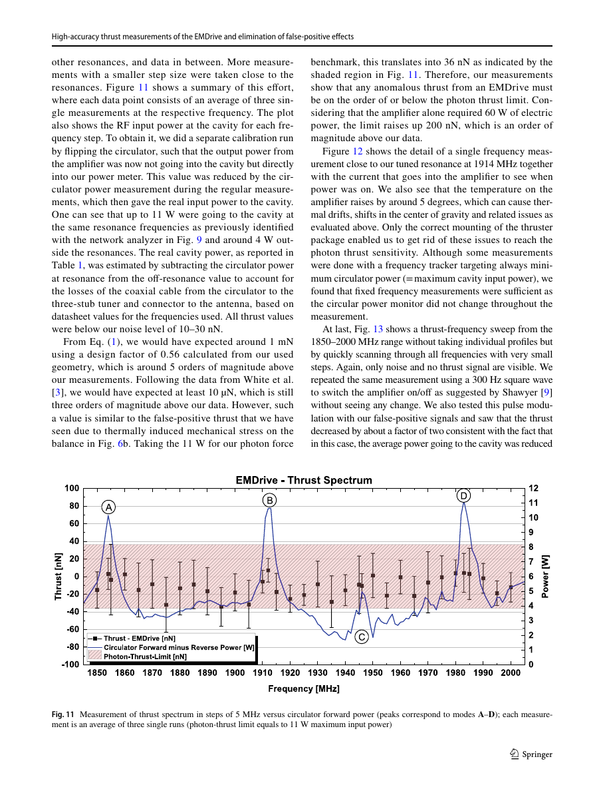

# High-accuracy thrust measurements of the EMDrive and elimination of false-positive effects

**Citation:** Tajmar, M., Neunzig, O. & Weikert, M. (2022). *High-accuracy thrust measurements of the EMDrive and elimination of false-positive effects*. CEAS Space Journal, 14, 31–44 (published online 27 July 2021). https://doi.org/10.1007/s12567-021-00385-1. Open access under CC BY 4.0.

The stored PDF is the published journal version (12 pages). It was retrieved from the Deutsche Nationalbibliothek archive copy (https://d-nb.info/1244138614/34) because Springer's PDF link was blocked by a bot challenge. Page numbers below are PDF pages; PDF p. 1 is journal p. 31. An earlier conference version appeared at Space Propulsion 2020+1 (March 2021).

**TL;DR:** TU Dresden replicated a NASA Eagleworks-type EMDrive (White et al. 2017 geometry, with HDPE dielectric discs). A conventional mounting reproduced an apparent thrust of about 1 µN/W, "similar to the one reported by White et al.". That signal disappeared when the cavity hung from a bolt bearing below the suspension point of an inverted counterbalanced double-pendulum balance. The EMDrive was battery-powered, with no high-current feedthroughs, in a large vacuum chamber. Across a 1850–2000 MHz sweep, including four resonances (Q 330–741), the measurements show no thrust above noise (10–30 nN) and stay within the photon-thrust limit. That is at least two orders of magnitude below earlier claims. QI is discussed as one of the EMDrive theories, all of which the authors call "highly controversial".

## Key claims
- **Review of EMDrive theories:** they include Shawyer's equation and McCulloch's QI. QI is described as "a theory [10] based on inertial modification due to Unruh radiation giving a similar force prediction as Eq. (1)" with a design factor close to unity. The paper notes that "in his definition, Q is not the quality factor but the number of reflections within the cavity." McCulloch's later dielectric extension (EPL 2017) is also cited.
- **Artefacts catalogued:**
  - Thermal expansion acting on pivots and fixings; centre-of-gravity shifts.
  - Buoyancy: 1 °C in a 15 × 15 × 15 cm³ cavity ≈ 150 µN in air.
  - Cable stiffness changing with temperature.
  - Liquid-metal-contact surface tension at amplifier currents, which can produce several µN.
  - Magnetic interaction of cables, damping magnets and voice coils with the Earth's field. In White et al.'s set-up "the damping magnet was mounted on the external supporting structure and not on the balance arm, which can very well cause orientation-dependent magnetic interaction forces of similar magnitude compared to their claimed thrusts."
  - Outgassing.
- **False positive reproduced and then removed:**
  - Mount A, cavity on the balance cage: about 1.5 µN at 10 W.
  - Mount A with the cavity screwed to the cage rods: about 20 µN, from thermal stress on the pivots.
  - Mount B, standing on the platform: about 200 nN from centre-of-gravity shifts.
  - Mount C, hanging from a bolt bearing: only noise (Fig. 6).
- A pulsed (300 Hz) frequency sweep showed no thrust change. The residual false-positive signal halved, in line with the halved average power. A pre-load similar to Shawyer's linear springs was also present (torsion springs).

## Key equations
Photon-thrust benchmark:
$$ F_{\rm photon} = \frac{P}{c} \approx 3.3\ {\rm nN/W} $$
The paper's Eq. (1) is Shawyer's thrust formula with a design factor. The QI prediction is said to be "similar" with a design factor near 1.
> [!UNVERIFIED] Exact typeset form of the paper's Eq. (1); see the PDF, p. 2.

## Data used
- Thrust-balance time series: an attocube IDS3010 interferometer with a 10 Hz low-pass filter; voice-coil calibration; profiles classified into sectors (off / ramp-up / on / ramp-down) with drift compensation (Fig. 4).
- VNA reflection scans (S11) and COMSOL eigenmode simulations to identify modes.

## Results & predictions
- Resonances: tuned peak at 1914 MHz (S11 ≈ −45 dB, Q = 477, TE312). TM212, the mode used by White et al., at 1943 MHz (Q = 430). Other peaks with Q 741 and 330. White et al. reported a Q of 7123. The authors attribute their roughly tenfold lower Q to surface roughness, antenna alignment and broadband tuning.
- Power: up to 11 W into the cavity at resonance (about 4 W off-resonance). The amplifier drew 2.5 A at 24.6 V, more than 60 W.
- Noise: 10–30 nN, with sub-nN resolution after averaging. The photon-thrust limit is 36 nN for 11 W, or about 200 nN if the whole 60 W amplifier power were radiated in one direction.
- Shawyer-type expectation: about 1 mN, roughly five orders of magnitude above the measured data.
- Conclusion: "Our data limit any anomalous thrust to below the force equivalent from classical radiation for a given amount of power. This provides strong limits to all proposed theories and rules out previous test results by at least two orders of magnitude." (p. 1)

## Figures

## Notable quotes
> "This provides strong limits to all proposed theories and rules out previous test results by at least two orders of magnitude." (p. 1, abstract)

> "Of course, all these theories are highly controversial [14] as any observation of forces higher than photon thrust is outside mainstream physics." (p. 2)

## Criticisms & responses
- **McCulloch's responses.** No blog post specifically about this paper was found. In earlier and later posts:
  - 24 May 2018, responding to Tajmar's 2018 preliminary results: Tajmar "does not yet even have a working emdrive and is looking at some sort of Lorentz force". QI expected 0.19 mN for that set-up against 0.004 mN observed ([blog](https://physicsfromtheedge.blogspot.com/2018/05/emdrive-trial-by-media.html)). He also argued that NASA's thrust followed the cavity orientation rather than the cabling, so it was not a Lorentz force.
  - 23 Jan 2022: he revised his interpretation. EmDrive thrust "may now not be due to the Unruh waves from the microwaves but from the Unruh waves seen by electrons accelerated by the microwaves in the metal walls, if you make a resonance". He wrote that "QI still predicts the emdrive (top right)" in his predicted-versus-observed plot, which includes Shawyer, Tajmar, Madrid and Moddel data ([blog](https://physicsfromtheedge.blogspot.com/2022/01/learning-from-experiments.html)).
- **Press coverage:** Popular Mechanics, Big Think and Slashdot reported in April 2021 (on the conference version) that the measurements refute EMDrive claims. Tajmar is quoted in Popular Mechanics as attributing earlier signals to heating that warped the balance's fastening elements.
  > [!UNVERIFIED] Exact wording of Tajmar's press quotes; secondary sources only.
- **Remaining issues:** EMDrive proponents (Shawyer) have argued about required Q and pre-load conditions. The paper addresses pre-load (torsion springs) and notes its Q was lower by an order of magnitude. It argues this "still rules out anomalous thrusts by at least two orders of magnitude according to Shawyer's Eq. (1)". See also the follow-up with a spherical end-cap and superconducting cavity in [2022-neunzig-emdrive-thrust](../2022-neunzig-emdrive-thrust/README.md).

## Related
- Evidence: [emdrive](../../02-evidence/emdrive.md), [lab-tests](../../02-evidence/lab-tests.md), [propulsion](../../02-evidence/propulsion.md)
- Sources: [2016-white-eagleworks](../../04-experiments/2016-white-eagleworks/README.md) (the replicated geometry), [2015-mcculloch-emdrive-pip](../../01-papers/2015-mcculloch-emdrive-pip/README.md), [2017-mcculloch-emdrives-dielectrics](../../01-papers/2017-mcculloch-emdrives-dielectrics/README.md), [2018-tajmar-spacedrive](../../04-experiments/2018-tajmar-spacedrive/README.md), [2019-kossling-spacedrive-balance](../../04-experiments/2019-kossling-spacedrive-balance/README.md), [2022-neunzig-laser-resonators](../2022-neunzig-laser-resonators/README.md), [2022-neunzig-emdrive-thrust](../2022-neunzig-emdrive-thrust/README.md), [2016-samsonov-emdrive-null](../2016-samsonov-emdrive-null/README.md)
