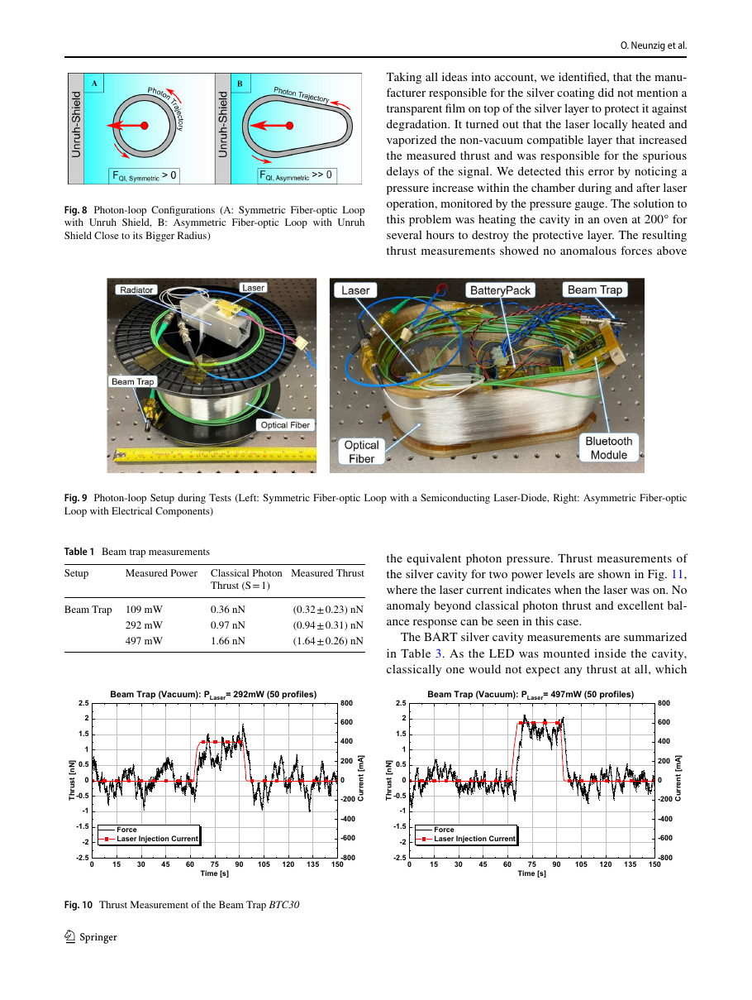
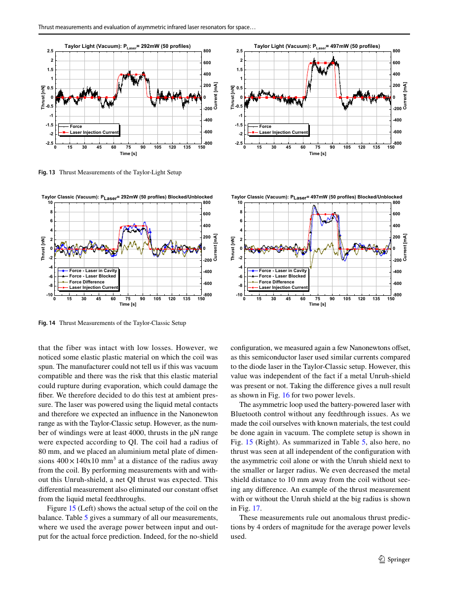
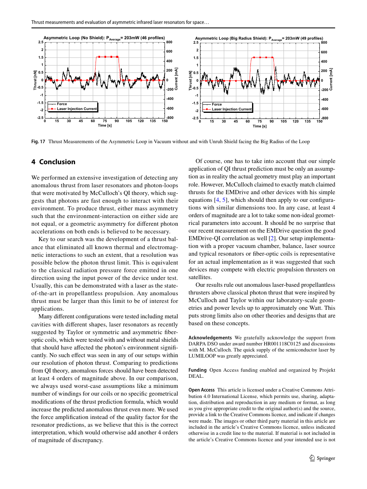

# Thrust measurements and evaluation of asymmetric infrared laser resonators for space propulsion

<!-- local-only-note -->
> 📁 **Local only:** `paper-conference.pdf` (licence `unknown`) is kept out of the public repository. The openly licensed `paper.pdf` is included.

**Citation:** Neunzig, O., Weikert, M. & Tajmar, M. (2022). *Thrust measurements and evaluation of asymmetric infrared laser resonators for space propulsion*. CEAS Space Journal, 14(1), 45–62 (online 24 April 2021). https://doi.org/10.1007/s12567-021-00366-4. CC BY 4.0. A correction was issued as https://doi.org/10.1007/s12567-021-00372-6 (27 May 2021); its content was not checked.

**About the stored PDF:** `paper.pdf` is the published CC BY 4.0 journal version (18 pages, journal pp. 45–62), retrieved from the German National Library archive copy ([d-nb.info/124181175X](https://d-nb.info/124181175X/34)) because Springer's site blocks scripted downloads. **Page numbers below are PDF pages** (journal page = PDF page + 44). An earlier conference version (SP2020_104, Space Propulsion 2020+1, 20 pages, [TU Dresden link](https://tu-dresden.de/ing/maschinenwesen/ilr/rfs/ressourcen/dateien/forschung/folder-2007-08-21-5231434330/ag_raumfahrtantriebe/SPC-Thrust-Measurements-and-Evaluation-of-Asymmetric-Infrared-Laser-Resonators-for-Space-Propulsion.pdf)) is kept locally as `paper-conference.pdf`. Where a quote appears only in that version, we say so.

**TL;DR:** This is a direct test of QI, part of McCulloch's DARPA-funded programme (award HR001118C0125), which McCulloch says he persuaded Tajmar to join in 2017. Travis Taylor had proposed laser "EMDrives" based on QI. TU Dresden built a sub-nN inverted counterbalanced double-pendulum balance and tested several devices:
- copper and silver asymmetric metal cavities (CC/CX, CC/CC, Circle);
- a silver "BART" LED cavity;
- four Taylor-type high-finesse laser resonators;
- symmetric and asymmetric fibre-optic "photon loops", with and without a metal "Unruh shield".

Every device gave only the classical photon thrust F = P/c (about 1–2 nN at 0.3–0.5 W). The authors conclude this "puts strong limits on all proposed theories like quantised inertia by at least 4 orders of magnitude".

## Key claims
- **What QI predicts here (Sect. 2):**
  - McCulloch's EMDrive formula is F = PQL/c · (1/D − 1/d) (Eq. 2). Taylor's version replaces Q with a wavelength-dependent expression (Eq. 3; the authors correct a sign).
  - The authors argue that McCulloch's "Q" is not the resonator quality factor but the number of photon round trips. They quote McCulloch: "…the Q factor quantifies how many trips there are before the power dissipates". They therefore use a force amplification factor S (several hundred for good mirrors) instead of an optical Q, which can be of order millions.
  - This lowers QI predictions to "2–3 orders of magnitude above the photon thrust limit, which is still of major interest". It also "invalidates Taylor's Eq. 3", whose assumptions gave 0.1 N per W.
  - Their worst-case prediction for a device is photon thrust × S.
- **Set-up:** an inverted counterbalanced double-pendulum balance with sub-nN sensitivity, operated in vacuum. Laser power was limited to ≤ 1 W (3.3 nN photon thrust) to control thermal drift. An 808 nm laser at 0.01–0.65 W was used, among others. The balance was verified with a beam trap, which measured photon thrust to within error.
- **Encapsulation detail (later central to McCulloch's response):** "every copper cavity was encapsuled in an aluminium case, similar to the beam trap mentioned previously, to minimize heat radiation to the balance components" (p. 6).
- **One false positive found and resolved:** the silver CC/CX cavity first showed a force 50% above photon thrust, with suspicious on/off delays. The cause was vaporisation of an undisclosed transparent protective film on the silver coating, detected as a rise in chamber pressure. It was removed by baking at 200 °C.

## Key equations
QI inertial mass, as quoted (Eq. 1):
$$ m_i = m\left(1 - \frac{2c^2}{|a|\Theta}\right) $$
McCulloch's EMDrive force (Eq. 2), with L the cavity length and D, d the end widths:
$$ F_{\rm EMDrive} = \frac{P\,Q\,L}{c}\left(\frac{1}{D} - \frac{1}{d}\right) $$
Taylor's laser version (Eq. 3; ξ = cavity loss per oscillation):
$$ F_{\rm Taylor} = \frac{4\pi P\,L^2}{\lambda c\,\xi}\left(\frac{1}{D} - \frac{1}{d}\right) $$
Worst-case comparison used in the results:
$$ F_{QI} \approx \frac{P\,S}{c}, \qquad F_{\rm photon} = \frac{P}{c} $$

## Data used
- Balance time series, averaged over 40–60 profiles; laser power measured with a calibrated power meter; resonator decay times (about 250 ns, "equivalent to a Q of millions").

## Results & predictions
- Beam trap (vacuum): (0.32 ± 0.23), (0.94 ± 0.31) and (1.64 ± 0.26) nN at 109, 292 and 497 mW, against calculated photon thrust of 0.36, 0.97 and 1.66 nN (p. 11). The text prints "0.36 mN", an apparent typo.
- Metal cavities: expected amplification of about 9× photon thrust for copper and 39× for silver. Measured values show "excellent agreement with classical photon thrust and no anomalous force as predicted by QI".
- BART silver LED cavity at 1.54 W: the claimed effect implied 2700 nN; measured (0.22 ± 4.13) nN, "ruling out any anomalous thrust by 4 orders of magnitude" (p. 13). The BART design was suggested by Lucio and McCulloch, with initial positive reports by Komala.
- Taylor resonators (amplification factors 500–908): only photon thrust, "ruling out theoretical predictions by three orders of magnitude". Taylor-Classic had a feedthrough offset of about 67 nN at 500 mW; the differential measurement was below photon thrust.
- Fibre-optic loops (at least 4330 windings, 4000 used conservatively): no thrust, symmetric or asymmetric, with or without the shield (Figs. 16–17).
- Conclusion: QI-predicted forces "should have been detected at least 4 orders of magnitude above" (p. 17). The authors acknowledge that "our simple application of QI thrust prediction must be only an assumption as in reality the actual geometry must play an important role" (conference version only; this sentence is not in the journal text). They counter that McCulloch "claimed to exactly match claimed thrusts for the EMDrive and other devices with his simple equations" (p. 17).

## Figures

## Notable quotes
> "This puts strong limits on all proposed theories like quantised inertia by at least 4 orders of magnitude for the laboratory-scale geometries and power levels used with worst case assumptions for the theoretical predictions." (p. 1, abstract)

> "At 1.54 W of optical LED power, the expected thrust from the claimed measurement would have been 2700 nN [12], however we measured (0.22±4.13) nN, ruling out any anomalous thrust by 4 orders of magnitude." (p. 13)

## Criticisms & responses
- **McCulloch's response (blog, 27 Apr 2021, "Response to Tajmar's New Cavity Results").** McCulloch opens: "there is no criticism of Tajmar's team here". He says he had not known, until reading the paper, that "every copper [and silver] cavity was encapsulated in an aluminium case". In QI the Unruh waves seen by the accelerated photons extend outside a partially transparent cavity, so the cavity "falls down" the Unruh gradient. A symmetric metal box around it means "there's no background gradient", and the combined cavity and box should show "no or much less thrust" ([blog](https://physicsfromtheedge.blogspot.com/2021/04/response-to-tajmars-new-cavity-results.html)).
  - He re-plotted the data as observed minus photon thrust. Most points lie slightly above zero, which he attributes to all cavities having a thicker wall in the thrust direction.
  - He compared the silver and copper cavities. With Q (in his sense) of 39 for silver and 9 for copper, he expected a 4.3× ratio of thrust. The average excess was 0.16 nN for silver against 0.05 nN for copper, a ratio of 3.2.
  - He states clearly that "none of the results I'm going to discuss now are significant since the error bars are about the same size as the values".
  - Proposed next steps: repeat the tests without the metal box, and try the Becker & Bhatt capacitor method, "perhaps 1000 times more powerful".
- **Dresden's follow-up tested these objections.** [Neunzig et al. IAC-2021 / Acta Astronautica 2022](../2022-neunzig-emdrive-thrust/README.md):
  - They removed the aluminium case: "The only setup change of removing the aluminium plate did not have any effect on measured thrust whatsoever."
  - They added an asymmetric tapered metal cone and end-plate around the Taylor-Light beam, giving 0.96–1.64 nN photon thrust against QI predictions of 482–822 nN; measured (1.01 ± 0.30) and (1.62 ± 0.26) nN.
  - McCulloch had suggested that the conductive walls of the vacuum chamber cancel the Unruh radiation. In response, they operated the fibre loop on a marble table outside the vacuum chamber, with no metal within 80 m in front of or behind the coil. Again there was no thrust. They also note that the aluminium plate had served as protection against stray laser light.
- **McCulloch's later reinterpretation (blog, 23 Jan 2022).** "It turned out that QI thrusters based on light alone did not perform well (Tajmar, 2021) and yet QI thrusters that are based on electrons did". He explains this by the small mass-energy of light that can be "focused" in a cavity, and by an earlier assumption that v = c. With the corrected formula, he says, QI "accounts for the effectively zero thrusts seen by Tajmar's team for the laser cavities" ([blog](https://physicsfromtheedge.blogspot.com/2022/01/learning-from-experiments.html)). He adds: "QI has not been falsified", and points to galaxies and wide binaries.
- **Interpretation of "Q":** the authors' choice of S (round trips) over optical Q *lowers* the QI prediction. They note that using optical Q "would otherwise add another 4 orders of magnitude or discrepancy" (p. 17).

## Related
- Evidence: [propulsion](../../02-evidence/propulsion.md), [lab-tests](../../02-evidence/lab-tests.md), [emdrive](../../02-evidence/emdrive.md)
- Sources: [2017-taylor-laser-resonators](../../01-papers/2017-taylor-laser-resonators/README.md) (the proposal tested), [2015-mcculloch-emdrive-pip](../../01-papers/2015-mcculloch-emdrive-pip/README.md), [2017-mcculloch-emdrives-dielectrics](../../01-papers/2017-mcculloch-emdrives-dielectrics/README.md), [2018-mcculloch-propellantless-propulsion](../../01-papers/2018-mcculloch-propellantless-propulsion/README.md), [2022-neunzig-emdrive-thrust](../2022-neunzig-emdrive-thrust/README.md), [2021-tajmar-emdrive-false-positive](../2021-tajmar-emdrive-false-positive/README.md), [2021-mcculloch-symmetric-capacitors](../../01-papers/2021-mcculloch-symmetric-capacitors/README.md), [2018-bhatt-capacitor-thrust](../../04-experiments/2018-bhatt-capacitor-thrust/README.md)
- Media on the DARPA programme: [2018-plymouth-darpa](../../07-media/2018-plymouth-darpa/README.md), [2018-motherboard-darpa-pseudoscience](../../07-media/2018-motherboard-darpa-pseudoscience/README.md)
