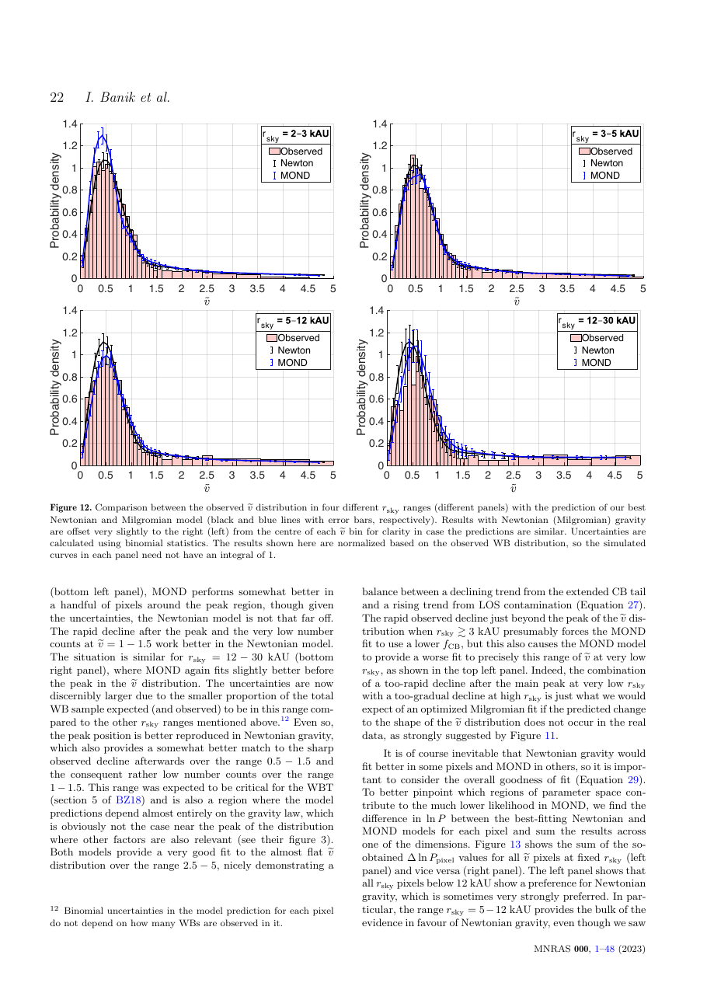
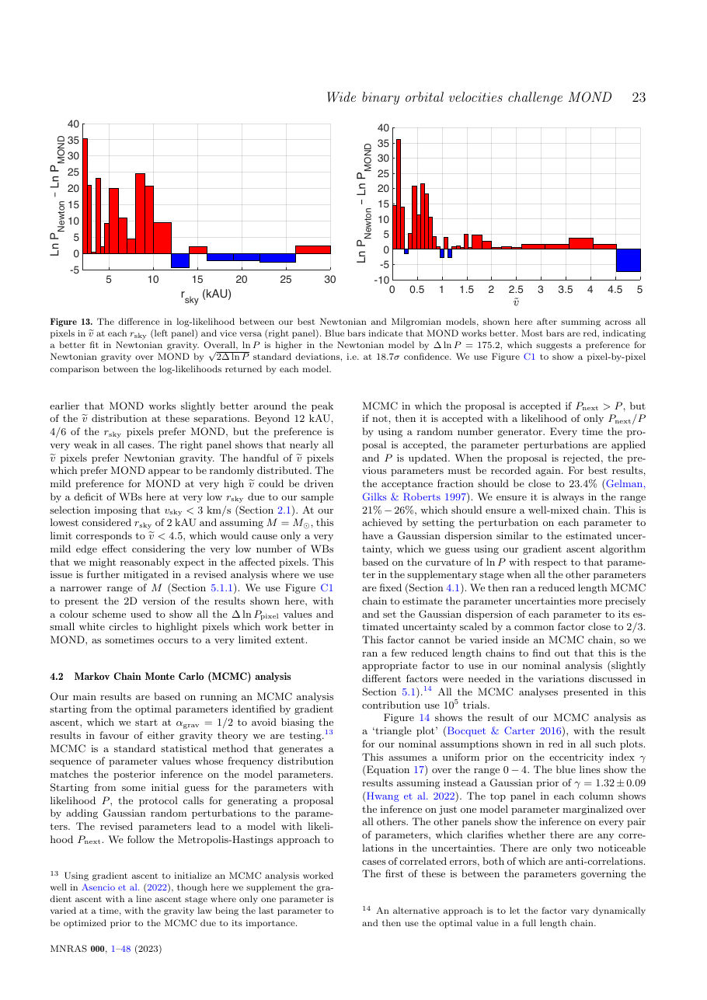

# Strong constraints on the gravitational law from Gaia DR3 wide binaries

**Citation:** Banik, I., Pittordis, C., Sutherland, W., Famaey, B., Ibata, R., Mieske, S. & Zhao, H. (2024). *Strong constraints on the gravitational law from Gaia DR3 wide binaries*. Monthly Notices of the Royal Astronomical Society, 527(3), 4573–4615. https://doi.org/10.1093/mnras/stad3393. arXiv:[2311.03436](https://arxiv.org/abs/2311.03436).

The stored PDF is **arXiv v4 (28 Sep 2026)**, 48 pages. Its arXiv comment reads: "Published in MNRAS in this form, corrected Figure 15 and related discussion". Page numbers below refer to that PDF.

**TL;DR:** A wide-binary test (WBT) of MOND using 8611 Gaia DR3 wide binaries within 250 pc, with sky-projected separations of 2–30 kAU. The authors forward-model:
- orbits in a rigorously computed MOND potential that includes the Galactic external field effect (EFE, g_e = 1.8 a₀);
- undetected close-binary companions;
- line-of-sight contamination.

The best Newtonian model beats the best MOND model at **19σ**. An MCMC fit gives α_grav = −0.021 (+0.065/−0.045), where 0 is Newton and 1 is MOND, which excludes MOND at 16σ. The paper does not fit QI. It does state that the earlier Gaia DR2 analysis of Pittordis & Sutherland (2019) "falsifies the quantized inertia proposal (McCulloch & Lucio 2019)". It also says that simple population statistics like those in McCulloch & Lucio (2019) can produce an erroneous MOND-like signal from contamination.

## Key claims
- In MOND with the Galactic EFE, local wide-binary orbital velocities should exceed Newtonian values by about 20% at large separations (Banik & Zhao 2018).
- **Statement about QI (p. 4):** the gravity binding wide binaries can be read from the main peak of the ṽ distribution at ṽ ≲ 2. "If the orbital velocity becomes asymptotically flat with increasing separation, we would expect the mode of the ṽ distribution to be significantly higher in systems with large r_sky. The predicted peak shift is in catastrophic disagreement with the observations, which show at most only a modest peak shift. This still leaves open the possibility that WBs obey MOND with its inevitable EFE, but it falsifies the quantized inertia proposal (McCulloch & Lucio 2019) and repeated claims to have confirmed that WBs follow the isolated MOND prediction without considering the full ṽ distribution (Hernandez et al. 2019, 2022)."
  - The basis for this sentence is the earlier result of Pittordis & Sutherland (2019, "PS19"), specifically their figure 11. This paper does not compute a QI model itself.
- **Methodological warning (Sect. 4, p. 20):** the median ṽ rises by close to 20% with r_sky/r_M, but this trend disappears for ṽ ≲ 2. The authors conclude "the apparent MOND signal discussed above is almost certainly a consequence of contaminating effects, highlighting how easily one can reach erroneous conclusions from the WBT using simple population statistics without a good understanding of the astrophysical systematics (McCulloch & Lucio 2019; Hernandez et al. 2019, 2022)."
- **Re-analysis of Chae (2023):** Chae's sample shows a MOND-like signal. Imposing a ṽ-uncertainty cut like this paper's "completely removes the apparent MOND signal despite only reducing the sample size by about 1/5". The authors argue that a similar issue may affect Hernandez (2023).
- Adapting the MOND interpolating function to fit wide binaries would create tension with rotation-curve constraints. The overall conclusion is that "MOND must be substantially modified on small scales to account for local WBs" (p. 1).

## Key equations
Dimensionless relative velocity (Eq. 3):
$$ \tilde v \equiv v_{\rm rel} \div \sqrt{\frac{GM}{r_{\rm sky}}} $$
The gravity-law parameter α_grav linearly interpolates the stretch and scaling factors between Newton (0) and MOND/QUMOND with the simple interpolating function (1).

## Data used
- Gaia DR3 wide binaries with quality cuts, including a precision cut on ṽ: 8611 systems within 250 pc, binned into 540 (r_sky, ṽ) pixels.
- Models include a seven-parameter population model: semi-major-axis broken power law (a_break, β), eccentricity (γ), close-binary fraction f_CB and k_CB, line-of-sight fraction f_LOS, and α_grav.

## Results & predictions
- Newtonian dynamics is preferred at 19σ in a direct comparison of the best models. From the MCMC, α_grav = −0.021 (+0.065/−0.045); MOND is excluded at 16σ.
- The preference for Newtonian gravity holds across "a considerable range of variations" to the analysis. The authors acknowledge that the best-fitting model "does not fully reproduce the observations".
- Prospects: Gaia DR4 could roughly triple the sample.

## Figures

## Notable quotes
> "Directly comparing the best Newtonian and Milgromian models reveals that Newtonian dynamics is preferred at 19σ confidence." (p. 1, abstract)

> "This still leaves open the possibility that WBs obey MOND with its inevitable EFE, but it falsifies the quantized inertia proposal (McCulloch & Lucio 2019)" (p. 4)

## Criticisms & responses
- **McCulloch's response (blog, 30 Aug 2026, "Responding to Criticisms")**, under the heading "Falsification by Wide Binaries": "This is the weirdest criticism them all. It is backwards. I published a paper with J. Lucio in MNRAS (2019) to show that wide binaries are the best proof of quantised inertia. These twin stars show the same orbital anomalies as galaxies, but dark matter cannot be used to correct them. QI predicts the odd wide binary orbits exactly." ([blog](https://physicsfromtheedge.blogspot.com/2026/08/responding-to-criticisms.html))
  - The reply does not engage with Banik et al.'s or PS19's specific arguments: contamination by close binaries and line-of-sight pairs, and the absence of a peak shift.
  - The McCulloch & Lucio paper was published in *Astrophysics and Space Science* 364, 121, not in MNRAS as the blog says; see [2019-mcculloch-wide-binaries](../../01-papers/2019-mcculloch-wide-binaries/README.md).
  - No post directly naming Banik et al. (2024) was found. McCulloch's June 2025 post mentions meeting Banik at a conference, but discusses other topics ([blog](https://physicsfromtheedge.blogspot.com/2025/06/demysticon-2025-in-sesimbra.html)).
- **Counter-analyses by MOND-favouring groups:**
  - Hernandez, Chae & Aguayo-Ortiz, *A critical review of recent GAIA wide binary gravity tests* (arXiv:2312.03162). Among other points, they argue that Banik et al. use a narrow mass range of about 1–1.6 M☉ and look only at s > 2000 au. See [2024-hernandez-wide-binary-review](../../01-papers/2024-hernandez-wide-binary-review/README.md).
  - Chae (2023/2024) reports a low-acceleration anomaly; see [2023-chae-wide-binaries](../../01-papers/2023-chae-wide-binaries/README.md).
  - The field remained contested at the time of writing. Later independent analyses (e.g. with triple-star modelling) are reported to favour Newtonian gravity.
  > [!UNVERIFIED] Details of post-2024 wide-binary reanalyses; not read for this entry.
- **Scope (factual):** the QI statement relies on PS19's DR2 analysis, and QI is not among the models fitted here. QI has no external field effect, so it predicts a larger enhancement for local wide binaries than MOND with EFE. That would make it more strongly disfavoured by a Newtonian result. This inference is the archive's, not a calculation in the paper.

## Related
- Evidence: [wide-binaries](../../02-evidence/wide-binaries.md), [galaxy-rotation](../../02-evidence/galaxy-rotation.md)
- Sources: [2019-mcculloch-wide-binaries](../../01-papers/2019-mcculloch-wide-binaries/README.md), [2019-hernandez-gaia-wide-binaries](../../01-papers/2019-hernandez-gaia-wide-binaries/README.md), [2012-hernandez-wide-binaries](../../01-papers/2012-hernandez-wide-binaries/README.md), [2023-chae-wide-binaries](../../01-papers/2023-chae-wide-binaries/README.md), [2024-hernandez-wide-binary-review](../../01-papers/2024-hernandez-wide-binary-review/README.md), [2024-mcculloch-proxima-centauri](../../01-papers/2024-mcculloch-proxima-centauri/README.md), [2025-mcculloch-jupiter-mass-binaries](../../01-papers/2025-mcculloch-jupiter-mass-binaries/README.md)
