# A1: fixed-Θ refit of the SPARC radial acceleration relation

> **Editorial analysis.** This is our own calculation, not a published result. It tests the QI formula for the radial acceleration relation (RAR) exactly as printed in [McCulloch 2017](../../01-papers/2017-mcculloch-galaxy-rotations-sparc/README.md), against the public SPARC data. Proposed as item A1 in [ideas-and-tests](../../08-synthesis/ideas-and-tests.md).

## Question
McCulloch's 2017 galaxy formula fixes Θ at 8.8 × 10²⁶ m from the present cosmic diameter and is compared visually with binned data displayed with RMS scatter. How well does that equation fit the public RAR under an explicit likelihood, which scale do the data prefer, and how does it compare with fitted MOND functions? Applying the older Θ = 2.6 × 10²⁶ m to the same 2017 equation is a scale-sensitivity experiment, not a reproduction of the 2007 or 2012 analysis.

## Bottom line
1. **The published 2017 curve agrees within the scatter of all 14 public bins.** This supports the stated visual agreement at that descriptive level; exact identity with the privately supplied bins remains unverified. The likelihood findings below address systematic offsets under additional modelling assumptions.
2. **Θ = 2.6 × 10²⁶ m fits much worse under these assumptions.** It predicts accelerations ~2–2.4 times too high (−0.33 to −0.38 dex) in the low-acceleration bins. Point-level ΔBIC ≈ +4,400 against QI with Θ free; this is not a calibrated exclusion significance.
3. **Θ = 8.8 × 10²⁶ m captures most of the effect but lies above the low-acceleration bin means under the default baryonic assumptions.** Mean residuals reach −0.07 to −0.12 dex (predictions 17–32% too high) below g_bar ≈ 10⁻¹¹ m s⁻². ΔBIC is +490 against MOND with fitted a₀, and +417 against QI's own best Θ. The galaxy bootstrap never brings either difference near zero (16–84%: +343 to +671 and +273 to +599).
4. **With Θ free, QI prefers Θ ≈ 1.23 × 10²⁷ m** (galaxy bootstrap 1.14–1.31 × 10²⁷ m), i.e. 2c²/Θ ≈ 1.47 × 10⁻¹⁰ m s⁻². That is about 1.4 times the co-moving diameter QI uses, and the value moves between ≈ 0.97 and 1.49 × 10²⁷ m as Υ_disk ranges over 0.4–0.6.
5. **With Θ free, the QI function fits slightly worse than MOND's "simple" function or the McGaugh 2016 fitting function at the default Υ★.** ΔBIC is +73 (bootstrap +17 to +123), and best-Θ QI wins in 4% of resamples. The difference is a mild S-shaped residual (figure 3). It shrinks to +28 when Υ★ is also fitted, and reverses at Υ_disk = 0.6. The shape ranking depends on the baryonic assumptions.
6. **Fitting a global Υ★ retains the preference for a free scale in this comparison.** Fixed Θ = 8.8 × 10²⁶ m then prefers Υ_disk = 0.43 and remains ΔBIC +356 behind MOND (+328 behind QI with Θ and Υ★ both free). Fixed Θ = 2.6 × 10²⁶ m drives Υ_disk to 0.17, well below the SPARC default, and remains +2,749 behind.

The 2017 QI equation has a MOND-like deep limit, but both fixed scales tested here fit less well than a free scale under the stated assumptions. This identifies a conditional normalization tension; it does not establish model-independent exclusion of QI or contradict agreement within the scatter shown in the author's figure. The 17–32% offsets above concern predicted accelerations, equivalent to about 8–15% in velocity at fixed radius.

## Relation to McCulloch's comparison
In [McCulloch 2017, §3 and Fig. 1](https://arxiv.org/pdf/1709.04918), the binned data were supplied by McGaugh and the boxes represent RMS scatter. Our likelihood and the standard errors of the bin means in Figure 2 ask a different question: whether a systematic offset remains under the specified measurement-error and baryonic assumptions. A curve can lie within the point scatter while differing from the mean.

The script now reconstructs that comparison using SPARC's public `RARbins.mrt`: 14 bins containing 2,630 points, with a standard deviation around each observed mean. It evaluates the published QI curve at the tabulated baryonic means and plots vertical ±1 standard-deviation bars. It also shows the paper's Eq. 2 reference at its stated a₀ = 1.2 × 10⁻¹⁰ m s⁻², with no refitting. The supplied table does not include horizontal scatter, so none is invented.

**Result:** the published QI curve lies within one tabulated scatter of all **14/14** means; its largest absolute offset is **0.741** times that scatter. The fixed Eq. 2 reference also lies within all 14, with maximum **0.220**. This is consistent with the author's visual agreement claim. Counting bins inside a scatter band is a descriptive comparison, not a calibrated goodness-of-fit or significance test.

This is a **public-bin reconstruction**, not a verified reproduction of the exact privately supplied bins in the 2017 figure. The source table identifies itself as data behind Lelli et al. 2017 Fig. 2; its counts also do not cover all 2,693 unbinned points. Neither bin membership nor correspondence to the author's original inputs is established here. The unbinned likelihood remains a separate quantitative extension. The [generated summary](results/summary.md#public-bin-reconstruction-of-the-2017-comparison) and JSON record provenance, conventions and derived offsets.

## Data
- **SPARC** (Lelli, McGaugh & Schombert 2016, AJ 152, 157, [doi:10.3847/0004-6256/152/6/157](https://doi.org/10.3847/0004-6256/152/6/157)), downloaded from [astroweb.case.edu/SPARC](https://astroweb.case.edu/SPARC/). The site gives no redistribution licence, so the tables are fetched by the script into `data/`, which is git-ignored. SHA-256 sums are recorded in `results/results.json`.
- **RAR points:** `RAR.mrt`, the 2,693 points behind Fig. 2 of Lelli et al. 2017 (ApJ 836, 152, [doi:10.3847/1538-4357/836/2/152](https://doi.org/10.3847/1538-4357/836/2/152)), with the per-point uncertainties on log g_bar and log g_obs that the file supplies. These are the same points as McGaugh, Lelli & Schombert 2016 (PRL 117, 201101, [doi:10.1103/PhysRevLett.117.201101](https://doi.org/10.1103/PhysRevLett.117.201101)): "2693 points in 153 galaxies".
- **Galaxy labels:** `RAR.mrt` has no galaxy column. The script rebuilds the RAR from `MassModels_Lelli2016c.mrt` with Υ_disk = 0.5, Υ_bul = 0.7, Q < 3, i ≥ 30° and δV/V ≤ 10%. That gives 2,700 points. It then aligns them to `RAR.mrt`, which lists galaxies in reverse name order. 2,683 points match to the printed 0.01 dex, 10 (all UGC 7524) match within 0.06 dex, and 7 rebuilt points are unmatched and dropped. The points come from **147 galaxies**: all 153 pass the galaxy cuts, but the 10% velocity-error cut removes every point of 6 of them. The labels are used only for the bootstrap and the Υ★ variants.

## Method
- **Models:** g_obs = g_bar · ν(g_bar / a), fitted in log space.

  | Model | ν(y) | a |
  |---|---|---|
  | Newton | 1 | — |
  | QI ([2017 Eq. 8](../../00-overview/equations.md#5-galaxy-scale-relations-2017-onward)) | √(1 + 1/y) | 2c²/Θ; Θ fixed at 2.6 or 8.8 × 10²⁶ m, or free |
  | MOND "simple" μ = x/(1+x) | ½ + √(¼ + 1/y) | a₀ free |
  | MOND "standard" μ = x/√(1+x²) | √(½ + √(¼ + 1/y²)) | a₀ free |
  | McGaugh et al. 2016 RAR fit (reference) | 1/(1 − e^(−√y)) | a₀ free |

- **Likelihood:** Gaussian in log g_obs with variance σ_obs² + (slope · σ_bar)² + σ_int². The second term propagates the g_bar error through the model's local slope. σ_int is an intrinsic scatter fitted for every model, so k = 1 for fixed-Θ QI and Newton and k = 2 for one-parameter models. Comparisons use BIC = −2 ln L + k ln n; AIC is in `results.json`.
- **Correlated points:** points within a galaxy share distance, inclination and Υ★ errors, which the point-level likelihood does not model as a covariance. Every fit is repeated on **200 bootstrap resamples of galaxies** (whole galaxies drawn with replacement). Ranges quoted are 16th–84th percentiles conditional on the error model and baryonic assumptions. They describe sampling variation in the fitted parameters and scores, not a calibration of BIC evidence thresholds.
- **Υ★ systematics:** g_bar is rebuilt from the mass-model components with Υ_disk = 0.4, 0.5 and 0.6 (Υ_bul = 1.4 Υ_disk). Separately, a single global Υ_disk is fitted as an extra free parameter for every model (flat prior 0.15–1.0).
- **Check against the literature:** the McGaugh fitting function gives a₀ = 1.15 × 10⁻¹⁰ m s⁻² here (bootstrap 1.07–1.23). This is consistent with the ≈ 1.2 × 10⁻¹⁰ m s⁻² published for these data with a different fitting method.

## Results
Generated by the script (`results/summary.md`); point-level fit, Υ_disk = 0.5:

| Model | k | a (m s⁻²) | equiv. Θ = 2c²/a (m) | σ_int (dex) | rms (dex) | ΔBIC vs MOND simple | bootstrap ΔBIC (16–84%) | best in bootstrap |
|---|---|---|---|---|---|---|---|---|
| Newton (baryons only) | 1 | — | — | 0.498 | 0.514 | +7,138 | — | — |
| QI, Θ = 2.6 × 10²⁶ m (fixed) | 1 | 6.91 × 10⁻¹⁰ | 2.6 × 10²⁶ | 0.292 | 0.312 | +4,468 | +4,040 to +4,883 | 0% |
| QI, Θ = 8.8 × 10²⁶ m (fixed) | 1 | 2.04 × 10⁻¹⁰ | 8.8 × 10²⁶ | 0.104 | 0.146 | +490 | +343 to +671 | 0% |
| QI, Θ free | 2 | 1.47 × 10⁻¹⁰ (1.37–1.57) | 1.23 × 10²⁷ | 0.086 | 0.135 | +73 | +17 to +123 | 4% |
| MOND simple, a₀ free | 2 | 1.13 × 10⁻¹⁰ (1.05–1.21) | 1.59 × 10²⁷ | 0.082 | 0.133 | 0 | (reference) | 42% |
| MOND standard, a₀ free | 2 | 1.61 × 10⁻¹⁰ (1.50–1.72) | 1.12 × 10²⁷ | 0.092 | 0.139 | +212 | +128 to +305 | 0% |
| McGaugh 2016 RAR fit, a₀ free | 2 | 1.15 × 10⁻¹⁰ (1.07–1.23) | 1.56 × 10²⁷ | 0.082 | 0.133 | −4 | −19 to +10 | 55% |

The "equiv. Θ" column just converts each fitted scale with 2c²/a. It has a physical meaning only for the QI rows.

**Υ★ sensitivity** (ΔBIC vs MOND simple at the same Υ★):

| Model | Υ_disk = 0.4 | 0.5 | 0.6 | Υ_disk fitted |
|---|---|---|---|---|
| QI, Θ = 2.6 × 10²⁶ m | +3,756 | +4,467 | +4,851 | +2,749 (Υ = 0.17) |
| QI, Θ = 8.8 × 10²⁶ m | +229 | +489 | +900 | +356 (Υ = 0.43) |
| QI, Θ free | +201 (Θ ≈ 9.7 × 10²⁶) | +73 (1.23 × 10²⁷) | −44 (1.49 × 10²⁷) | +28 (Υ = 0.56; Θ = 1.39 × 10²⁷) |
| MOND standard | +426 | +212 | −24 | +59 (Υ = 0.62) |
| McGaugh 2016 fit | +36 | −4 | −55 | −15 (Υ = 0.53) |

The best-fit Θ is strongly degenerate with Υ★. A lower Υ★ (less baryonic mass) wants a larger acceleration scale and so a smaller Θ. Only at Υ_disk ≈ 0.4 does the preferred Θ come near 8.8 × 10²⁶ m. When Υ★ is left free, however, the data prefer Υ_disk ≈ 0.56 for QI and ≈ 0.51 for MOND, close to the 0.5 SPARC assumes.

## Figures
Our own figures (CC BY 4.0). Each follows the reader's light or dark theme.


*Public-bin reconstruction. The vertical bars show the public table's within-bin standard deviations, not uncertainties of the means. Both curves use the scales stated in the 2017 paper. Identity with the author's privately supplied bins is unverified. Figures 1–4 below show our additional fitting diagnostics.*


*Figure 1. The 2,693 SPARC RAR points (grey) with Newton (dashed), QI at Θ = 2.6 and 8.8 × 10²⁶ m, and the best-fit MOND simple curve. The early-Θ curve lies above almost all the data. The late-Θ curve lies above the data in the deep-MOND regime.*



*Figure 2. Mean residual log(g_obs / g_model) in 0.2-dex bins of g_bar for QI with three choices of Θ. Zero means the model is right on average. Bins with fewer than 20 points are not shown. The bin standard errors are 0.007–0.023 dex, smaller than the markers. These are point-based standard errors, not the RMS scatter displayed by McCulloch or uncertainties that account for within-galaxy correlations.*


*Figure 3. As figure 2, for the four one-parameter fits. QI with Θ free has a mild S-shaped residual: a little high near g_bar ≈ 10⁻¹¹·⁵ and a little low near 10⁻¹⁰. The MOND standard function shows the same pattern more strongly.*


*Figure 4. How the QI fit worsens as Θ moves away from the best value (log scale on both axes). The two values used in QI papers are marked.*

## Caveats
- **This is an RAR-level fit, not a fit to individual rotation curves.** Distance, inclination and Υ★ are not fitted galaxy by galaxy as in Li et al. 2018 (A&A 615, A3, [doi:10.1051/0004-6361/201732547](https://doi.org/10.1051/0004-6361/201732547)). That follow-up is now in [A1b](../a1b-sparc-per-galaxy/README.md), which also favors a free scale under its priors. A1b uses a different sample, velocity-space residuals and a prior-penalized objective, so the magnitudes of its score differences cannot be compared with A1's BIC differences as evidence that the result has become stronger.
- **BIC uses an independence approximation here.** Galaxy resampling preserves within-galaxy clusters, but retains the same point-level error weights and model assumptions. Neither the BIC differences nor their bootstrap ranges establish exclusion significance.
- **Only the published 2017 QI formula is tested.** Eq. 8 rests on the assumption a′ = 2c²/Θ at a galaxy's edge, where a′ describes local motions separately from the mean rotational acceleration ([equations §3](../../00-overview/equations.md#3-the-rounded-form-and-the-minimum-acceleration-20102013)). Both fixed-Θ runs use that equation; the older scale does not reproduce an earlier paper's full dynamics or data comparison. [Renda's reconstruction](../../03-criticism/2019-renda-sceptical/README.md) is a separate, disputed calculation (A2), not the definition of QI used here. McCulloch's later derivations of the same inertial-mass law require their own audit (A2b in [ideas-and-tests](../../08-synthesis/ideas-and-tests.md)).
- **The coefficient is rounded.** Using βπ² ≈ 1.99 instead of 2 changes the Θ ↔ a mapping by < 1%. That is negligible here.
- **Redshift is ignored.** SPARC galaxies are nearby (distances up to ~130 Mpc), so QI's (1 + z) factor changes Θ by < 3%.
- **Υ★ conventions:** Υ_bul = 1.4 Υ_disk follows the SPARC defaults (0.5 and 0.7). Gas is fixed at Υ = 1 with the 1.33 helium factor already in the SPARC tables.

## Reproduce
```sh
python3 -I 09-analysis/a1-sparc-rar-refit/test_rar_refit.py
python3 -I 09-analysis/a1-sparc-rar-refit/rar_refit.py             # ~1 min on 8 cores; downloads data on first run
python3 -I 09-analysis/a1-sparc-rar-refit/rar_refit.py --boot 0    # ~15 s, no bootstrap
```
Python 3 standard library only; no numpy or scipy needed. The bootstrap seed is fixed (`--seed 20261019`), so reruns give identical numbers. Outputs:
- `results/results.json`: every fit, the bootstrap percentiles, the binned residuals, the Υ★ variants and the data checksums
- `results/summary.md`: the tables above
- `results/fig-*.svg`: the figures

## Related
- Evidence: [galaxy-rotation](../../02-evidence/galaxy-rotation.md), [dwarf-galaxies](../../02-evidence/dwarf-galaxies.md), [wide-binaries](../../02-evidence/wide-binaries.md)
- Sources: [2017-mcculloch-galaxy-rotations-sparc](../../01-papers/2017-mcculloch-galaxy-rotations-sparc/README.md), [2012-mcculloch-galactic-scales](../../01-papers/2012-mcculloch-galactic-scales/README.md), [2021-haug-minimum-acceleration](../../01-papers/2021-haug-minimum-acceleration/README.md), [2019-renda-sceptical](../../03-criticism/2019-renda-sceptical/README.md)
- Equations: [Θ values and discrepancies](../../00-overview/equations.md#7-discrepancies-and-inconsistencies-between-papers)
