# A1b: per-galaxy SPARC rotation-curve fits, QI vs MOND

> **Editorial analysis.** This is our own calculation, not a published result. It follows up [A1](../a1-sparc-rar-refit/README.md). A1 fitted the stacked radial acceleration relation (RAR); here every galaxy's rotation curve is fitted individually. Each galaxy gets its own stellar mass-to-light ratios, distance and inclination, constrained by priors, in the style of Li et al. 2018 (A&A 615, A3, [doi:10.1051/0004-6361/201732547](https://doi.org/10.1051/0004-6361/201732547)).

## Question
A1 found that QI's published Θ values do not match the acceleration scale of the SPARC RAR. But the RAR fixes every galaxy's distance, inclination and Υ★ at catalogue values. Can those per-galaxy uncertainties absorb the mismatch? If so, Θ = 8.8 × 10²⁶ m might survive.

## Bottom line
1. **No.** Per-galaxy freedom does not rescue either fixed Θ, and the conclusions of A1 get stronger.

   | Model | ΔBIC vs MOND simple | Galaxy bootstrap, 16–84% |
   |---|---|---|
   | QI, Θ = 2.6 × 10²⁶ m (fixed) | +14,504 | +10,494 to +18,483 |
   | QI, Θ = 8.8 × 10²⁶ m (fixed) | +1,195 | +750 to +1,681 |

   Neither is ever preferred in 1,000 galaxy resamples.
2. **The fits absorb the excess acceleration by pulling galaxies closer.** With Θ = 8.8 × 10²⁶ m, a third of the galaxies are moved more than 20% closer than their catalogue distance (median D/D₀ = 0.88). With Θ = 2.6 × 10²⁶ m, three quarters are moved that far (median 0.60). The one-parameter fits leave distances near catalogue values (median D/D₀ = 0.97). Distance is the effective lever because it changes g_obs (∝ 1/D) but leaves g_bar unchanged. The fitted Υ★ values barely differ between models (medians 0.51–0.55).
3. **With the scale free, QI prefers Θ ≈ 1.37 × 10²⁷ m** (bootstrap 1.22–1.51 × 10²⁷ m), consistent with A1's 1.23 × 10²⁷ m. Galaxy by galaxy the preferred Θ scatters widely: median 1.6 × 10²⁷ m, 16–84% range 6.8 × 10²⁶ to 4.3 × 10²⁷ m. 48 of the 153 galaxies individually fit better with Θ = 8.8 × 10²⁶ m than with MOND at its global a₀, so the fixed value is not wrong for every galaxy. It is wrong for the sample.
4. **Even with Θ free, QI's curve shape is worse here than MOND simple** (ΔBIC +612, bootstrap +270 to +943; QI is best in 1% of resamples). In A1 this gap was small and depended on Υ★. With rotation curves fitted point by point it is clear, though still far smaller than the fixed-Θ penalties. The McGaugh 2016 fitting function does best of all (ΔBIC −93, best in 98% of resamples). MOND's "standard" function does worst of the one-parameter fits (+1,440).

These ΔBIC values are inflated, because the published velocity errors are too small for *every* model (see Caveats). Dividing by the reference fit's χ² per degree of freedom (5.3) gives deliberately conservative values:

| Model | Conservative ΔBIC vs MOND simple |
|---|---|
| QI, Θ = 8.8 × 10²⁶ m (fixed) | +225 (bootstrap +141 to +317) |
| QI, Θ free | +115 (bootstrap +51 to +178) |
| QI, Θ = 2.6 × 10²⁶ m (fixed) | +2,731 |

On the usual scale, a ΔBIC above 10 is already "very strong" evidence, so every conclusion survives.

## Data and sample
- **SPARC** mass models and galaxy table (Lelli, McGaugh & Schombert 2016, AJ 152, 157, [doi:10.3847/0004-6256/152/6/157](https://doi.org/10.3847/0004-6256/152/6/157)), fetched by A1's script into the git-ignored `../a1-sparc-rar-refit/data/`.
- **Sample:** the same 153 galaxies as A1 (quality Q < 3, inclination ≥ 30°). Every rotation-curve point with V > 0 is used, 3,168 points in all. A1's 10% velocity-error cut is not applied, because the per-point errors now enter the χ² directly.

## Method
- **Model:** for each radius, V_pred = √(g_model(g_bar) · R), with g_model = g_bar · ν(g_bar / a). The functions ν are the same as in A1: QI ([2017 Eq. 8](../../00-overview/equations.md#5-galaxy-scale-relations-2017-onward)), MOND simple, MOND standard and the McGaugh 2016 RAR fitting function.
- **Per-galaxy nuisance parameters and priors:**
  - Υ_disk: log-normal, 0.5 ± 0.1 dex.
  - Υ_bulge: log-normal, 0.7 ± 0.1 dex. Bulge-less galaxies have no bulge parameter.
  - Distance D: Gaussian with the SPARC distance error. Rotation-curve radii scale ∝ D and baryonic velocities ∝ √D.
  - Inclination i: Gaussian with the SPARC inclination error (at least 1°). Observed velocities and their errors scale by sin i₀ / sin i.
  - Gas mass is fixed (Υ_gas = 1, with helium already included in SPARC's gas velocities).
  - In total, 490 nuisance parameters across the 153 galaxies.
- **Fitting:**
  - The shared scale (a, or Θ = 2c²/a for QI) is stepped over a grid in log₁₀ a from −11.0 to −8.5 in 0.01-dex steps. The grid also includes the two exact fixed-Θ values.
  - At each grid value, each galaxy's χ² plus prior penalty is minimised over its nuisance parameters (L-BFGS-B within ±5σ bounds, warm-started from neighbouring grid points).
  - The global profile is the sum over galaxies. Its minimum is refined parabolically.
  - BIC = χ² + priors + k ln n, with k = 1 for free-scale models, k = 0 for fixed Θ, and n = 3,168. The nuisance-parameter count is the same for every model, so it cancels in ΔBIC.
- **Galaxy bootstrap:** 1,000 resamples of the 153 galaxies, drawn with replacement. This is cheap because the per-galaxy profiles are stored, so every resample just re-sums them. Ranges are 16th–84th percentiles.

## Results
From `results/summary.md` (generated):

| Model | a (m s⁻²) [bootstrap 16–84%] | equiv. Θ = 2c²/a (m) | ΔBIC vs MOND simple [bootstrap] | best in bootstrap | median Υ_disk | median D/D₀ | galaxies with D/D₀ < 0.8 | median χ²_red |
|---|---|---|---|---|---|---|---|---|
| QI, Θ = 2.6 × 10²⁶ m (fixed) | 6.91 × 10⁻¹⁰ | 2.6 × 10²⁶ | +14,504 [+10,494 to +18,483] | 0% | 0.51 | 0.60 | 75% | 4.29 |
| QI, Θ = 8.8 × 10²⁶ m (fixed) | 2.04 × 10⁻¹⁰ | 8.8 × 10²⁶ | +1,195 [+750 to +1,681] | 0% | 0.54 | 0.88 | 33% | 2.97 |
| QI, Θ free | 1.31 × 10⁻¹⁰ [1.19–1.47] | 1.37 × 10²⁷ | +612 [+270 to +943] | 1% | 0.55 | 0.97 | 14% | 2.86 |
| MOND simple, a₀ free | 1.11 × 10⁻¹⁰ [1.01–1.25] | 1.62 × 10²⁷ | 0 (reference) | 0% | 0.51 | 0.97 | 15% | 2.72 |
| MOND standard, a₀ free | 1.27 × 10⁻¹⁰ [1.13–1.42] | 1.41 × 10²⁷ | +1,440 [+701 to +2,166] | 0% | 0.59 | 0.98 | — | 2.93 |
| McGaugh 2016 RAR fit, a₀ free | 1.06 × 10⁻¹⁰ [0.95–1.18] | 1.70 × 10²⁷ | −93 [−132 to −46] | 98% | 0.51 | 0.98 | — | 2.71 |

Comparison with A1 (stacked RAR):

| Fitted scale | A1b (this analysis) | A1 |
|---|---|---|
| QI Θ | 1.37 × 10²⁷ m | 1.23 × 10²⁷ m |
| MOND simple a₀ | 1.11 × 10⁻¹⁰ m s⁻² | 1.13 × 10⁻¹⁰ m s⁻² |
| McGaugh function a₀ | 1.06 × 10⁻¹⁰ m s⁻² | 1.15 × 10⁻¹⁰ m s⁻² |

The two methods agree on the scale, and both give the same model ranking.

## Figures
Our own figures (CC BY 4.0). Each follows the reader's light or dark theme.



*Figure 1. Total χ² + priors, summed over all 153 galaxies, against the shared acceleration scale. It is measured from the best model, on a log(1 + Δ) scale. For QI, a = 2c²/Θ, and the two Θ values used in QI papers are marked. All four forms agree at high a, where they become Newtonian; they differ in the transition and the deep-MOND regime.*


*Figure 2. Cumulative distribution of fitted ÷ catalogue distance. Values below 0.3 and above 1.7 are drawn at the frame edge. With either fixed Θ, the fit systematically moves galaxies closer to raise g_obs, strongly so for Θ = 2.6 × 10²⁶ m. The free-scale QI and MOND fits leave distances centred near the catalogue values.*


*Figure 3. The Θ that each galaxy prefers when fitted alone (QI formula, all nuisance parameters free). The right-most bin collects values at or beyond the grid edge (4 galaxies at the edge). The scatter is wide. The sample as a whole points to ≈ 1.4 × 10²⁷ m, between the 8.8 × 10²⁶ m of 2017 and the larger values preferred by many galaxies.*

## Caveats
- **The velocity errors are too small for every model.** The median reduced χ² is about 2.7 for all of them, and the χ² per degree of freedom of the reference fit is 5.3, driven by a minority of poorly fitted galaxies. Non-circular motions, warps and beam smearing are not in SPARC's random errors. As a result the raw ΔBIC overstates the evidence. Two checks both leave the conclusions unchanged: the conservative rescaling above, and the galaxy bootstrap, which uses no assumption about the per-point errors.
- **The results depend on the priors.** Wider distance or Υ★ priors would let fixed-Θ QI pull galaxies even closer and shrink its penalty. Figure 2 shows how much it already leans on distances. Moving a third of the sample more than 20% closer than measured is in tension with the redshift-independent distances (TRGB, Cepheids, SN) that SPARC uses for many galaxies.
- **The external field effect is ignored.** It would matter for MOND but not for QI, which predicts none. Including it would change the MOND fits, not the QI ones.
- **Only the published QI formula is tested** (the a′ = 2c²/Θ step of [2012/2017](../../00-overview/equations.md#3-the-rounded-form-and-the-minimum-acceleration-20102013)). A2 (Renda-corrected F(a)) remains to be done.
- **The fits are maximum-likelihood, not MCMC.** Per-galaxy local minima are possible. Warm-starting along the grid makes them unlikely, and the A1 and A1b scales agree.

## Reproduce
```sh
uv venv --python 3.13 .venv
uv pip install --python .venv/bin/python -r 09-analysis/requirements.txt
.venv/bin/python -I 09-analysis/a1b-sparc-per-galaxy/fit_galaxies.py    # ~50 s on 8 cores
```
The bootstrap seed is fixed (`--seed 20261019`). Outputs:
- `results/results.json`: every fit, the per-galaxy nuisance parameters and preferred Θ, and the full per-galaxy profiles
- `results/summary.md`: the generated tables
- `results/fig-*.svg`: the figures

## Related
- [A1: stacked RAR refit](../a1-sparc-rar-refit/README.md) · [ideas-and-tests](../../08-synthesis/ideas-and-tests.md)
- Evidence: [galaxy-rotation](../../02-evidence/galaxy-rotation.md)
- Sources: [2017-mcculloch-galaxy-rotations-sparc](../../01-papers/2017-mcculloch-galaxy-rotations-sparc/README.md), [2019-renda-sceptical](../../03-criticism/2019-renda-sceptical/README.md)
