# A2b: McCulloch's later derivations traced to the galaxy predictions

> **Editorial analysis.** This is our own reading and arithmetic, not a published result. It follows each derivation step by step as printed, recomputes it numerically, and separates the author's results from our variants. Proposed as A2b in [ideas-and-tests](../../08-synthesis/ideas-and-tests.md). It is kept separate from Renda's disputed spectrum reconstruction (A2).

## Question
In his [30 August 2026 reply to critics](https://physicsfromtheedge.blogspot.com/2026/08/responding-to-criticisms.html), McCulloch accepts Renda's point that the early derivation "only looked at the peak" of the Unruh spectrum. He points instead to the uncertainty-principle and information-erasure derivations. The audit asks four questions:
- What does each later route actually assume?
- Which of those assumptions fix the galaxy-scale constant 2c²/Θ, and which only fix the normalisation?
- How does the inertial-mass formula become the galaxy law that A1, A1b and A6 test?
- Which published criticism applies to which step?

## Bottom line
1. **Every later route reduces to one postulate.** The routes are the 2016 uncertainty principle, the 2017 information-loss route (as printed), the 2020 horizon widths and the 2020 information theory. Each ends at m_i/m = 1 − d_R/d_H:
   - d_R = c²/a is the Rindler-horizon distance;
   - d_H = Θ/2 is "the radius of the cosmos".

   The galaxy constant 2c²/Θ follows whenever both horizons are given the same geometric treatment.
2. **The disputed choices change only the normalisation, not the galaxy constant.** Four choices are at issue:
   - ħ vs ħ/2;
   - radius vs half-circumference;
   - Wien-peak photon vs k_BT;
   - log₂ vs ln.

   Varying them one at a time moves the prefactor P between 0.20 and 6.3 but leaves κ = 2 unchanged (Table 1). They bear on whether a route recovers *ordinary* inertia, not on any galaxy prediction. The "exact" P = 1 of the 2020 papers comes from compensating changes, ½ × 1/π × 1/β, which cancel the 2016 factor 2πβ. In both 2020 routes the normalisation is then fixed by construction: the 2020 widths route counts N = mc²/E_p photons, and the 2020 information route divides by N₁ bits. So P = 1 is not an independent success.
3. **κ = 2 is not forced by the general idea.** Three variants that fit the general idea give other values:
   - Half-circumference for the Rindler horizon only: κ = 2π.
   - Counting bits out to Θ rather than Θ/2: κ = 1.
   - Areas instead of distances (2017): a *quadratic* law, 1 − (2c²/aΘ)², which the paper linearises near a ≈ 2c²/Θ.

   Giné & Luciano's de Sitter uncertainty principle also gives a quadratic correction. The earlier routes give 1.99 (2007) and 1.27 (2013, taken literally). Which cosmic radius to use is not fixed by any derivation. Editorial check: the present proper particle-horizon diameter in Planck 2018 ΛCDM is 8.74 × 10²⁶ m, which matches the Θ = 8.8 × 10²⁶ m used since 2017.
4. **The step from the mass formula to an orbit law is not unique.** McCulloch's papers use four laws from the same Eq. 1 (Table 2, Fig. 1):
   - **2017 Eq. 8** (tested in A1) replaces |a| with a_bar on the right-hand side of his Eq. 6.
   - **The exact solution of Eq. 6** is MOND's "simple" function with a₀ = 2c²/Θ. It uses the same algebra as McCulloch & Lucio's 2019 wide-binary formula.
   - **The deep-limit law** v⁴ = 2GMc²/Θ is used in 2012, 2017 and 2024.
   - **The additive law** a = g + a_Q (2010, 2019 Rindler horizons, 2025 JuMBOs) has no Tully–Fisher limit.
5. **On SPARC at the published Θ, the choice of law matters as much as the choice of Θ.** These results use A1's data and likelihood:
   - **The exact solution of Eq. 6** fits worse than Eq. 8: ΔBIC +608 at Υ_disk = 0.5 (+162 to +813 for Υ_disk = 0.4–0.6), and it fits worse in 200/200 galaxy-bootstrap resamples. It adds a_Q rather than a_Q/2 at high acceleration.
   - **The additive law** fails outright: ΔBIC +8,225, with mean residuals of −1.1 dex in the lowest bins.
   - **With the scale free,** the exact solution is MOND's simple function at 1.13 × 10⁻¹⁰ m s⁻², an equivalent Θ of 1.6 × 10²⁷ m (1.8 times the published value).

   Part of the 2017 comparison's agreement at the published Θ therefore rests on the Eq. 7 substitution. Neither completion is derived for inner radii, because a′ = 2c²/Θ is assumed only "at the edge of a galaxy".
6. **The redshift law is a further, separate assumption** (editorial extension). Eq. 9, Θ(z) = Θ₀/(1+z), is the size at epoch z of *today's* horizon sphere. Taken literally, the derivations' "cosmic horizon seen by the object" gives different evolution. The particle horizon at each epoch gives a_Q ∝ (1+z)^1.4. The pre-2017 Hubble diameter 2c/H(z) gives exponents of 0.7–1.2, but its normalisation is already strongly disfavoured by the SPARC data in A1. Neither reading is a published QI prediction.

Overall, the later derivations avoid Renda's peak-spectrum objection by not using the spectrum at all. They put a new postulate in its place, which no one has independently assessed. The galaxy prediction does not follow from the derivations alone; it needs three further choices: which cosmic radius, which orbit law and which Θ(z). The derivations neither strengthen nor weaken A1's empirical diagnostics of Eq. 8. They show that Eq. 8 is one of several completions of the same premises.

## Data
- **Sources:** the derivation papers are read from the stored PDFs:
  - [2016](../../01-papers/2016-mcculloch-relativity-uncertainty/README.md);
  - [2017 information loss](../../01-papers/2017-mcculloch-information-loss/README.md) (accepted manuscript);
  - [2020 widths](../../01-papers/2020-mcculloch-horizon-widths/README.md);
  - [2020 information theory](../../01-papers/2020-mcculloch-information-theory/README.md).
- **Orbit laws:** taken from [2012](../../01-papers/2012-mcculloch-galactic-scales/README.md), [2017 SPARC](../../01-papers/2017-mcculloch-galaxy-rotations-sparc/README.md), [2017 dwarfs](../../01-papers/2017-mcculloch-dwarf-galaxies/README.md), [2019 wide binaries](../../01-papers/2019-mcculloch-wide-binaries/README.md), [2019 Rindler horizons](../../01-papers/2019-mcculloch-rindler-horizons/README.md), [2024 Proxima](../../01-papers/2024-mcculloch-proxima-centauri/README.md) and [2025 JuMBOs](../../01-papers/2025-mcculloch-jupiter-mass-binaries/README.md).
- **SPARC:** the radial acceleration relation points (2,693 points, 147 galaxies) come through [A1](../a1-sparc-rar-refit/README.md)'s loader. The script fetches them into A1's git-ignored `data/` if they are missing. The SHA-256 sums are in `results/results.json`.
- **Cosmology:** flat ΛCDM with Planck 2018 values (H₀ = 67.66 km s⁻¹ Mpc⁻¹, Ω_m = 0.3111) and radiation for N_eff = 3.046 massless neutrinos (an approximation).
- **Not available:**
  - The 2024 book, which the 2026 blog post cites for a "more robust" uncertainty-principle derivation. > [!UNVERIFIED] Its derivation has not been checked.
  - A 2022 "Corrected" revision of the 2020 information paper (ResearchGate). > [!UNVERIFIED]

## Method
- **Routes.** Each route is coded as printed (`route_*` in the script) and evaluated numerically. Each result is then written as m_i/m = P(1 − κc²/(aΘ)), with P and κ recovered from two accelerations. The fit is checked to hold to ~10⁻¹⁵ over 2.5c²/Θ < a < 10³ m s⁻². Single choices are then varied one at a time.
- **Laws.** Each orbit law is checked against the equation it claims to solve, to machine precision. McCulloch & Lucio's 2019 Eq. 13 is checked against the exact solution of Eq. 6. Each law is then scored on SPARC with A1's likelihood: Gaussian in log g_obs, errors on both axes and a fitted intrinsic scatter. The scoring is done at fixed Θ (k = 1) and with the scale free (k = 2). It is repeated for Υ_disk = 0.4, 0.5 and 0.6, and with 200 galaxy-bootstrap resamples for the fixed-Θ comparison.
- **Θ(z).** Three readings are computed: Eq. 9; the proper particle-horizon diameter 2χ_p(z)/(1+z); and the Hubble diameter 2c/H(z). For each, γ is the equivalent exponent in a_Q ∝ (1+z)^γ.

## Results
All numbers below are generated by the script ([summary](results/summary.md)).

**Table 1. Routes written as m_i/m = P(1 − κc²/(aΘ)).**

| Route | As printed / variant | P | κ |
|---|---|---|---|
| 2007 Unruh spectrum | as printed | 1 | βπ² = 1.988 |
| 2013 asymmetric Casimir | Eq. 8 bracket taken literally | 1 | 4/π = 1.273 |
| 2016 uncertainty principle | as printed (ħ, radii, Wien-peak photon) | 2πβ = 1.266 ("26% too large") | 2 |
| | with k_BT instead of the Wien peak | 2π | 2 |
| | with ħ/2 and half-circumferences | β = 0.201 | 2 |
| 2017 information loss (areas) | as printed, linearised near a ≈ 2c²/Θ | (4/3) ln 2 = 0.924 | 2 |
| | same steps without the linearisation | not of this form: (2/3) ln 2 (1 − (2c²/aΘ)²) | — |
| 2020 horizon widths | as printed (ħ/2, both half-circumferences, k_BT) | 1 | 2 |
| | radii for both horizons | π | 2 |
| | half-circumference for the Rindler horizon only | 1 | **2π** |
| | Wien-peak photon, as in 2016 | β | 2 |
| 2020 information theory | as printed (log₂ 2 = 1, distance Θ/2) | 1 | 2 |
| | natural log (Landauer's kT ln 2) | ln 2 = 0.693 | 2 |
| | bits counted to Θ instead of Θ/2 | 2 | **1** |

**Table 2. Orbit laws in McCulloch's papers** (g = GM/r², a_Q = 2c²/Θ = 2.04 × 10⁻¹⁰ m s⁻²).

| Law | Form | High-g offset | Deep limit | Used in |
|---|---|---|---|---|
| Deep limit | a² = g·a_Q | — | v⁴ = 2GMc²/Θ | 2012 Eqs. 7–9; 2017 SPARC Eqs. 10–13; 2017 dwarfs; 2024 Proxima |
| 2017 Eq. 8 | a = √(g² + g·a_Q) | +a_Q/2 | same | 2017 SPARC; tested in A1, A1b, A6–A6f |
| Eq. 6 solved exactly | a = g/2 + √(g²/4 + g·a_Q) (MOND simple, a₀ = a_Q) | +a_Q | same | same algebra as 2019 wide binaries Eqs. 10–13 |
| Additive | a = g + a_Q | +a_Q | a → a_Q (no Tully–Fisher) | 2010; 2019 Rindler horizons Eq. 3; 2025 JuMBOs Eq. 6 |

**SPARC scores** (Υ_disk = 0.5; ΔBIC against the McGaugh 2016 fit with a₀ free):

| Law | Θ fixed at 8.8 × 10²⁶ m | Θ free (best a, equivalent Θ) |
|---|---|---|
| 2017 Eq. 8 | +494 | +77 (1.47 × 10⁻¹⁰; 1.23 × 10²⁷ m) |
| Eq. 6 solved exactly | +1,102 | +4 (1.13 × 10⁻¹⁰; 1.60 × 10²⁷ m) |
| Additive | +8,225 | +1,446 (2.6 × 10⁻¹¹; 7.0 × 10²⁷ m) |

The exact law's mean residuals at fixed Θ are −0.05 to −0.14 dex in every bin from 10⁻¹² to 10⁻⁹ m s⁻², a near-uniform overprediction. Eq. 8's residuals are within 0.03 dex of zero above 10⁻¹⁰ m s⁻². These offsets are conditional on SPARC's Υ★ and the A1 error model; see A1's caveats.

**Θ(z) readings** (a_Q(z)/a_Q(0)):

| z | Eq. 9 | particle horizon (γ) | Hubble 2c/H(z) (γ) |
|---|---|---|---|
| 1.0 | 2.00 | 2.63 (1.40) | 1.78 (0.83) |
| 2.3 | 3.30 | 5.54 (1.43) | 3.45 (1.04) |
| 4.5 | 5.50 | 11.98 (1.46) | 7.25 (1.16) |

For comparison, A6–A6f mostly found slower-than-(1+z) growth, except in the MUSE-DARK halo-free conversion. A literal particle-horizon reading would widen that gap. These readings are our extensions and are not attributed to the author.


*Figure 1. The four orbit laws at Θ = 8.8 × 10²⁶ m, with the public SPARC bin means ± within-bin standard deviation (descriptive only; see A1). The deep-limit curve is drawn only where it applies.*



*Figure 2. Growth of the acceleration scale with redshift under McCulloch's Eq. 9 and two literal readings of "the cosmic horizon" (editorial).*

## Which criticism applies to which step

| Step | Assumption | Criticism | Applies to later routes? |
|---|---|---|---|
| Unruh spectrum cut by a Hubble-scale Casimir effect (2007), peak-only energy (2013) | linear F; all energy in the peak mode | [Renda 2019](../../03-criticism/2019-renda-sceptical/README.md): the mode sum is not linear, and the peak-only treatment is invalid; [Dickmann & Dickmann 2023](../../03-criticism/2023-dickmann-casimir-contradicts/README.md): the full sum gives a force ∝ a⁴ | No: the 2016–2020 routes do not use the spectrum. McCulloch's 2026 reply relies on this |
| Horizons act as boundaries on vacuum modes | Rindler horizon damps Unruh radiation | [Junghanns 2026](../../03-criticism/2026-junghanns-causal-restriction-nogo/README.md) (unreviewed): a horizon restricts access but imposes no Casimir boundary; Milgrom 1999 and [Koberlein 2017](../../07-media/2017-koberlein-doing-it-wrong/README.md): isotropy | Partly. Junghanns says the 2016 route is not excluded but needs independent assumptions; the 2020 papers still motivate the bracket by horizon damping |
| Conserved quantity | mass-energy + ħc/Δx (2016, 2020); mass-energy + information (2017, 2020) | none published | The new postulate behind every later route; not independently assessed |
| Normalisation | ħ/2, half-circumference, k_BT, log₂ | McCulloch himself: "no good justification for using the width"; log₂ is argued, not derived | Affects P only (this analysis) |
| Bracket coefficient | same geometry for both horizons; distance (not area) counting; cosmic radius Θ/2 | none published | Sets the galaxy constant; varies with these choices (Table 1) |
| m_i ≠ m_g | Eq. 1 applies to inertial mass only | equivalence-principle bounds ([Turyshev review](../../01-papers/2010-turyshev-pioneer-review/README.md)); QI's torsion-balance argument | All routes |
| Orbit law | split into rotation plus a′ = 2c²/Θ "at the edge", applied at all radii; Eq. 7 substitution | none published (this analysis) | All galaxy predictions |
| Θ and Θ(z) | Θ = 8.8 × 10²⁶ m since 2017; Θ₀/(1+z) | [equations §7](../../00-overview/equations.md#7-discrepancies-and-inconsistencies-between-papers); A1 and A6 | All galaxy and redshift predictions |

## Caveats
- **The 2024 book's derivation is unread.** It is the version McCulloch now calls "more robust"; it may differ from the 2016 and 2020 versions read here.
- **Re-coding the printed algebra tests its arithmetic, not its physics.** The routes reproduce their printed results, so the findings concern which assumptions carry the result, not algebra errors.
- **The SPARC comparisons inherit A1's assumptions:** Υ★, the error model and points within a galaxy treated as independent apart from the bootstrap. The fixed-Θ ΔBIC values are not calibrated significances.
- **The exact solution of Eq. 6 is our completion,** not McCulloch's galaxy formula. He uses the same algebra only for wide binaries. It should be labelled as an editorial variant wherever it is reused.
- **The Θ(z) readings depend on the assumed cosmology.** Eq. 9 itself is stated as "assuming a linear expansion of the cosmos with time".

## Reproduce
```sh
python3 -I 09-analysis/a2b-derivation-trace/test_derivation_trace.py
python3 -I 09-analysis/a2b-derivation-trace/derivation_trace.py            # 200 bootstrap resamples
python3 -I 09-analysis/a2b-derivation-trace/derivation_trace.py --no-sparc # routes and Θ(z) only, no download
```
Standard library only. Imports A1's `rar_refit.py` for the SPARC loader, likelihood and plotting.

## Related
- Analyses: [A1](../a1-sparc-rar-refit/README.md), [A1b](../a1b-sparc-per-galaxy/README.md), [A6](../a6-rar-redshift-evolution/README.md), [A6d](../a6d-mcculloch-2017-highz/README.md)
- Evidence: [derivation](../../02-evidence/derivation.md), [galaxy-rotation](../../02-evidence/galaxy-rotation.md), [cosmology](../../02-evidence/cosmology.md)
- Sources: [2018-gine-hawking-unruh-uncertainty](../../01-papers/2018-gine-hawking-unruh-uncertainty/README.md) (origin of the half-circumference), [2020-gine-luciano-eup-modified-inertia](../../01-papers/2020-gine-luciano-eup-modified-inertia/README.md), [2024-mcculloch-quantised-accelerations](../../07-media/2024-mcculloch-quantised-accelerations/README.md)
