# A3: ledger of QI thrust predictions against measurements

> **Editorial analysis.** This is our own tabulation and arithmetic, not a published result. Every input is transcribed from the source cited in its row. Where a source gives no QI number, any number we compute is labelled *editorial*. It was proposed as A3 in [ideas-and-tests](../../08-synthesis/ideas-and-tests.md).

## Question
QI's propulsion claims are among its most direct laboratory predictions. This ledger covers the quantitative comparisons in the sources listed below and asks:
- What force was predicted, by whom, and from which formula?
- What was measured, and how large is the prediction relative to the measured upper limit?
- Which predictions preceded a controlled test, and which were compared retrospectively with existing thrust claims? A retrospective comparison need not involve fitting a numerical parameter.
- Where in specific thrust (force per watt) has QI been tested, and where has it not?

## Bottom line
1. **Dresden-adapted predictions exceed our descriptive bounds by 6× to 3,700× in the strongest run of each tabulated group.** The ten groups combine some designs and repeat hardware; they are not ten independent devices. The predictions use Dresden's adaptation F = PS/c or PQ/c, with its choices of amplification and geometry. Our bound is U = max(m, 0) + 2σ, using reported scatter; it is not a calibrated 95% confidence limit. The largest prediction/U in each group is:
   - 3,700× for the asymmetric fibre loop in vacuum;
   - 270–830× for the Taylor resonators, the fibre loops and both EmDrives;
   - 7–33× for the copper and silver cavities, where S is only 9 or 39;
   - 5.9× for the fibre loop moved out of the vacuum chamber (McCulloch's requested change), which was measured in air at µN rather than nN resolution.

   **Editorial check:** Dresden's abstract states a margin of at least four orders of magnitude. Our descriptive bounds do not reproduce that margin: the strongest is 10^3.6, and the metal-cavity group maxima are 10^0.8–10^1.5. Dividing by near-zero central measurements can produce ratios above 10⁴ for some runs, but that is unstable and does not establish a confidence bound or how the authors obtained their abstract's figure. The comparison also spans later N22 tests, not just the N21 paper making that claim.
2. **McCulloch's 2022 revision lowers the predictions; its mapping to the tested setups needs care.** The [2022 preprint](../../01-papers/2022-mcculloch-qi-thrust-casimir/README.md) replaces the photon "accelerand" with electrons in the walls and changes the formulas.
   - **Silver cavity.** Its revised 0.4 nN, scaled linearly in P to Dresden's powers, is 0.6–1.8× the anomalous bound max(measured − P/c, 0) + 2σ. That is near the resolution limit; these descriptive comparisons do not establish its exclusion.
   - **Fibre loop.** Transferring its printed 40 nN to Dresden's vacuum runs gives 45–67× our bounds ([N21 Table 5](../../03-criticism/2022-neunzig-laser-resonators/README.md)). The published in-air bounds (380–650 nN) are 9–16× larger than 40 nN and cannot resolve it. This transfer is conditional: McCulloch objected that the chamber could hide the effect, quotes a different measurement uncertainty, and uses Q = 300 whereas Dresden reports about 3300 windings. The preprint does not reconcile those parameters. This is not a matched reconstruction establishing exclusion of the revised model.
3. **The capacitor comparison is conditional, and the 2021 formula is dimensionally incomplete.** McCulloch did not apply these formulas to [Tajmar & Schreiber 2020](../../03-criticism/2020-tajmar-capacitor-thrust/README.md). Our application of 2022 Eq. 5 gives 217 µN against their 3σ limit of 2.9 µN (74×), using 2.1 kV, 10 µA, 21 mW, a 90 µm gap, full plate area, Q = 1 and his electron-speed convention. Their leakage through damaged polyethylene does not establish the assumed electron transit or acceleration; voltage, thickness and surroundings also differ from Bhatt & Becker's experiment. **The [2021 Eq. 6](../../01-papers/2021-mcculloch-symmetric-capacitors/README.md) multiplies a force per electron by I/q, a rate rather than a count.** Without a residence/counting time it yields N/s, so we retain its arithmetic separately and do not report an exclusion ratio. T20's own empirical extrapolation (6.8 mg) is 23× its limit and is not a QI number.
4. **The positive comparisons in this ledger are retrospective; none establishes independent confirmation of QI.** Table 2 covers EmDrive, Mach-effect and capacitor claims.
   - **Numerical agreement.** For the ten 2017 EmDrive comparisons other than Shawyer 1, predicted / claimed is 0.18–2.7. Shawyer 1 changes sign between versions (0.24× → −0.99× → 1.6×), and the Fearn et al. MET is overpredicted 8–27×. This describes agreement with claimed values, not a statistical fit or evidence that parameters were adjusted.
   - **Later measurements.** Dresden reproduced a NASA-like EmDrive signal as a mounting artefact and found no anomalous thrust in its tests (see [emdrive](../../02-evidence/emdrive.md)). This does not demonstrate that every other positive claim was experimentally refuted; several remain unreplicated.
   - **Moddel is not a thrust measurement.** [Moddel et al. 2021](../../01-papers/2021-moddel-optical-cavity-current/README.md) reports electrical current and voltage. Its 1.4 pW is output power from a 0.02 µm² (2 × 10⁻¹⁴ m²) device. McCulloch treats that power as input, uses area 2 × 10⁻⁸ m² and quotes a 0.1 nN observation absent from the source. We preserve his numbers in the source audit, but exclude this row from thrust comparisons and Fig. 1.
   - **Fig. 1 uses different power bases.** Optical, microwave and electrical power are not interchangeable wall-plug input. The photon-rocket line (3.3 nN/W) is a reference, not an assumed ceiling for QI. The asymmetric loop's in-air bounds are 560–5,200× that line; the capacitor's is about 4 × 10⁴× (1.4 × 10⁻⁴ N/W).
5. **Arithmetic checks.**
   - **Reproduced.** The implemented 2015/2017 formulas and 2018 Mach-effect Eq. 9 reproduce the tabulated numbers within rounding. The 2018 Eqs. 7 and 14 values are transcribed, not independently recomputed.
   - **Not reproduced.** Three 2022 examples (Eqs. 8, 9 and 11) do not reproduce from the inputs in either the text or the table. The printed values are 1.8–2.4× those from the text inputs.
   - **Arithmetic slip.** The text calls the Madrid result "250" times the prediction; 10,000/20 = 500.
   - **Dresden's Table B2.** Its 156 µN prediction for the 18 W superconducting run uses Q = 2599 (the other mode) rather than the listed 2063, which gives 124 µN. This does not change the conclusion.
6. **The IVO sources reviewed here supply no device-specific QI prediction or reproducible measurement.** Their claimed 45–52 mN/W is 1.3–1.6 × 10⁷ times the photon-rocket reference. The cited OTP-2 report supplies no underlying data.

## Data
- **Controlled measurements** (stored PDFs, CC BY):
  - [Neunzig, Weikert & Tajmar 2021/22](../../03-criticism/2022-neunzig-laser-resonators/README.md) (N21): Tables 2–5, covering cavities, the BART cavity, Taylor resonators and fibre loops.
  - [Neunzig, Weikert & Tajmar 2022](../../03-criticism/2022-neunzig-emdrive-thrust/README.md) (N22): Tables B1–B5, covering EmDrives, the superconducting EmDrive, repeat cavities, the cone and the in-air loop.
  - [Tajmar, Neunzig & Weikert 2021/22](../../03-criticism/2021-tajmar-emdrive-false-positive/README.md) (T21): Table 1.
  - [Tajmar & Schreiber 2020](../../03-criticism/2020-tajmar-capacitor-thrust/README.md) (T20): Table 1 and Sec. 4.5.
- **QI predictions and retrospective comparisons:**
  - [2015 Prog. Phys.](../../01-papers/2015-mcculloch-emdrive-pip/README.md), Table 1.
  - [2015 EPL](../../01-papers/2015-mcculloch-emdrive-epl/README.md), Table 1.
  - [2017 EPL](../../01-papers/2017-mcculloch-emdrives-dielectrics/README.md), Table 1.
  - [2018 J. Space Explor.](../../01-papers/2018-mcculloch-propellantless-propulsion/README.md), Eqs. 7 and 14 and Table 1. The equations are images in the stored PDF, so their printed values are used.
  - [2021 capacitor preprint](../../01-papers/2021-mcculloch-symmetric-capacitors/README.md), Eq. 6.
  - [2022 Casimir preprint](../../01-papers/2022-mcculloch-qi-thrust-casimir/README.md), Eqs. 5–11 and its tables.
- **Source audit:** [Moddel et al. 2021](../../01-papers/2021-moddel-optical-cavity-current/README.md), §3.1 and Fig. 4a, checked against the [primary paper](https://arxiv.org/pdf/2101.03085); electrical output, not thrust.
- **Informal:**
  - McCulloch's blog: the Dresden 2018 comparison ([2018-tajmar-spacedrive](../../04-experiments/2018-tajmar-spacedrive/README.md)) and the Plymouth capacitor tests.
  - IVO press claims ([2022-satnews-ivo](../../07-media/2022-satnews-ivo/README.md), [2023-universetoday-ivo](../../07-media/2023-universetoday-ivo/README.md)).
  - OTP-2 ([2026-nextbigfuture-ivo-review](../../07-media/2026-nextbigfuture-ivo-review/README.md)).
- Nothing is downloaded; all values are typed into `thrust_ledger.py` with their table or equation numbers.

> [!UNVERIFIED] McCulloch's 2022 comparisons cite Neunzig et al.'s IAC 2021 paper and "Perez-Diaz et al. 2021, paper submitted", neither of which is stored here. His "50 ± 200 nN" for the Dresden loop matches no published table exactly; the closest is N22 Table B5, (0.05 ± 0.30) µN at 203 mW in air.

## Method
- **Descriptive bounds.** For a null measurement m ± σ, we use U = max(m, 0) + 2σ. N22 states that its ± is the standard deviation of repeated runs, and we assume N21 and T21 use the same convention. T20's 0.3 mg is already a reported 3σ limit and is used as given. Predicted/U > 1 means the prediction exceeds this numerical bound; it does not by itself establish a confidence level.
  - Dresden's predictions are totals that include photon thrust (S = 1), so they are compared with the total measured force.
  - McCulloch's revised silver-cavity number is an *anomalous* force, so it is compared with max(m − P/c, 0) + 2σ.
- **Predictions.** Each row uses the printed prediction when available, otherwise the stated editorial calculation. The script recomputes the implemented formulas and reports deviations (section 4 of `results/summary.md`).
  - Dresden: F = PS/c, with S the force-amplification factor (round trips or windings), or F = PQ/c with loaded Q. The fibre-loop windings are minimum counts, so those predictions are lower bounds.
  - McCulloch:
    - 2015 Eq. 10 (1-D) and Eq. 14 (3-D);
    - 2017 Eq. 13, with the sign convention of its Table 1;
    - 2018 Eq. 9, which reduces to PQ/c for the Mach-effect thrusters;
    - 2021 Eq. 6, F = N_eħc/(2ns²), retained only in the dimensional audit because N_e = I/q has units s⁻¹;
    - 2022 Eq. 5, F = π²PQc²A/(240cv²d²).
  - Two cases are *editorial applications* of these formulas:
    - **The White-geometry replica (T21).** Dresden's own PQ/c convention is applied to T21's loaded Q. T21 itself quotes Shawyer's formula (≈ 1 mN) and a White-scaled ≥ 10 µN, not a QI number.
    - **The Tajmar & Schreiber capacitor.** The 2022 formula uses McCulloch's electron-speed convention, v² = qV/(2m_e), and plate area πr² with r = 20 mm. The dimensional audit separately evaluates 2021 Eq. 6 at n = 1, 1.2 (p. 3 text), and 1.49 (p. 4 and Fig. 2), without supplying a missing counting time or assuming this describes the test's leakage current.
- **Specific thrust.** Fig. 1 plots force / reported power on a log scale. Optical tests use optical power (the fibre loops use the average of input and output), EmDrives use microwave power, and capacitors use electrical power. The figure uses printed predictions when available, excludes non-QI comparisons and the dimensionally incomplete 2021 formula, and marks the reversed Shawyer sign explicitly. It is not an efficiency ranking. Moddel's electrical output is excluded entirely from thrust comparisons.

## Results
Full tables, including every run, are in [`results/summary.md`](results/summary.md) and [`results/ledger.csv`](results/ledger.csv).

**Table 1. Controlled comparisons (ranges across all included runs).**

| Device | Source | Prediction | U (descriptive 2σ unless stated) | Predicted / U |
|---|---|---|---|---|
| Copper cavities, S = 9 | N21 T2 | Dresden PS/c | 0.7–2.3 nN | 3.3–7 |
| Silver cavities, S = 39 | N21 T2, N22 B3 | Dresden PS/c | 1.2–2.4 nN | 19–33 |
| Taylor resonators, S = 500–908 | N21 T4 | Dresden PS/c | 1.2–3.2 nN | 214–731 |
| Taylor-Light in tapered metal cone | N22 B4 | Dresden PS/c | 1.6–2.1 nN | 299–384 |
| Symmetric fibre loop + shield, S > 4000 | N21 T5 | Dresden PS/c (lower bound) | 2.9–3.4 nN | 147–831 |
| Asymmetric fibre loop, vacuum, S > 3300 | N21 T5 | Dresden PS/c (lower bound) | 0.5–0.9 nN | 455–3,723 |
| Asymmetric fibre loop, air, S = 3300 | N22 B5 | Dresden PS/c (shielded predictions are lower bounds) | 0.32–0.65 µN | 0.63–5.9 |
| EmDrive, spherical end cap, Q = 113–1027 | N22 B1 | Dresden PQ/c | 36–76 nN | 30–377 |
| Superconducting EmDrive, Q ≈ 2000–2600 | N22 B2 | Dresden PQ/c | 0.6–1.1 µN | 144–273 |
| EmDrive, White-geometry replica | T21 T1 | *editorial* PQ/c | 20–44 nN | 175–383 |
| Leakage-current capacitor | T20 | *editorial* 2022 Eq. 5; transit assumptions unverified | 2.9 µN (reported 3σ) | 74, conditional |
| Silver cavity, McCulloch 2022 revision | N21 T2 | 0.4 nN at 0.203 W, scaled ∝ P | 0.47–0.99 nN (anomalous) | 0.58–1.8 |
| Fibre loop, McCulloch 2022 revision | N21 T5 / N22 B5 | 40 nN as printed; Q/windings and chamber issues unresolved | vacuum 0.6–0.9 nN; air 0.38–0.65 µN | vacuum 45–67; air 0.06–0.11, conditional |

Two non-QI comparisons, kept for context:
- **BART LED cavity.** Its claimed 2700 nN exceeds U = 8.5 nN by 318×.
- **Tajmar & Schreiber's capacitor.** The Bhatt–Becker extrapolation (6.8 mg) is 23× their limit.

**Table 2. The author's predictions against claimed thrusts** (printed values; claimed values as tabulated by McCulloch).

| Claim | Model | Predicted / claimed |
|---|---|---|
| EmDrive, 10 tests other than Shawyer 1 | 2017 Eq. 13 (dielectrics) | 0.18–2.7 |
| EmDrive, Shawyer 1 (16 mN) | 2015 1-D / 2015 3-D / 2017 / 2018 / 2022 | 0.26 / 0.24 / **−0.99** / 0.26 / 1.6 |
| Mach-effect thruster, Mahood 1999 | 2018 Eq. 9, Q = 60–190 (estimated) | 0.58–1.8 |
| Mach-effect thruster, Fearn et al. 2013 | same | 8.4–27 |
| Asymmetric capacitor, NASA 2004 | 2018 Eq. 14 | 0.86 |
| Symmetric capacitor, Becker & Bhatt | 2022 Eq. 10 | 0.95 |
| Madrid fibre loop (unpublished) | 2022 Eq. 8 | 0.002 (author: "an artefact") |

**Fig. 1.** QI-based predictions and descriptive bounds or claimed thrusts per reported watt. The power basis varies by experiment; the capacitor bound is reported 3σ. The Shawyer row plots magnitudes and includes a reversed-sign prediction. Ranges span runs or model versions, not confidence intervals.



### Editorial check: McCulloch 2022 arithmetic
Eq. 5 is recomputed with the printed inputs, using c = 3 × 10⁸ m/s as printed:

| Eq. | Device | Printed | From text inputs | From table inputs |
|---|---|---|---|---|
| 6 | Shawyer EmDrive | 26 mN | 26.1 mN | — |
| 7 | Silver cavity | 0.4 nN | 0.43 nN | 0.43 nN |
| 8 | Madrid loop | 20 nN | 10.8 nN | 53 nN |
| 9 | Dresden loop | 40 nN | 17 nN | 168 nN |
| 10 | Becker & Bhatt capacitor | 5.6 mN (table 5.7) | 5.7 mN | 5.2 mN |
| 11 | Photo-injector | 0.35 nN | 0.19 nN | 0.22 nN |

- For Eqs. 8 and 9, the text writes A/d² as 0.01/0.01, but the table lists A = 0.1 m² and d = 0.1 m. The table also gives loop 1 v = c, whereas the text uses 0.7c.
- For Eq. 11, the text uses d = 43 nm and the table 33 nm; the table also changes v. This is an arithmetic check of McCulloch's inputs, not a reconstruction of a measured Moddel force. The source's area and output power do not match the interpretation used here by McCulloch.
- With the text inputs, the Dresden-loop prediction is 17 nN, 19–28× the vacuum bound. The Q/windings discrepancy and chamber objection still prevent an unconditional exclusion claim.

## Where QI has and has not been tested
- **Tested, null:**
  - photon-based devices (cavities, resonators, fibre loops), at nN resolution in several setups; the symmetric loop was in air, and the asymmetric loop's outdoor follow-up had µN resolution;
  - microwave EmDrives at tens of nN, and superconducting ones at sub-µN resolution;
  - one leakage-current capacitor, at 0.3 mg; applicability of the later QI electron-transit model remains unverified.
- **Untested or untestable as published:**
  - **A matched test of the electron-transit mechanism,** with its applicability and parameters specified beforehand. The 2026 "quantum jitter" capacitor preprint ([2026-mcculloch-quantum-thrust-capacitors](../../01-papers/2026-mcculloch-quantum-thrust-capacitors/README.md)) was not obtained.
  - **The self-levitating 129 nm cavities** ([2020-mcculloch-nano-materials](../../01-papers/2020-mcculloch-nano-materials/README.md)). They have no input power, so they are off this chart.
  - **Spinning-disc weight changes** ([2019-mcculloch-rindler-horizons](../../01-papers/2019-mcculloch-rindler-horizons/README.md)).
  - **Superluminal travel** ([2019-mcculloch-superluminal-travel](../../01-papers/2019-mcculloch-superluminal-travel/README.md)), for which no engine design is given.
  - **A reconstruction of Taylor's own calculation** ([2017-taylor-laser-resonators](../../01-papers/2017-taylor-laser-resonators/README.md)) remains outside this ledger. N21 §2 attributes a roughly 0.1 N at 1 W prediction to Taylor; its tested adaptations are already included above. This is not a claim that Taylor gave no number or that the concept was untested.
- **Claimed but not independently measured:**
  - IVO's drive and OTP-2;
  - the Plymouth capacitor tests;
  - the Madrid loop.

## Caveats
- **Dresden's S or Q is a choice.** Dresden interprets McCulloch's Q as the number of round trips S. Using the optical quality factor instead would raise the photon predictions by about 10⁴, which would only strengthen the nulls. McCulloch's 2022 revision lowers them by changing the formula. The ledger records both but cannot settle which reading QI implies.
- **Geometry.** Dresden's predictions omit geometric factors, as they say; McCulloch's own formulas include crude ones. Neither is a full 3-D calculation.
- **The 2σ convention is ours.** Using 3σ would lower ratios by roughly a third where scatter dominates and can change borderline comparisons such as the revised silver cavity. Run scatter is not necessarily the uncertainty in a mean; shared systematics and selection of the strongest run are not accounted for. We do not assign confidence coverage to these bounds.
- **Editorial applications.** The T21 and T20 predictions are ours. The capacitor comparison requires more than replication fidelity: its electron speed, active area and acceleration mechanism have not been established for T20's leakage current. Neither it nor a dimensionally incomplete formula excludes all capacitor-based QI models.
- **Claimed thrusts are transcribed as tabulated by McCulloch.** We did not re-derive them from the original experimenters. Shawyer's, Cannae's and the early NASA numbers lack full error budgets, and some cavity dimensions were estimated from photographs.

## Reproduce
```sh
python3 -I 09-analysis/a3-thrust-ledger/test_thrust_ledger.py
python3 -I 09-analysis/a3-thrust-ledger/thrust_ledger.py
```
Standard library only; imports A1's `rar_refit.py` for plotting. No download.

## Related
- Evidence: [propulsion](../../02-evidence/propulsion.md), [emdrive](../../02-evidence/emdrive.md), [lab-tests](../../02-evidence/lab-tests.md)
- Analyses: [A2b](../a2b-derivation-trace/README.md) (derivations of the inertia law; the thrust formulas are separate)
- Context: [2023-dickmann-casimir-contradicts](../../03-criticism/2023-dickmann-casimir-contradicts/README.md) (an Unruh pressure ∝ a⁴ would undercut the thrust mechanism), [2024-provatidis-inertial-propulsion-review](../../01-papers/2024-provatidis-inertial-propulsion-review/README.md)
