# A6: redshift evolution of the acceleration scale (binned first pass)

> **Editorial analysis.** This is our own calculation, not a published result. It tests the redshift law printed in [McCulloch 2017](../../01-papers/2017-mcculloch-galaxy-rotations-sparc/README.md) against the binned MUSE-DARK measurements. Proposed as item A6 in [ideas-and-tests](../../08-synthesis/ideas-and-tests.md).

## Question
McCulloch 2017 fixes Θ₀ = 8.8 × 10²⁶ m and lets the horizon shrink into the past as Θ = Θ₀/(1+z). His acceleration scale, a_Q = 2c²/Θ, should therefore grow as (1+z). Standard MOND keeps a₀ constant. [Ciocan et al. 2026](../../01-papers/2026-ciocan-muse-dark-rar/README.md) measure a rising RAR scale in 79 galaxies at 0.33 < z < 1.44. Do those measurements agree with the published QI prediction, with a locally calibrated QI scale, or only with the shape of the (1+z) law?

## Status: binned, not per-galaxy
The planned test refits individual MUSE-DARK rotation curves with QI's own function. The MUSE-DARK data portal did not respond on 23 October 2026, from two networks. This first pass instead uses the four binned values of a₀(z) tabulated by [Alcock 2026](../../01-papers/2026-alcock-rar-scale-hubble/README.md), who digitized them from Ciocan et al.'s Fig. 3. [A6b](../a6b-musedark-per-galaxy/README.md) now reconstructs model curves from public parameters; a refit to the exact survey sample and its uncertainties remains open.

## Bottom line
1. **The published prediction is too high in every bin.** Converted to MUSE-DARK's convention, it predicts 2.54–3.94 × 10⁻¹⁰ m s⁻² where the bins give 1.99–2.71. That is 28–45% too high, χ² = 273 for 4 bins with the bars read as 1σ. Nothing was fitted. The offset persists for every assumed acceleration distribution tested (χ² 181–357).
2. **A modest mass-scale shift can remove most of the offset in this proxy calculation.** A single uniform shift of −0.11 dex in the adopted baryonic masses (adopted masses about 30% above the assumed true masses) leaves χ² = 5.4 for 3 degrees of freedom. This uses synthetic QI curves; it does not establish that the masses are wrong. Adding molecular gas at fixed kinematics raises g_bar and widens the normalization gap, although a full dynamical refit could also redistribute mass between components.
3. **The (1+z) shape fits best of the four laws tested.** With the amplitude free, (1+z) gives χ² = 4.5/3 (p = 0.21) under the 1σ reading. The fitted exponent in QI's convention is γ = 0.74 ± 0.14, 1.8σ below the printed 1. If the bars are 95% intervals instead, every one-parameter law is in tension, (1+z) least so (p = 6 × 10⁻⁴, γ 3.6σ below 1).
4. **A scale calibrated at z ≈ 0 transfers, depending on which one.** The amplitude these bins prefer, a_Q(0) = 1.51 × 10⁻¹⁰ m s⁻² (Θ₀ ≈ 1.19 × 10²⁷ m), is close to A1's SPARC fit of 1.47. Evolving A1's best-fit scale with (1+z), without refitting, gives χ² = 6.3/4 (nominal p = 0.18). A1b's lower best-fit scale gives χ² = 40.7/4. These scores hold the external calibrations fixed; their uncertainties are displayed separately below. The A1 transfer is favorable to a calibrated variant, conditional on this conversion and error model.
5. **A constant scale and the editorial proper-horizon law are disfavoured.** A constant a₀ gives χ² = 28.8/3, as Alcock found. Setting Θ to the proper particle-horizon diameter at each epoch rises too steeply (χ² = 25.1/3 with the amplitude free).

6. **The MUSE-DARK refit without a halo gives QI's shape at two-thirds of its normalization.** Ciocan et al.'s MOND-framework refit (their Eq. E.5) refits the stellar masses with modified dynamics and no halo, the closest published analogue of a QI analysis. Converted to QI's convention, its effective exponent is γ = 1.02 (0.95–1.09 at the 95% corners) and its scale is 0.66 times McCulloch's prediction. Their halo-based global fit (Eq. 4) gives γ = 1.19 at 0.72–0.78 times the prediction. This is our conversion of a published linear fit, not a fit with QI's function.

> **Update (23 Oct 2026).** The per-galaxy follow-ups below qualify this result: the rise depends on MUSE-DARK's dynamical masses ([A6b](../a6b-musedark-per-galaxy/README.md)), and RC100 at higher redshift disfavours it ([A6c](../a6c-rc100-qi/README.md)).

Taken together, the binned data agree with the *direction and approximate rate* of QI's predicted evolution, as McCulloch's 2017 paper anticipated. They disagree with its *absolute normalization* by about the same fraction as A1 found at z ≈ 0. Both conclusions depend on MUSE-DARK's mass scale and on the unstated confidence level of the plotted bars. A rising scale is not unique to QI: an H(z)-tracking MOND scale fits nearly as well (χ² = 7.4/3).

## Data
- **Published global fits:** Ciocan et al. 2026 Eq. 4 (DC14 decompositions) and Eq. E.5 (MOND-framework refit), with their 95% intervals. Each linear law is evaluated at the four bin redshifts and converted to QI's convention with the inverse of the conversion below.
- **Binned a₀(z):** Alcock 2026, MNRAS 551, stag1485, Table 1 ([doi:10.1093/mnras/stag1485](https://doi.org/10.1093/mnras/stag1485), CC BY 4.0). Four quantile bins in redshift, digitized from Ciocan et al. 2026 Fig. 3. The lowest and highest values, 1.99 and 2.71 × 10⁻¹⁰ m s⁻², are printed in Ciocan et al.'s text. The intermediate values and all bars are digitized. The numbers are written into the script with this provenance.

  | Plotted z | a₀ (10⁻¹⁰ m s⁻²) | lower bar | upper bar |
  |---|---|---|---|
  | 0.503 | 1.990 | 0.085 | 0.086 |
  | 0.825 | 2.200 | 0.105 | 0.105 |
  | 1.047 | 2.571 | 0.114 | 0.110 |
  | 1.276 | 2.710 | 0.134 | 0.138 |

- **Baryonic-acceleration distribution:** Ciocan et al.'s Fig. F.1 reports the Gaussian hyperparameters of the true log g_bar distribution in their fit: mean −10.79, width 0.63 dex. These values were read from the figure.
- **Calibrated scales:** read at run time from the generated A1 and A1b results files.

## Method
- **Approximate convention conversion.** MUSE-DARK defines a₀ through the McGaugh et al. 2016 function, g = g_bar / (1 − e^(−√(g_bar/a₀))). QI's Eq. 8 is g = g_bar √(1 + a_Q/g_bar). Both have the same deep limit, but they differ through the transition. For each QI scale we find the McGaugh a₀ that best matches the QI curve, in log space, over the assumed g_bar distribution. This equal-weight curve projection does not reproduce the survey's regression with errors in both coordinates, intrinsic scatter and correlated model parameters. For the published scale in these bins the ratio a₀/a_Q is 0.83–0.85 (table in [summary](results/summary.md)). On SPARC, which samples higher accelerations, A1's two fitted scales differ by a factor of 0.78.
- **Sensitivity.** The distribution mean is varied by ±0.3 dex and its width from 0.40 to 0.90 dex. The same distribution is assumed in every bin, because no per-bin values are published.
- **Laws tested.** QI as printed, a_Q ∝ (1+z); H(z)/H₀ (Planck 2018); the editorial proper particle-horizon diameter at each epoch; and a constant. Each is tested with an absolute normalization where one exists, and with the amplitude free. The exponent of a_Q ∝ (1+z)^γ is also fitted.
- **Fit statistic.** Weighted χ² with asymmetric bars, using the bar on the model's side, as Alcock does. Bars are read both as 1σ and as 95% intervals.
- **The bar convention remains unresolved.** Scaling the full-sample interval by √4 would suggest roughly 0.11 for a 1σ bin error, near the plotted bars. That estimate assumes equal independent information per bin, which is not established for correlated rotation-curve points. It cannot determine the confidence level; both readings are retained.
- **Mass-scale check.** For each bin we find the uniform offset in log baryonic mass that makes QI-generated data, analysed with the adopted masses, return the observed a₀.
- **Validation.** On the raw bins the script reproduces Alcock's fits: γ = 0.78 ± 0.15, a frozen scale of 2.28 with χ² = 28.8, and H(z) tracking with amplitude 1.40 and χ² = 5.1 (he reports 5.2).

## Results
Generated by the script (`results/summary.md`). Units are 10⁻¹⁰ m s⁻², in MUSE-DARK's convention; χ² uses bars read as 1σ.

| Model | z = 0.50 | z = 0.83 | z = 1.05 | z = 1.28 | χ² / dof |
|---|---|---|---|---|---|
| **Data** | 1.99 | 2.20 | 2.57 | 2.71 | |
| QI published, Θ₀ = 8.8 × 10²⁶ m | 2.54 | 3.12 | 3.52 | 3.94 | 273 / 4 |
| QI (1+z), A1 scale (not refitted) | 1.79 | 2.20 | 2.48 | 2.78 | 6.3 / 4 |
| QI (1+z), A1b scale (not refitted) | 1.59 | 1.96 | 2.21 | 2.47 | 40.7 / 4 |
| QI (1+z), amplitude fitted (a_Q(0) = 1.51) | | | | | 4.5 / 3 |
| H(z), amplitude fitted | | | | | 7.4 / 3 |
| Editorial proper-horizon Θ(z), amplitude fitted | | | | | 25.1 / 3 |
| Constant scale, amplitude fitted | | | | | 28.8 / 3 |

Across the galaxy-bootstrap range of each calibrated scale, A1's predictions move by about ±0.13 at the lowest redshift to ±0.2 at the highest. A1b's move by about −0.16/+0.21 to −0.25/+0.32.



*Figure 1. The four binned MUSE-DARK values with QI predictions, all converted to MUSE-DARK's convention. The orange band shows the published prediction's range over the assumed g_bar distributions. The green band shows the bootstrap range of A1b's calibrated scale. The diamond at z = 0 is the SPARC value, 1.20 ± 0.26.*


*Figure 2. The uniform shift in log baryonic mass that would bring each bin onto a QI law. Negative values mean the adopted masses would have to be too large.*

## Caveats
- **These are four digitized points, not the data.** The bar convention is unstated and the bins share calibrations. All reported p-values and σ equivalents are nominal, conditional on independence and the conversion. Shared errors can affect normalization and shape tests differently; their impact is not captured by rescaling every χ² in the same direction. Alcock also cautions about absolute significances.
- **MUSE-DARK's accelerations come from a dark-matter disc–halo model.** Both g_bar and g_obs derive from the same DC14 decompositions, and stellar masses are fitted dynamically. Ciocan et al.'s MOND-framework refit gives a slower rise, a₁ = 1.20 rather than 1.59 × 10⁻¹⁰ m s⁻². A QI-framework refit could differ again.
- **The conversion assumes one g_bar distribution for all bins.** That distribution comes from a fit hyperparameter read off a figure. The sensitivity grid moves the published prediction by roughly ±5%, which does not change its conclusion.
- **External fields are not modelled.** QI has no external field effect. Alcock notes that weaker external fields at higher z could steepen an apparent MOND evolution.
- **Other high-z evidence points the other way.** McGaugh reports no Tully–Fisher evolution to z ≈ 2.5 ([2025-mcgaugh-kinematics-high-redshift](../../07-media/2025-mcgaugh-kinematics-high-redshift/README.md)). The z ≈ 1–2.4 Genzel sample has not been added here.
- **Only McCulloch's 2017 equations are tested.** The editorial proper-horizon law is our own extension, labelled as such.

## Reproduce
```sh
python3 -I 09-analysis/a6-rar-redshift-evolution/test_redshift_scale.py
python3 -I 09-analysis/a6-rar-redshift-evolution/redshift_scale.py     # ~2 min; no downloads
```
Python 3 standard library only. It reads A1's and A1b's results files for the calibrated scales. Outputs:
- `results/results.json`: every prediction, fit, conversion factor, mass offset and sensitivity case; a nominal significance is `null` with `p_underflow: true` if its p-value falls below floating-point range
- `results/summary.md`: the tables above
- `results/fig-*.svg`: the figures

## Follow-ups
- **Per galaxy: [A6b](../a6b-musedark-per-galaxy/README.md).** Rebuilt from public parameters, the rise weakens with SED masses, whose broad ranges admit both no evolution and (1+z). The radial sampling also matters.
- **Higher redshift: [A6c](../a6c-rc100-qi/README.md).** The RC100 sample at z = 0.6–2.5 disfavours both the published law and the (1+z) shape.
- **Still open:** the exact MUSE-DARK data, and the tabulated bin values with their confidence level, from the survey team.

## Related
- Sources: [2026-ciocan-muse-dark-rar](../../01-papers/2026-ciocan-muse-dark-rar/README.md), [2026-alcock-rar-scale-hubble](../../01-papers/2026-alcock-rar-scale-hubble/README.md), [2017-mcculloch-galaxy-rotations-sparc](../../01-papers/2017-mcculloch-galaxy-rotations-sparc/README.md)
- Analyses: [A1](../a1-sparc-rar-refit/README.md), [A1b](../a1b-sparc-per-galaxy/README.md)
- Evidence: [galaxy-rotation](../../02-evidence/galaxy-rotation.md), [cosmology](../../02-evidence/cosmology.md)
- Context: [mond](../../05-context/mond.md)
