# A6b: QI's redshift law against MUSE-DARK galaxies rebuilt from public parameters

> **Editorial analysis.** This is our own calculation, not a published result. It extends the binned [A6](../a6-rar-redshift-evolution/README.md) to individual galaxies. The MUSE-DARK data portal was unreachable, so each galaxy is rebuilt from published fit parameters rather than taken from the survey's own data products.

## Question
[McCulloch 2017](../../01-papers/2017-mcculloch-galaxy-rotations-sparc/README.md) predicts a_Q = 2c²(1+z)/Θ₀ with Θ₀ = 8.8 × 10²⁶ m. Fitting QI's own function to individual MUSE-DARK galaxies, does a_Q rise as (1+z)? Does the answer survive the stellar-mass systematic raised by [Karpov 2026](../../01-papers/2026-karpov-musedark-a0z-audit/README.md)?

## Bottom line
1. **The answer depends on the baryonic mass budget, as Karpov found.** The total kinematics are identical in every variant; the stellar and molecular-gas contributions to g_bar change.
   - With MUSE-DARK's own dynamical masses, the best-fit a_Q rises faster than (1+z). The fitted exponent is γ ≈ 1.3–3.0, and γ ≤ 0 occurs in at most 8% of bootstrap resamples. These fits do not establish a lower bound of γ = 1.
   - With SED stellar masses, γ ≈ 0 to 1.7, with wide 95% bootstrap ranges that include both 0 and 1.
   - With SED masses plus molecular gas from a published scaling, γ ≈ −1.3 to 1.0. For the main-sequence gas case on Karpov's grid, γ ≥ 1 occurs in only 2–3% of resamples.
2. **The radial sampling matters as much as the mass budget.** Sampling each galaxy from 2 kpc to the edge of its data gives different bins from sampling to 3 effective radii, as Karpov did. Neither reproduces the published bins. The median rebuilt/released rotation-speed ratio at 2 kpc is close to 1, but individual-galaxy agreement is much poorer: the 16–84% range is 0.94–1.08.
3. **The published normalization is neither confirmed nor excluded here.** With dynamical masses, a_Q per bin is 0.6–1.5 times McCulloch's prediction. With SED masses it is 0.47–0.91 times, and with molecular gas added 0.18–0.63 times.
4. **The public products therefore cannot decide QI's redshift law.** The mass estimate and radial sampling move γ by amounts comparable to or larger than its sampling uncertainty. The exact data behind the published bins, and independent constraints on the stellar and molecular-gas masses, are needed.

This qualifies A6 without establishing why the published bins rise. On the reconstructed curves, SED masses weaken the rise; the data-extent grid still gives positive best-fit exponents, while Karpov's grid is nearly flat. Both γ = 0 and γ = 1 remain compatible with the broad SED-mass ranges. The exact survey sample and regression have not been reproduced.

## Data
- **Fit parameters:** `galpak_params_all.csv` from [Karpov's Zenodo package](https://doi.org/10.5281/zenodo.22278304), parsed from the MUSE-DARK release's per-galaxy GalPaK3D files: disc mass, Sérsic index and effective radius, gas surface density, DC14 halo shape, bulge, velocity dispersion and derived speeds. The release states no reuse terms, so the file is downloaded into the git-ignored `data/` folder and not redistributed.
- **Redshift, SED mass, star-formation rate and data extent:** `a0post_summary_k1.0.csv` from [Sentina's Zenodo package](https://doi.org/10.5281/zenodo.23442383) (CC BY 4.0), for 89 galaxies. The model-evidence values for the quality cut come from the same package.

- **Cross-check, not an input:** the script also downloads the release's halo-fit catalogue `DC14_bestfit.txt` as captured by the Internet Archive on 7 January 2026 (checksummed, git-ignored). Both list the same 126 galaxies, and the median ratio of halo parameters is 1.00. But 15 of 125 galaxies differ by more than 10% in virial velocity, and 16–36 in the other halo parameters. Karpov downloaded his files in September 2026, so the two may come from different runs of the release. The table is in [summary](results/summary.md). This check does not validate the reconstructed curves; it flags that the release may have changed.

## Method
- **Mass model.** Sérsic disc of scale height 0.15 R_e, decomposed into flattened Gaussians. Gas follows v² = πGΣr, as in Karpov and Sentina. The DC14 halo uses the released shape parameters. The 10 galaxies with released bulge parameters get a Hernquist bulge. g_obs is the model's circular acceleration including pressure support; g_bar adds disc, gas and bulge.
- **Radial grids.** "Data grid": 2 kpc to the observed extent in 0.2 kpc steps, matching MUSE-DARK's inner cut. "Karpov grid": 25 radii from max(0.3 kpc, 0.2 R_e) to 3 R_e. These are chosen model-sampling grids, not the survey's observed radial points.
- **Samples.** All usable galaxies with 0.33 < z < 1.44 and SED log M★ > 8.8 (86 on the data grid, 88 on Karpov's). "Letter-like" also applies the published evidence cut and v/σ > 1, giving 80–81 galaxies against the paper's 79. The paper's visual classification is not public.
- **Mass budgets.** Dynamical disc mass; SED total stellar mass; SED mass plus molecular gas from the Tacconi et al. 2018 scaling, on the main sequence or offset using each galaxy's SFR. For the 10 galaxies with bulges, the main SED variants partition total stellar mass at the released stellar bulge-to-total ratio and place added gas in the disc. This corrects the previous double counting of the whole SED mass in the disc plus a fixed bulge. The original bookkeeping is retained only in the Karpov reproduction and a sensitivity comparison. Correcting it changes fitted γ by about +0.02 to +0.05 here; it does not reverse the conclusion. The retained B/T and shared stellar/gas disc profile are modelling assumptions.
- **Gas-scaling provenance.** Coefficients (0.07, −3.8, 0.63, 0.53, −0.33) follow the all-data error-weighted, β = 2 row of [Tacconi et al. Table 3b](https://arxiv.org/pdf/1702.01140), as used by Karpov. They differ from that table's combined “best” row. The scaling includes helium in molecular-gas mass; H₂ is shorthand in our labels. Its calibration covers log M★ = 9.0–11.8, so the lowest-mass objects here require a small extrapolation.
- **Fits.** QI's function g = g_bar √(1 + a_Q/g_bar) in four redshift quartiles, and a_Q = A(1+z)^γ on all points. Residuals are in log g_obs with equal weights, as in Karpov. Uncertainties come from 300 galaxy bootstrap resamples with fixed bin edges.
- **Validation.**
  - Rebuilt speed at 2 kpc against the release's: median ratio 0.998 (16–84%: 0.94–1.08, 87 galaxies). A near-unity median does not validate each curve to 1%.
  - The disc code matches the exact Freeman thin exponential disc within 1.5%.
  - On Karpov's grid, sample and original mass bookkeeping our independent code reproduces his published bins within 4% for all three budgets.

## Results
Generated by the script (`results/summary.md`). Exponent γ of a_Q ∝ (1+z)^γ, with galaxy-bootstrap 16–84% ranges. QI as printed is γ = 1; a constant scale is γ = 0.

| Budget | Data grid, Letter-like | Data grid, all | Karpov grid, Letter-like | Karpov grid, all |
|---|---|---|---|---|
| Dynamical mass | 2.95 (1.36 to 4.59) | 2.75 (1.44 to 4.06) | 1.78 (1.11 to 2.58) | 1.26 (0.43 to 2.04) |
| SED mass | 1.74 (−0.22 to 3.17) | 1.61 (−0.02 to 3.09) | 0.25 (−0.69 to 1.26) | 0.03 (−0.92 to 0.77) |
| SED + H₂, main sequence | 0.57 (−1.38 to 2.07) | 0.43 (−1.48 to 2.11) | −0.95 (−2.27 to −0.03) | −1.26 (−2.44 to −0.23) |
| SED + H₂, from SFR | 1.03 (−0.87 to 2.57) | 0.94 (−0.76 to 2.32) | −0.40 (−1.64 to 0.62) | −0.61 (−1.49 to 0.20) |

McGaugh-function a₀ per bin with dynamical masses, against the published 1.99 / 2.20 / 2.57 / 2.71 × 10⁻¹⁰ m s⁻²:

| Grid and sample | bin 1 | bin 2 | bin 3 | bin 4 |
|---|---|---|---|---|
| Data grid, Letter-like | 1.67 | 2.82 | 4.14 | 6.10 |
| Karpov grid, Letter-like | 1.87 | 2.50 | 3.65 | 3.72 |


*Figure 1. QI's a_Q fitted per redshift bin on the data grid with Letter-like cuts, for three mass budgets, with bootstrap 16–84% bars. The orange line is McCulloch's published prediction.*



*Figure 2. The fitted exponent γ for every combination of radial grid, sample and mass budget. Dotted lines mark a constant scale (γ = 0) and QI's printed law (γ = 1).*

## Caveats
- **This is a rebuild, not the survey's data.** g_obs is the survey's model curve, so observational noise in the kinematics is not represented. The published bins are not reproduced on either grid.
- **The scatter is large.** Residual rms is 0.20–0.30 dex, against 0.17 dex intrinsic scatter in the paper. Equal-weight least squares is not the paper's marginalised regression.
- **Bootstrap limits.** Galaxies are resampled, but their decomposition parameters stay fixed; measurement and shared calibration uncertainties are not propagated. Bootstrap tail fractions describe resampled best fits and are not posterior probabilities or calibrated p-values. Equal weights apply to radial points, so the data-extent grid gives more weight to galaxies with more sampled radii.
- **The molecular-gas budget uses a population scaling, not measurements.** Karpov notes the dynamical mass may partly absorb unmodelled gas.
- **Which mass is right is not decided here.** Karpov makes the same point: an independent molecular-gas measurement is needed.
- **The two Zenodo packages are not peer reviewed.** Both are by independent researchers. Sentina's README says parts of his code checks were written with AI assistants.

## Reproduce
```sh
.venv/bin/python -I 09-analysis/a6b-musedark-per-galaxy/test_musedark_qi.py
.venv/bin/python -I 09-analysis/a6b-musedark-per-galaxy/musedark_qi.py --boot 300   # ~4 min; downloads two Zenodo packages and one archived catalogue on first run
```
Requires numpy and scipy ([requirements](../requirements.txt)). The bootstrap seed is fixed (`--seed 20261023`). Outputs are `results/results.json`, `results/summary.md` and two SVG figures. If the Internet Archive is unreachable, the cross-check is reported as unavailable and the fits are unaffected.

## Related
- Analyses: [A6 (binned)](../a6-rar-redshift-evolution/README.md), [A1](../a1-sparc-rar-refit/README.md), [A1b](../a1b-sparc-per-galaxy/README.md)
- Sources: [2026-ciocan-muse-dark-rar](../../01-papers/2026-ciocan-muse-dark-rar/README.md), [2026-karpov-musedark-a0z-audit](../../01-papers/2026-karpov-musedark-a0z-audit/README.md), [2026-sentina-a0z-rc100](../../01-papers/2026-sentina-a0z-rc100/README.md), [2017-mcculloch-galaxy-rotations-sparc](../../01-papers/2017-mcculloch-galaxy-rotations-sparc/README.md)
- Evidence: [galaxy-rotation](../../02-evidence/galaxy-rotation.md)
