# A6c: QI's redshift law against RC100 dark-matter fractions at z = 0.6–2.5

> **Editorial analysis.** This is our own calculation, not a published result. It applies the method of [Sentina 2026](../../01-papers/2026-sentina-a0z-rc100/README.md) to QI's interpolating function and McCulloch's published redshift law, using the RC100 sample of [Nestor Shachar et al. 2023](../../01-papers/2023-nestorshachar-rc100-rotation-curves/README.md). It is the high-redshift lever arm planned for [A6](../a6-rar-redshift-evolution/README.md).

## Question
[McCulloch 2017](../../01-papers/2017-mcculloch-galaxy-rotations-sparc/README.md) predicts a_Q = 2c²(1+z)/Θ₀ with Θ₀ = 8.8 × 10²⁶ m. At z ≈ 2 that scale should be three times its present value. RC100 measures the dark-matter fraction inside the effective radius for 100 massive star-forming discs at z = 0.6–2.5. Do those fractions agree with QI's predicted rise?

## Bottom line
1. **The published prediction fits substantially worse under this error model.** It predicts more apparent dark matter at high redshift than the RC100 decomposition infers. Its −ln L is 42.4 worse than a constant QI scale with fitted amplitude. In the four redshift quartiles the fitted scale is 1.6–2.3 × 10⁻¹⁰ m s⁻², while the prediction rises from 3.7 to 6.7.
2. **The (1+z) shape is disfavoured as well, even with the amplitude free.** Its −ln L is 6.1 worse than a constant scale; the (1+z) law fits better in 2 of 400 galaxy bootstrap resamples (0.5%). The fitted exponent is γ = −0.56, with an approximate profile interval of −1.40 to +0.20 at Δ(−ln L) ≤ 2. None of 400 resamples reaches γ = 1. These are conditional fit diagnostics, not calibrated exclusion significances or probabilities that a theory is true.
3. **The fixed SPARC-calibrated predictions also fit worse.** Evolving A1's or A1b's best-fit z ≈ 0 scale with (1+z) is 25 and 20 worse than a constant scale. Uncertainty in those external calibrations is not marginalised here.
4. **The ranking persists across the sensitivity cases**: with the original velocity-only error prescription, row 87 as transcribed, without rows 67 and 83 flagged by Sentina, and with illustrative error correlations of ±0.5. Below z = 1.5 the (1+z) shape is only 1.2 worse; most of the leverage comes from z ≈ 2.
5. **Hubble tracking fits worse too**, by 8.6, consistent in direction with Sentina's McGaugh-function result.

This points against the rise seen in the MUSE-DARK bins ([A6](../a6-rar-redshift-evolution/README.md)), while being compatible with the broad SED-mass results in [A6b](../a6b-musedark-per-galaxy/README.md). The surveys probe different galaxy populations and accelerations, so this is not a direct comparison of the same physical sample. RC100 supplies a useful conditional challenge to QI's (1+z) law; it does not establish a model-independent exclusion.

## Data
- **RC100 Table B1** (Nestor Shachar et al. 2023, ApJ 944, 78, CC BY 4.0): redshift, baryonic mass, effective radius R_e, f_DM(R_e) with its uncertainty and V_circ(R_e) for 100 galaxies.
- **Transcription:** Sentina's `rc100_table3.csv` ([Zenodo](https://doi.org/10.5281/zenodo.23442383), CC BY 4.0), downloaded into the git-ignored `data/` folder. We checked every row against the journal PDF.
  - 99 rows match in redshift, baryonic mass, R_e, f_DM, its error and V_circ.
  - Row 87, the lensed galaxy J0901+1814, does not match. The journal gives log M_bar = 10.72, R_e = 3.85 kpc, f_DM = 0.44 ± 0.15 and V_circ = 250 km s⁻¹. The transcription has 11.09, 4.33, 0.06 ± 0.06 and 209. We use the journal values and keep the transcribed row as a sensitivity case.
- **Calibrated scales** are read from the A1 and A1b results files.
- **Radius and velocity errors:** [Table B1 uncertainty columns](../../01-papers/2023-nestorshachar-rc100-rotation-curves/table-b1-errors.csv), transcribed from the journal PDF. Fractional R_e errors range from 13% to 66%; omitting them is not justified by their size. Row 87 has σ(R_e) = 2.00 kpc and σ(V_circ) = 42 km s⁻¹.

## Method
- For each galaxy, g_obs = V_circ²/R_e. A law a(z) predicts g_bar by inverting the interpolating function, so f_DM,pred = 1 − g_bar/g_obs.
  - QI: g_bar = (√(a² + 4g_obs²) − a)/2, exactly.
  - McGaugh: inverted numerically, used only to reproduce Sentina.
- **Approximate likelihood**, extending Sentina's `fdm_test.py`: Gaussian residuals in f_DM. The main fit uses the published errors on f_DM, V_circ and R_e, with a fitted intrinsic scatter τ. For d = ∂f_pred/∂ln g_obs, the residual variance is σ_f² + d²σ_ln g² − 2d Cov(f_DM, ln g_obs) + τ². We set σ_ln g² = (2σ_V/V)² + (σ_R/R)², assuming zero V–R covariance. The main fit also sets the f_DM–ln g covariance to zero; sensitivity cases set its correlation to −0.5 or +0.5. The source's original 20%-V-only prescription is retained separately for reproduction. All three quantities come from the same model, so the missing joint posterior remains a limitation.
- **Laws.** Published QI (only τ free); (1+z) with A1 or A1b amplitude; (1+z), constant, H(z) and (1+z)^γ with free amplitude. Planck 2018 cosmology for H(z).
- **Uncertainty.** Profile likelihood for γ, plus 400 galaxy bootstrap resamples.
- **Validation.** On the table as transcribed, the code reproduces Sentina's Δ(−ln L) = 8.98 between Hubble tracking and a constant scale. Its constant-scale amplitude is 1.29 × 10⁻¹⁰ m s⁻², against his bootstrap median of 1.26.

## Results
Generated by the script (`results/summary.md`). Δ(−ln L) relative to a constant QI scale with fitted amplitude; positive means worse. Twice this difference is a log-likelihood-ratio statistic. Equal parameter counts do **not** give it a chi-square reference distribution: the constant and (1+z) models are not nested. The γ profile uses an approximate likelihood within the encompassing power-law family, with the limitations above.

| Model | Free parameters | Δ(−ln L), main | original velocity-only errors | without rows 67, 83 | z < 1.5 only |
|---|---|---|---|---|---|
| QI published, Θ₀ = 8.8 × 10²⁶ m | τ | +42.4 | +42.1 | +42.3 | +10.0 |
| QI (1+z), A1 amplitude | τ | +25.4 | +25.3 | +24.7 | +3.9 |
| QI (1+z), amplitude fitted | A, τ | +6.1 | +6.0 | +5.7 | +1.2 |
| QI, scale ∝ H(z) | A, τ | +8.6 | +8.5 | +8.2 | +1.5 |
| QI, constant scale | A, τ | 0 | 0 | 0 | 0 |
| QI, (1+z)^γ | A, γ, τ | −1.0 (γ = −0.56) | −0.9 (γ = −0.55) | −0.5 (γ = −0.36) | −0.6 (γ = −1.28) |

For Corr(f_DM, ln g_obs) = −0.5 or +0.5, the free-amplitude (1+z) penalty is +6.12 or +6.02, respectively. These examples test sensitivity; they do not determine the actual covariances.

QI scale fitted in redshift quartiles, against the published prediction (10⁻¹⁰ m s⁻²):

| Median z | Fitted a_Q (1σ) | Published 2c²(1+z)/Θ₀ |
|---|---|---|
| 0.81 | 1.89 (1.61–2.22) | 3.70 |
| 1.36 | 2.32 (1.88–2.85) | 4.82 |
| 2.01 | 1.67 (1.32–2.05) | 6.15 |
| 2.26 | 1.62 (1.34–1.94) | 6.66 |



*Figure 1. QI's scale fitted to RC100 dark-matter fractions in four redshift quartiles, with 1σ intervals. The orange line is McCulloch's published prediction; the dashed green line is the best (1+z) law with free amplitude.*

## Caveats
- **The dark-matter fractions are model outputs.** RC100 fits each galaxy with a baryonic disc, bulge and dark-matter halo, using priors on baryonic mass. A different decomposition, or modified dynamics, could return different fractions. The same caveat applies to MUSE-DARK.
- **The error model is approximate.** Linear propagation, Gaussian errors near the physical f_DM boundaries, and unknown within-galaxy covariances limit the interpretation of the likelihood differences. Galaxy resampling does not propagate the decomposition posterior or shared calibration errors. No null simulations calibrating a rejection probability have been performed.
- **The sample changes with redshift.** RC100 galaxies are massive, log M★ ≈ 9.5–11.5 (median 10.65), and at z ≈ 2 they are compact and baryon dominated. The test probes the transition region, where the interpolating function's shape matters, not the deep low-acceleration regime.
- **One radius per galaxy.** Each galaxy enters through f_DM at R_e only. Full rotation-curve fits could constrain the shape better.
- **External fields and gas are not modelled separately.** Molecular gas is included in RC100's baryonic mass through its priors.
- **Sentina's analysis is not peer reviewed.** We reuse his method and transcription but checked the transcription ourselves. Our test of QI's laws is new.

## Reproduce
```sh
.venv/bin/python -I 09-analysis/a6c-rc100-qi/test_rc100_qi.py
.venv/bin/python -I 09-analysis/a6c-rc100-qi/rc100_qi.py --boot 400   # ~20 s; downloads Sentina's package on first run
```
Requires numpy and scipy. The bootstrap seed is fixed (`--seed 20261023`).

## Related
- Analyses: [A6 (binned MUSE-DARK)](../a6-rar-redshift-evolution/README.md), [A6b (MUSE-DARK per galaxy)](../a6b-musedark-per-galaxy/README.md), [A1](../a1-sparc-rar-refit/README.md), [A1b](../a1b-sparc-per-galaxy/README.md)
- Sources: [2023-nestorshachar-rc100-rotation-curves](../../01-papers/2023-nestorshachar-rc100-rotation-curves/README.md), [2026-sentina-a0z-rc100](../../01-papers/2026-sentina-a0z-rc100/README.md), [2017-mcculloch-galaxy-rotations-sparc](../../01-papers/2017-mcculloch-galaxy-rotations-sparc/README.md), [2025-mcgaugh-kinematics-high-redshift](../../07-media/2025-mcgaugh-kinematics-high-redshift/README.md)
- Evidence: [galaxy-rotation](../../02-evidence/galaxy-rotation.md)
