# A6d: McCulloch's 2017 high-redshift comparisons, reproduced and extended

> **Editorial analysis.** This is our own calculation, not a published result. Following the repository's rule, it reproduces the author's own comparisons before extending them. Source: [McCulloch 2017](../../01-papers/2017-mcculloch-galaxy-rotations-sparc/README.md), Sect. 4 and Fig. 2.

## Question
McCulloch 2017 supports QI's redshift prediction with two comparisons: Tully–Fisher offsets from [Übler et al. 2017](../../01-papers/2017-ubler-tully-fisher-evolution/README.md), and six galaxies from [Genzel et al. 2017](../../01-papers/2017-genzel-baryon-dominated-discs/README.md). Do the comparisons reproduce, and what do his own equations give when applied fully to the same data?

## Bottom line
1. **The Genzel comparison reproduces approximately.** Using v_c(R₁/₂)²/R₁/₂ with Genzel's exponential-disc radius, QI's minimum acceleration is 12–22% above the observed value for the four lower-redshift galaxies. McCulloch reports 9–19%; his exact inputs are not stated.
2. **The "minimum acceleration" reading conflicts with the data it is compared to.** The paper says QI "precludes accelerations below 2c²/Θ". Five of the six galaxies sit below that value at R₁/₂. His 2017 Eq. 8 does not in fact impose such a floor: it gives √(g_bar a_Q) in the deep limit.
3. **Applying Eq. 8 to the same galaxies overpredicts every one.** With Genzel's baryonic acceleration, (1 − f_DM) v_c²/R₁/₂, QI predicts accelerations 23–49% above observed. It implies dark-matter fractions of 0.19–0.38 where Genzel finds 0–0.21. This matches [A6c](../a6c-rc100-qi/README.md); RC100 includes these galaxies.
4. **The Übler numbers differ from those quoted, and the trend between redshifts reverses.**
   - Übler's baryonic Tully–Fisher offsets from the local relation are −0.44 dex at z ≈ 0.9 and −0.27 dex at z ≈ 2.3. McCulloch quotes ranges of −0.38 to −0.47 and −0.2 to −0.47. QI's Eq. 13 gives −0.28 and −0.52 relative to its own z = 0.
   - Within Übler's sample, the zero point rises by +0.17 ± 0.06 dex from z ≈ 0.9 to 2.3. QI predicts a further fall of 0.24 dex. The nominal difference is 6.4σ, statistical errors only. Übler's two alternative samples give +0.28 and +0.20.
   - QI's absolute zero point is also lower than the local relation, because a_Q(0) = 2.04 × 10⁻¹⁰ m s⁻² exceeds SPARC's 1.2. Including that, QI predicts −0.51 and −0.75 dex.

The 2017 paper's statement that the data support the prediction "at least up to Z=2.2" is not borne out by its own sources once Eq. 8 and the Übler baryonic numbers are used.

## Data
- **Genzel et al. 2017, Table 1:** redshift, H-band and exponential-disc R₁/₂, v_c(R₁/₂) including asymmetric-drift correction, and f_DM(R₁/₂) with ±2 rms ranges or upper limits.
- **Übler et al. 2017, Sect. 3.3 and Fig. 5:** baryonic and stellar Tully–Fisher zero points at z ≈ 0.9 and 2.3 with the local slopes, and offsets from Lelli et al. 2016 and Reyes et al. 2011.
- Numbers are typed into the script with table and section references.

## Method
- **Fig. 2 reproduction:** observed acceleration v_c²/R₁/₂ against 2c²(1+z)/Θ₀, Θ₀ = 8.8 × 10²⁶ m. Both of Genzel's radii are shown. The paper's text says "velocity dispersion", but only the circular velocity reproduces its numbers; dispersions give ratios of 17–70.
- **Eq. 8 extension:** g_QI = g_bar √(1 + a_Q(z)/g_bar), with g_bar = (1 − f_DM) v_c²/R₁/₂ from Genzel's baryons-plus-halo decomposition.
- **Tully–Fisher:** Eq. 13 gives Δlog M = −log₁₀(1+z) relative to QI at z = 0. The absolute version also subtracts log₁₀(a_Q(0)/1.2 × 10⁻¹⁰), using the deep-limit relation v⁴ = G M a. That is an approximation, because Lelli's local slope is 3.75 rather than 4.

## Caveats
- **Genzel's f_DM values come from an NFW-halo decomposition**, with upper limits for four galaxies. Six galaxies are a small sample.
- **Übler's baryonic masses use gas-mass scaling relations**, which carry systematic uncertainty that may itself evolve with redshift. The 6.4σ uses the quoted fit errors only and is a nominal figure.
- **The absolute Tully–Fisher comparison mixes methods**: SPARC's normalisation against Übler's high-z masses.

## Reproduce
```sh
python3 -I 09-analysis/a6d-mcculloch-2017-highz/test_highz_2017.py
python3 -I 09-analysis/a6d-mcculloch-2017-highz/highz_2017.py
```
Standard library only; no downloads.



*Figure 1. Orange: McCulloch's Fig. 2 comparison, QI's minimum acceleration against the observed acceleration, labelled by redshift. Blue: his Eq. 8 applied to Genzel's baryonic accelerations. Points above the dashed line are QI overpredictions.*

## Related
- Analyses: [A6](../a6-rar-redshift-evolution/README.md), [A6c](../a6c-rc100-qi/README.md), [A6e](../a6e-sharma-qi/README.md)
- Sources: [2017-mcculloch-galaxy-rotations-sparc](../../01-papers/2017-mcculloch-galaxy-rotations-sparc/README.md), [2017-genzel-baryon-dominated-discs](../../01-papers/2017-genzel-baryon-dominated-discs/README.md), [2017-ubler-tully-fisher-evolution](../../01-papers/2017-ubler-tully-fisher-evolution/README.md)
- Evidence: [galaxy-rotation](../../02-evidence/galaxy-rotation.md)
