# A6e: QI's redshift law against 263 discs with halo-independent baryonic masses

> **Editorial analysis.** This is our own calculation, not a published result. It uses the catalogues of [Sharma et al. 2025](../../01-papers/2025-sharma-dark-matter-fraction/README.md), whose baryonic masses come from photometry and gas scaling relations rather than from a dark-matter halo fit. That makes them closer to what a no-dark-matter theory such as QI needs than the inputs of [A6](../a6-rar-redshift-evolution/README.md), [A6b](../a6b-musedark-per-galaxy/README.md) or [A6c](../a6c-rc100-qi/README.md).

## Question
Using circular velocities and enclosed baryonic masses at up to three radii for 263 discs at 0.6 ≤ z < 2.5, does McCulloch's 2017 Eq. 8 with a_Q = 2c²(1+z)/Θ₀ fit? Does the (1+z) shape hold within a single survey? Does the fitted scale depend on stellar mass, which QI says it should not?

## Bottom line
1. **The published normalization needs the baryonic masses to be about 2 times smaller.** At R_out, the published law is 22 worse in −ln L than a constant scale with fitted amplitude. A common −0.31 dex shift in baryonic mass removes the difference. That shift is about the size of the 0.3 dex gas-scaling uncertainty, and the authors themselves suspect overestimated stellar masses. Fit at R_out, these data therefore do not decide QI's normalization.
2. **Survey systematics are larger than any redshift trend.** At the same redshift, z ≈ 0.85–0.89, KROSS gives a QI scale of 1.32 and KMOS3D 3.11 × 10⁻¹⁰ m s⁻². Pooling surveys mixes this offset into the redshift dependence, so the pooled shape is unconstrained: γ = 0.10, bootstrap 16–84% −1.15 to 1.00.
3. **Within KMOS3D, the only survey spanning z = 0.7–2.4, the (1+z) shape is mildly disfavoured.** The fitted γ is −1.66, and γ ≥ 1 occurs in 1.5% of galaxy resamples. The binned values (3.11, 3.90 and 2.21 × 10⁻¹⁰ at z ≈ 0.9, 1.4 and 1.7) are not monotonic, and the first two are 0.8 times McCulloch's prediction.
4. **The fitted scale depends on stellar mass, in opposite directions in the two large surveys.** In KROSS the upper mass half gives a larger scale; in KMOS3D, a smaller one. QI predicts no dependence; the opposite signs point to systematics in the masses.
5. **McCulloch's own Tully–Fisher formula (Eq. 13) gives masses that are too small for the observed baryons.** The median observed baryonic mass within R_out exceeds Eq. 13's value from V(R_out) by 0.40–0.62 dex. Using total baryonic mass, which includes an assumed extended atomic-gas disc, the excess is 0.86–0.92 dex. Those medians include the galaxies whose baryonic mass exceeds their dynamical mass (19% at R_out), which no QI scale can fit.

The data quality limits these conclusions. The published uncertainties include systematic terms, so the fitted intrinsic scatter is zero in every case and likelihood differences are understated. The clearest results are the survey offset and the required mass shift, not a verdict on the redshift law.

## Data
- **Catalogues:** `KMOS3D_FDM_CATALOG_GS.csv`, `KGES_FDM_CATALOG_GS.csv` and `KROSS_FDM_CATALOG_GS.csv` from [Zenodo 10.5281/zenodo.15458539](https://doi.org/10.5281/zenodo.15458539) (CC BY 4.0), downloaded into the git-ignored `data/` folder and checked by SHA-256.
- **Per galaxy:** redshift, stellar mass, R_e with error, circular velocity (pressure-corrected) at R_e, R_opt = 1.89 R_e and R_out = 2.95 R_e with errors, and baryonic mass enclosed within each radius with errors. Baryonic mass is M★ + M_H₂ + 1.33 M_HI, with gas from scaling relations.
- **Convention check:** the catalogue's dynamical mass equals V²R/G to within 0.5% (median), so g_bar = G M_bar(<R)/R² and g_obs = V²/R share the same spherical convention.

## Method
- **Model:** g = g_bar √(1 + a/g_bar) (McCulloch 2017 Eq. 8), with a(z) published, SPARC-calibrated, constant, (1+z), H(z) or (1+z)^γ. A variant adds a common shift in baryonic mass to the published law.
- **Likelihood:** Gaussian in ln g_obs. Variance = (2σ_V/V)² + s²σ_M² + (2s − 1)²σ_R² + τ², the first-order effect of velocity, baryonic-mass and radius errors, with R entering both accelerations. Mass errors use a log-normal width matched to the linear error.
- **Weights:** the slope s = (1 + (g_bar/g_obs)²)/2 is Eq. 8's derivative evaluated at the observed point, the same for every model. An earlier version let s follow each model; with mass errors of about 0.55 dex, fits then lowered their own variances, and a mass-shifted law appeared better than it was.
- **Samples:** R_out (main; the authors' most reliable radius), KMOS3D alone, R_opt, R_e where R_e exceeds the PSF, all radii together, and an illustrative cut excluding M_bar > M_dyn.
- **Uncertainty:** 400 galaxy bootstrap resamples, keeping each galaxy's radii together, and 1σ profile intervals for binned scales.

## Results
Generated by the script (`results/summary.md`). Δ(−ln L) relative to a constant scale with fitted amplitude; positive is worse.

| Sample | Published | Published + mass shift | (1+z), free amplitude | γ fitted |
|---|---|---|---|---|
| R_out, all surveys | +22.0 | +0.6 (shift −0.31 dex) | +0.3 | 0.10 |
| R_out, KMOS3D only | +2.3 | +1.0 (shift −0.13 dex) | +1.1 | −1.66 |
| All radii | +35.8 | −2.0 (shift −0.24 dex) | −0.7 | 0.85 |
| R_e, resolved (53 galaxies) | +0.3 | +0.1 | −0.1 | 0.82 |



*Figure 1. The constant QI scale fitted at R_out in each survey and, for KMOS3D, in three redshift bins, with 1σ profile intervals. The orange line is McCulloch's published prediction.*

## Caveats
- **Baryonic masses rest on SED fits and gas scaling relations**, with atomic gas assumed to extend to twice the ionised-gas radius. Those assumptions dominate the error budget and may vary with redshift and survey.
- **Velocities at R_opt and R_out are sometimes interpolated or extrapolated**; about a third of rotation curves do not reach R_out, and the authors inflate the errors accordingly.
- **The published errors include systematic terms,** so τ fits to zero and Δ(−ln L) understates real constraints. Common systematics are also treated as if independent between galaxies.
- **Spherical enclosed-mass accelerations** approximate disc geometry. The convention is the catalogue's own and is applied consistently.

## Reproduce
```sh
.venv/bin/python -I 09-analysis/a6e-sharma-qi/test_sharma_qi.py
.venv/bin/python -I 09-analysis/a6e-sharma-qi/sharma_qi.py --boot 400   # ~1 min; downloads three catalogues on first run
```
Requires numpy and scipy. The bootstrap seed is fixed (`--seed 20261023`).

## Related
- Analyses: [A6](../a6-rar-redshift-evolution/README.md), [A6b](../a6b-musedark-per-galaxy/README.md), [A6c](../a6c-rc100-qi/README.md), [A6d](../a6d-mcculloch-2017-highz/README.md)
- Sources: [2025-sharma-dark-matter-fraction](../../01-papers/2025-sharma-dark-matter-fraction/README.md), [2017-ubler-tully-fisher-evolution](../../01-papers/2017-ubler-tully-fisher-evolution/README.md), [2017-mcculloch-galaxy-rotations-sparc](../../01-papers/2017-mcculloch-galaxy-rotations-sparc/README.md)
- Evidence: [galaxy-rotation](../../02-evidence/galaxy-rotation.md)
