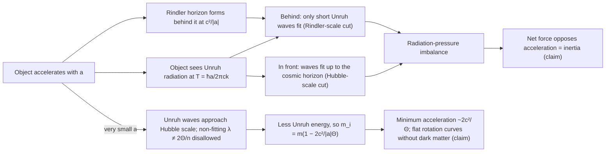
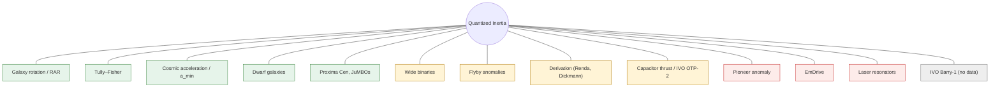

# Diagrams

These diagrams were made for this repository. They are hand-written SVG on a light background, and each file has a `<title>` and `<desc>` for accessibility. The plot and the wave paths were generated from formulas by small Python scripts run outside the repository (`python3 -I`). No figure is copied from a paper. Paper figures live in each source folder's `figures/`.

| File | What it shows | Used in |
|---|---|---|
| [qi-mechanism.svg](qi-mechanism.svg) | **Panel A.** An object accelerating to the right. Behind it is the Rindler horizon at c²/\|a\| (hatched region). Unruh waves in front fit up to the distant cosmic horizon; behind, only short waves fit. The radiation pressure is therefore unequal, and the net force opposes the acceleration (McCulloch 2013). **Panel B.** At very low acceleration the Rindler horizon lies beyond the cosmic horizon. Unruh waves that do not fit λ = 2Θ/n are disallowed, so inertia falls as mᵢ = m(1 − 2c²/(\|a\|Θ)) (McCulloch 2007). Not to scale. | [what-is-qi.md](../../00-overview/what-is-qi.md) |
| [low-acceleration-regime.svg](low-acceleration-regime.svg) | m_i/m against \|a\| on a log scale, **computed** from m_i/m = 1 − 2c²/(\|a\|Θ). There are two curves: Θ = 2c/H = 2.607 × 10²⁶ m (H = 2.3 × 10⁻¹⁸ s⁻¹, as in 2007; scale 6.9 × 10⁻¹⁰ m s⁻²) and Θ = 8.8 × 10²⁶ m (used from 2017; scale 2.0 × 10⁻¹⁰ m s⁻²). For comparison, the MOND "simple" function μ = x/(1 + x) with a₀ = 1.2 × 10⁻¹⁰ m s⁻² is shown dashed. Shaded bands mark the regions with m_i ≤ 0, which QI interprets as forbidden (a minimum acceleration). The darker band applies to both curves and the lighter band only to the old Θ. 400 points per curve; c = 2.998 × 10⁸ m s⁻¹. | [what-is-qi.md](../../00-overview/what-is-qi.md), [equations.md](../../00-overview/equations.md) |
| [evidence-map.svg](evidence-map.svg) | QI in the centre, with the phenomena it has been applied to arranged around it and colour-coded by status as of Oct 2026. | [what-is-qi.md](../../00-overview/what-is-qi.md) |

## Status categories used in the evidence map

| Colour | Meaning | Rule applied |
|---|---|---|
| Green | **Claimed fit (QI authors only)** | Published by McCulloch, alone or with co-authors. No independent confirmation or refutation found in this repository. *Green does not mean the claim is confirmed.* |
| Amber | **Contested / inconclusive** | The phenomenon itself is disputed (flybys, Tajmar/Podkletnov, wide binaries), there are conflicting results (capacitors), the outcome is self-described as inconclusive (IVO OTP-2), or a premise or derivation has been challenged in print (Renda 2019; Dickmann & Dickmann 2023; Unruh radiation unobserved). |
| Red | **Refuted or null test** | The target anomaly has a conventional explanation (Pioneer, thermal recoil), a QI prediction was not observed (Pioneer inside 10 AU), or a dedicated lab test was null (EmDrive, laser resonators). |
| Grey | **No result** | The test never ran (IVO Barry-1). |

Tell the maintainers if new sources change any classification. The diagram is generated, so edit the generator rather than the SVG by hand.

## Mermaid versions

GitHub and many Markdown viewers render these directly.

### Mechanism (simplified)

### Evidence map (simplified)

